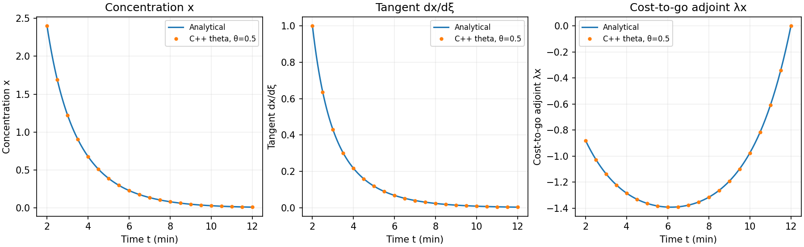
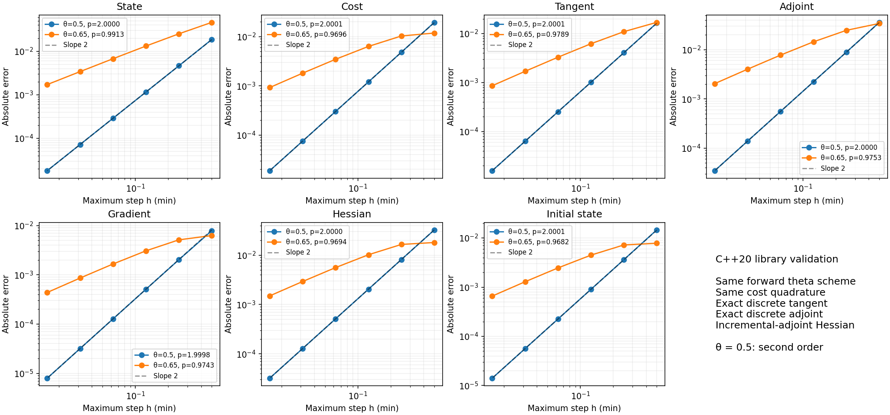
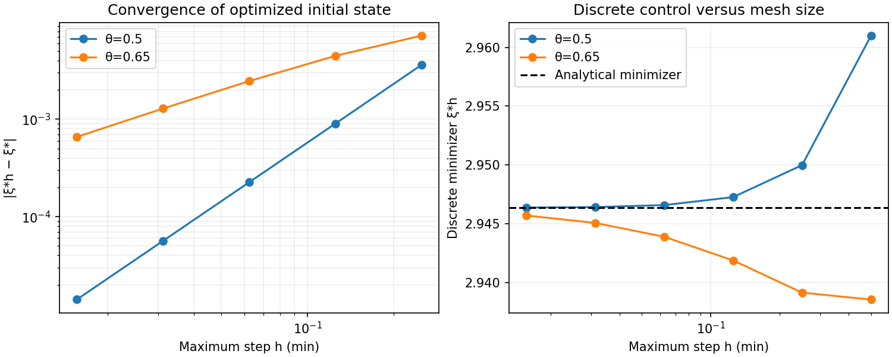
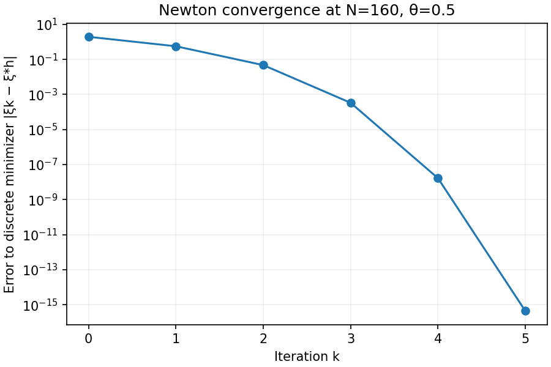

# ThetaOptimality

A C++20 library for the **theta-consistent discrete optimality system and its tangent linear model**. It is intended to provide common numerical machinery for our series of small, analytically verifiable examples, before applying the same construction to larger physical models.

The library computes a nonlinear forward trajectory, evaluates the matching theta-quadrature cost, propagates tangent perturbations, solves the exact discrete adjoint, and returns reduced gradients and incremental-adjoint Hessian-vector products. These operations describe one discrete constrained optimization problem. The formulas are developed together in [docs/formulation.md](docs/formulation.md).

The first worked example is nonlinear concentration decay with accumulated exposure. Its continuous state, cost, tangent, costate, gradient, and Hessian have elementary analytical references. The example uses the library's explicit quadrature and nodal cost sources throughout; accumulated running cost is not added to the physical state. The analytical references never replace a numerical forward step or supply the optimization gradient.

## Hidden-state oscillator example

Recover **initial displacement and unmeasured initial velocity** from six noisy
displacement observations of a known mass–spring–damper system. This example has
exact state, tangent, adjoint, objective, gradient, Hessian, and noisy-data
least-squares references. Thirteen error measures, including both recovered
initial-state components, converge at second order for theta = 0.5 and first
order for theta = 0.65.

```bash
make oscillator-plots
```

It also demonstrates a measurement schedule that cannot identify velocity:
sampling at integer half-periods eliminates that sensitivity. Genuine running
cost, consistent quadrature, and costate comparisons use a separate analytical
verification functional, without adding artificial information to the inverse
problem. The oscillator adds **245 numerical and qualification checks**; `make test` runs all five
suites (635 checks). It also reports engineering qualification for displacement
(1 mm), velocity (2 mm/s), and support-force error (0.04 N), including numerical
model error and whole-interval persistence. The coarse midpoint grid cannot
establish the tolerances. The refined midpoint grid qualifies from elapsed zero
with deterministic measurement bounds. The added theta = 0.65, N = 1024
bounded-data case remains unqualified under its conservative numerical allowance;
further refinement to theta = 0.65, N = 8192 qualifies all three goals from
**4.029296875 s**. The simultaneous 95% Gaussian noise-box
case qualifies all three goals from **4.8203125 s**. These are retrospective
all-data decisions through the eight-second elapsed horizon.

Read [the complete derivation and experiment](docs/oscillator.md).


The phase portraits overlay the analytical solution and optimal discrete
reconstruction, with a second panel magnifying their difference:


## Peng–Robinson gas composition example

Infer methane–ethane–nitrogen mole fractions from density observations at several
known temperatures and pressures, using the actual pinned **ThermoGPU** scalar
CPU backend. The example runs the library's tangent, adjoint, exact Hessian-vector
products, and optimizer, and independently encloses a nonlinear bounded-error
composition set in C++20.

```bash
make gas-plots
```

The synthetic truth is 85% methane, 10% ethane, and 5% nitrogen. Four density
observations with 0.1% error bounds give an accurate fit but cannot qualify all
three fractions to one percentage point. With 0.02% error bounds, all three
qualify. One density is deliberately underdetermined. Verdicts remain separate
from numerical test success.

This is a **static** specialization: composition carries unchanged between
experiments. It does not test nontrivial theta stepping or running-cost
quadrature; the decay and thermal examples continue to do that.
Read [the complete experiment and derivation](docs/peng_robinson.md).
The optional example links GPL-3.0-or-later upstream code; its original license
and revision are included under `third_party/ThermoGPU`.


## Two-temperature example

The project now also includes the earlier coupled **fluid–wall thermal model**, using this same C++20 optimality and qualification machinery. It reconstructs both initial temperatures from fluid observations, checks conservative energy balance, and qualifies fluid temperature (0.2 K tolerance) and stored-energy deviation (60 kJ tolerance). The retained analytical Gaussian-ellipse reference qualifies those goals after 0.067798 and 1.995560 minutes. A separate numerical-error-aware 95% noise-box analysis reports physical qualification under its explicit initial-temperature domain assumption.

```bash
make thermal
make thermal-plots
```

On the refined grid, the physical analysis qualifies both goals jointly after **4.734375 minutes**. Assimilating an added wall-temperature measurement at the same resolution reduces that time to **3.5078125 minutes**. The primary coarse grid cannot establish either tolerance with the conservative numerical allowance. The thermal tests distinguish numerical correctness, analytical/reference uncertainty, and physical qualification explicitly.

Read [docs/two_temperature.md](docs/two_temperature.md) for the complete derivation, assumptions, reference comparisons, and figures. All thermal inference and qualification computations are C++20; Python only renders their outputs.


`make test` runs the library validation plus the decay, two-temperature, gas-composition, and hidden-state oscillator suites. `make qualification-plots` draws the decay, thermal, gas, and oscillator examples; `make decay-plots` draws only decay and `make thermal-plots` only the thermal example.

## State qualification in C++20

The full **measurement-to-qualification experiment** is now [examples/decay_qualification.cpp](examples/decay_qualification.cpp). It uses the optimality library to reconstruct the initial concentration, compute measurement information and goal adjoints, propagate uncertainty, and decide whether concentration and accumulated exposure meet specified tolerances. All numerical inference, analytical references, nonlinear uncertainty sets, numerical-error allowances, and qualification decisions run in C++20. Python only plots the resulting CSV files.

```bash
make test qualification
# Optional figures; numerical results already exist after the command above.
make qualification-plots
```

Read [docs/state_qualification.md](docs/state_qualification.md) for the standalone explanation of the experiment, assumptions, error budgets, and results. The earlier `theta_decay` executable remains a separate running-cost optimality-system verification example; it does not replace the measurement-driven state-qualification experiment.

`make test` now runs both the library validation and state-qualification checks. It ends with a table of persistent qualification times for concentration and exposure, using `unqualified` when no time exists over the ten-minute horizon. All reported times are elapsed from $t_0$. The same C++ report is written to `results/qualification/qualification_times.csv` and read directly by the plot renderer. The qualification plots mark these times with vertical lines and label unqualified cases explicitly; no threshold-crossing decisions are made in Python. Use `make validation` for only the library checks.

The final **PHYSICAL QUALIFICATION DETERMINATION** gives the actual engineering decision separately from numerical test success. It states whether concentration, exposure, and **all requested goals together** qualify. Joint qualification starts at the latest individual persistent qualification time, and is not established if either goal remains unqualified. The baseline is **NOT QUALIFIED for all requested goals: exposure blocks it**. The added-exposure case is **QUALIFIED for all requested goals from elapsed zero** on the refined grid. These decisions use bounded-error data and continuous, numerical-error-aware envelopes; local Gaussian indicators and uncorrected node results remain diagnostics. `qualification_decisions.csv` is the C++ source for the final console and plot verdicts.


| Bounded-data experiment | Concentration | Accumulated exposure |
|---|---|---|
| Analytical reference with concentration observations | Qualified after 0.25850 min | Unqualified over the horizon |
| Coarse numerical model with physical error allowance | Qualified after 5 min | Unqualified over the horizon |
| Added bounded exposure observation, refined numerical model | Qualified over the whole horizon | Qualified over the whole horizon |

The numerical statements in this table use **whole-step envelopes**, including the time between nodes, relative to the piecewise-linear numerical reconstruction. They are conditional analytical error bounds evaluated in ordinary floating point, not directed-rounding certificates. The added observation is assimilated before retrospective qualification; this is not an online prediction made before the observation arrived.


## Build and run

The header-only library and example require a C++20 compiler and the standard library. The tested direct build is:

```bash
make
make test
make example
```

Or compile without a build system:

```bash
g++ -std=c++20 -O2 -Wall -Wextra -Wpedantic -Werror \
    -Iinclude examples/decay.cpp -o theta_decay
./theta_decay results
```

Python is optional and only plots the C++-generated CSV files:

```bash
python3 -m pip install matplotlib
make plots
```

CMake configuration and installation files are also supplied:

```bash
cmake -S . -B build-cmake -DCMAKE_BUILD_TYPE=Release
cmake --build build-cmake
ctest --test-dir build-cmake --output-on-failure
./build-cmake/theta_decay results
cmake --install build-cmake --prefix "$HOME/.local"
```

The release was validated with GCC 13.3.0 through Make and direct compiler commands. CMake was unavailable in the execution environment, so its configuration/install route has not been exercised here.

## Use the library

For a model with `N` states and `P` controls, supply a `Problem<N,P>` and a prescribed `Grid`. State and control dimensions are compile-time constants; vectors and matrices use `std::array`. Controls are denoted by `xi`; theta refers exclusively to the integrator weights.

The decay example supplies a complete `Problem<2,1>` in [examples/decay_model.hpp](examples/decay_model.hpp). Using that model:

```cpp
#include <theta_opt/theta_opt.hpp>
#include "decay_model.hpp"

using namespace theta_opt;

System<2,1> system(decay::problem(),
    Grid::uniform(decay::t0, decay::tf, 160, 0.5));
Vec<1> xi{2.4};

auto trajectory = system.forward(xi);
double J = system.cost(xi, trajectory);
auto tangent = system.tangent(xi, trajectory, Vec<1>{1.0});
auto adjoint = system.adjoint(xi, trajectory);
auto gradient = adjoint.gradient;
auto Hv = system.hessian_vector(xi, Vec<1>{1.0});

// Convenience: forward + cost + adjoint + reduced gradient.
auto evaluation = system.evaluate(xi);

auto optimum = minimize(system, Vec<1>{1.0}, OptimizeOptions{},
    [](const Vec<1>& trial) { return trial[0] > 0; });
```

`adjoint.nodal_adjoint` is the quadrature-source adjoint in the paper; `adjoint.step_multiplier` stores the auxiliary backward solves. `cost_to_go_adjoint(xi, adjoint)` gives the endpoint-adjusted convention used for pointwise continuous-costate comparisons. Both conventions give the same initial-state gradient; see the explanation below.

| Model component | First-order callbacks | Additional callbacks for exact Hessian products |
|---|---|---|
| Dynamics | `value`, `derivatives` containing state and control Jacobians | `directional_derivatives` of those Jacobians |
| Initial state | `value`, `jacobian` with respect to controls | `directional_jacobian` |
| Running cost | `evaluate`: value, state gradient, direct control gradient | `directional_gradient` |
| Terminal cost | Same scalar-function interface | `directional_gradient` |
| Control penalty | `value`, `gradient` | `hessian_vector` |

`Dynamics::admissible` optionally rejects nonphysical states during forward Newton steps. The optimizer accepts a separate control-admissibility predicate. Defaults represent zero running/terminal costs and a zero penalty. If you replace an entire scalar-function object, use `ScalarFunction::zero()` for a known zero function or provide the second-order callback explicitly. Missing second-order callbacks cause Hessian requests to throw; there is no silent finite-difference Hessian.

All callbacks must be deterministic, dimensionally compatible, finite on the iterates evaluated, and mutually consistent. They are evaluated at fixed time. Second-order callbacks differentiate along the supplied state and control directions; they are derivatives of Jacobians/gradients, not derivatives of the function value. [docs/api.md](docs/api.md) specifies their contracts and returned quantities.

## The decay experiment

Let $t\in[t_0,t_f]=[2,12]$ minutes and let normalized concentration $x$ and exposure $q$ satisfy

$$
\dot x=-0.5x-0.1x^2,\qquad \dot q=x,
\qquad x(t_0)=\xi>0,\quad q(t_0)=0.
$$

The nonzero $t_0$ exercises the general interval convention. Concentration is dimensionless and exposure has units of minutes. The running cost, terminal exposure target, and initial penalty are

$$
J(\xi)=\frac{0.1}{2}\int_{t_0}^{t_f}x^2\,dt
+\frac12[q(t_f)-Q]^2+\frac{0.4}{2}(\xi-3.2)^2,
\qquad Q=q(t_f;3).
$$

Weights carry the units needed to make these terms compatible. This is a controlled verification objective. The optimum balances three terms and need not equal the concentration used to choose $Q$.

With $\tau=t-t_0$, $r=e^{-a\tau}$, $k=(b/a)(1-r)$, and $D=1+k\xi$,

$$
x=\frac{\xi r}{D},\qquad q=\frac{\log D}{b},
\qquad\frac{0.1}{2}\int_{t_0}^t x^2\,ds
=\frac{0.1}{2b}(\xi-x-aq).
$$

Differentiating these expressions gives the exact tangent and reduced derivatives. Differentiating the remaining continuous cost with respect to the current physical state gives the continuous costate. Their full derivation is in [docs/decay.md](docs/decay.md).

The analytical-objective minimizer is approximately **2.94636705953319**. Its value is computed by an independent bracketed root solve of the analytical gradient. Discrete optimization starts at **1.0** and uses only the library's adjoint gradient and incremental-adjoint Hessian.



These comparisons use $\xi=2.4$, away from the optimum, so the gradients and costates remain nontrivial. The markers are values from the C++ library, and the continuous curves come from analytical expressions.

## Validation

The validation executable checks the nonlinear decay example and an additional time-dependent two-state, two-control problem on a nonuniform grid with varying theta. The latter includes a nonlinear initial map, direct control dependence in the dynamics and both costs, state/control cross derivatives, and a penalty. It tests derivative paths that the scalar initial-state-only decay example does not cover.

Checks include:

- Pivoted linear solves, including transpose solves and singular-matrix rejection.
- Nonuniform quadrature weights, endpoint contributions, and total weight.
- Tangents against finite differences of the actual discrete forward solve.
- Adjoint gradients against finite differences of the actual discrete objective.
- Incremental-adjoint Hessian products against finite differences of gradients, and Hessian symmetry.
- Independent global block-system tangent and adjoint solutions against sequential sweeps.
- Forward Newton trajectories against independent scalar quadratic-root theta steps.
- Discrete stationarity and local quadratic Newton convergence.
- Analytical temporal convergence for all seven quantities reported below.

The test executable reports its check count at runtime. The release validation report records compiler flags, count, and sanitizer coverage in [results/validation.txt](results/validation.txt). AddressSanitizer and UndefinedBehaviorSanitizer are run with leak detection disabled because the execution environment prevents LeakSanitizer's process inspection.

## Second-order convergence of the coupled construction

For $N=20,40,80,160,320,640$, independently rebuild and solve the complete problem. State, tangent, adjoint, cost, gradient, and Hessian comparisons use fixed $\xi=2.4$ to isolate temporal error. The fitted initial state is compared separately with the analytical-objective minimizer. State/tangent/adjoint errors are maximum component errors over all time nodes in the specified numerical scaling.

Compute

$$
p_h=\log_2(E_h/E_{h/2}).
$$

The finest two grids give:

| Quantity | $\theta=0.5$ | $\theta=0.65$ |
|---|---:|---:|
| Forward state | 2.000033 | 0.991291 |
| Cost functional | 2.000070 | 0.969608 |
| Tangent linear solution | 2.000052 | 0.978875 |
| Endpoint-adjusted adjoint | 2.000041 | 0.975298 |
| Reduced gradient | 1.999838 | 0.974290 |
| Reduced Hessian | 1.999987 | 0.969373 |
| Optimized initial state | 2.000054 | 0.968191 |



The last panel in that figure is control error at each time step, calculated as $|\xi_h^*-\xi^*|$. The executable also writes a dedicated `control_convergence.csv`, including each fitted control, the analytical minimizer, error, and observed order. This directly tests whether solving successively refined discrete optimization problems recovers the continuous problem's optimum.



The half-weight method shows second-order convergence throughout. The off-centered method supplies a first-order control experiment. Smoothness, stable propagation, and an isolated optimum with nonzero Hessian are essential here. Newton and optimization tolerances must be below the temporal errors being measured.

**Adjoint convention matters.** The raw nodal adjoint includes the preceding interval's quadrature endpoint contribution. For a pointwise comparison to a remaining-cost continuous costate, subtract

$$
h_{n-1}\theta_{n-1}\nabla_{\mathbf x}c(t_n,\mathbf x_n)
$$

at nodes $n\ge1$. The library returns the paper's raw nodal adjoint and exposes the conversion separately. The raw and adjusted values are both retained in the trajectory CSV. No adjustment occurs at $t_0$, and the reduced gradient is unchanged. We do not claim that an unadjusted step or nodal multiplier automatically approximates the continuous costate at second order.

## Quadratic convergence of Newton optimization

Temporal order and nonlinear solver order are different experiments. On the fixed $N=160$, $\theta=0.5$ grid, Newton's errors to an independently bracketed discrete minimizer decrease approximately as

$$
1.9466,\quad0.5622,\quad0.04729,\quad3.3405\times10^{-4},
\quad1.6664\times10^{-8},\quad O(10^{-15}).
$$

Before reaching the numerical floor, $e_{k+1}/e_k^2$ settles near **0.1493**, demonstrating local quadratic convergence. The trace records accepted step lengths as well as cost and gradient norm. Local convergence uses full Newton steps; an Armijo line search and a descent-direction fallback safeguard earlier iterations. A floating-point allowance in the objective decrease comparison prevents rounded costs from blocking convergence near stationarity.



## Scope of this first version

This is a small dense ODE library with prescribed time grids, explicit analytical derivative callbacks, and optional second derivatives. It supports arbitrary finite strictly increasing time grids and per-step theta in $[0,1]$; accuracy and positivity still depend on the model and grid. `Grid::uniform` is only a convenience.

It currently uses identity mass matrices, stores complete trajectories, and refactors dense step matrices during derivative sweeps. It has no sparse backend, DAE solver, mesh-adaptation derivatives, Enzyme binding, or GPU execution. Callback interfaces allow future derivative adapters without changing the mathematical contract. The control predicate is a feasibility safeguard; the optimizer solves interior unconstrained stationarity and does not implement boundary KKT conditions. Sampled observations now use explicit `Problem::nodal` costs; their values and derivative sources are not multiplied by running-cost quadrature weights. `goal_gradient` and `state_pullback` expose the same discrete adjoint for prediction goals and information actions. `qualification.hpp` contains local goal variance, box support, independent-Gaussian noise-box calibration, and persistent node criteria. Decay-specific nonlinear set construction and physical error bounds remain in the example model.

`include/theta_opt/` is the reusable library. `examples/` contains problem definitions, `tests/` verification, `docs/` derivations and callback contracts, and `results/` reproducible outputs. C++ produces all numerical results; Python is used only for figures.
