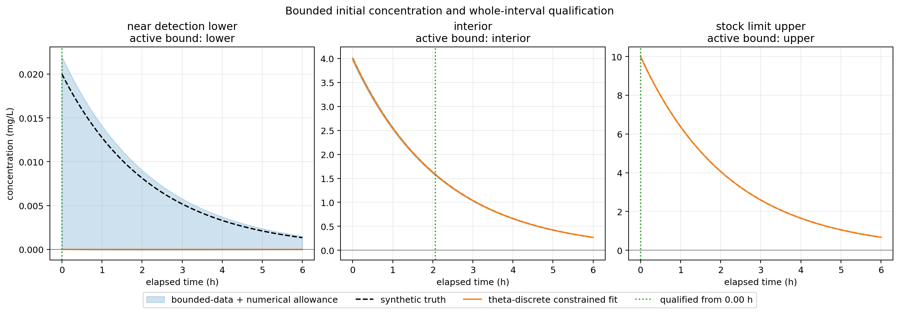
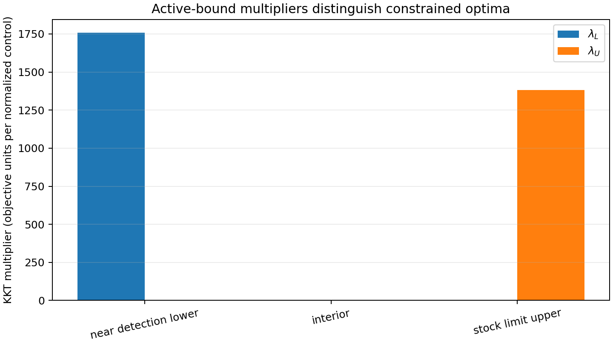
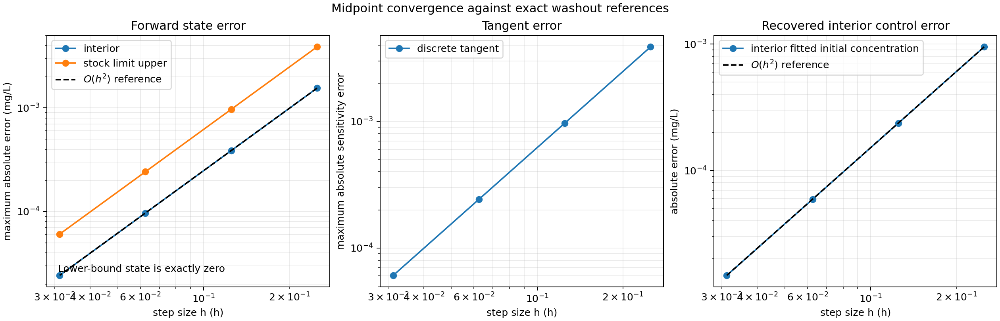

# State constraints and boundary optima in a drug washout

This example tests what happens when physically admissible states form a
bounded set and the best data fit lies on its boundary. The unknown is the
initial drug concentration in a one-compartment washout. Concentration cannot
be negative, and a prepared stock solution caps the initial concentration at
10 mg/L. Assay noise near the detection limit can make the unconstrained
least-squares estimate negative; data from a saturated stock solution can
favor an estimate above the stock limit. In both situations the optimizer must
stop at the physical bound and satisfy the correct KKT sign condition.

Run and plot the experiment with:

```bash
make bounded-washout
make bounded-washout-plots
```

The example adds the reusable `minimize_box_constrained` routine to the C++20
library. It implements a dense active-set Newton method for componentwise
control bounds and returns raw gradients, active-bound flags, lower and upper
KKT multipliers, and a KKT residual. The example calculations and qualification
run in C++; Python only renders retained CSV output.

## 1. Physical model and admissible initial states

For time $t\in[t_0,t_f]=[2,8]$ h, the concentration satisfies

$$
\dot c(t)=-k c(t),\qquad c(t_0)=c_0,
\qquad k=0.45\;\mathrm{h}^{-1}.
$$

The exact solution is

$$
c(t_0+\tau;c_0)=c_0e^{-k\tau}.
$$

The admissible set is the closed interval

$$
0\le c_0\le C_{\max},\qquad C_{\max}=10\;\mathrm{mg/L}.
$$

Because $k>0$, every admissible continuous trajectory stays nonnegative and
decays. The midpoint theta recurrence also preserves nonnegativity on the
tested grids:

$$
c_{n+1}=R(h)c_n,\qquad
R(h)=\frac{1-(1-\theta)kh}{1+\theta kh},\qquad \theta=\tfrac12.
$$

Here $h\le0.25$ h, so $R(h)>0$. Thus the finite-dimensional initial-state box
enforces state admissibility over the entire trajectory for this model.

The optimizer uses a normalized control $u=c_0/C_{\max}\in[0,1]$. This keeps
its bounds dimensionless and of order one.

## 2. Observation model and three cases

There are six assays at elapsed times
$\tau_j=(0,0.5,1.5,3,5,6)$ h. Each assay has standard scale
$\sigma=0.02$ mg/L. The instrument has a known offset $b=0.2$ mg/L:

$$
y_j=b+c_0^*e^{-k\tau_j}+\sigma z_j.
$$

The objective predicts the raw reading $b+c(t_j)$ and minimizes

$$
J_h(u)=\frac12\sum_{j=1}^6
\left[\frac{b+c_h(t_j;C_{\max}u)-y_j}{\sigma}\right]^2.
$$

The known offset keeps raw instrument readings positive in the near-detection
case. After offset subtraction, however, assay noise can make corrected
concentrations negative. That is a measurement result; it does not make a
negative physical concentration admissible.

| Case | True $c_0^*$ (mg/L) | Noise innovations $z_j$ | Expected constrained solution |
|---|---:|---|---|
| Near detection | 0.02 | $(-2.4,-2.0,-1.8,-1.5,-1.2,-1.0)$ | Lower bound, $c_0=0$ |
| Interior | 4.0 | $(-0.4,0.1,-0.2,0.3,-0.1,0.2)$ | Interior fit |
| Stock limit | 10.0 | $(1.2,1.0,0.9,0.8,0.6,0.5)$ | Upper bound, $c_0=10$ mg/L |

These are deterministic synthetic assay errors, retained unchanged on every
mesh. They intentionally make the unconstrained fits fall below zero, inside
the interval, and above the stock limit, respectively.

## 3. Analytical constrained solution

For the continuous model, define $s_j=e^{-k\tau_j}$ and
$\widetilde y_j=y_j-b$. In physical concentration coordinates,

$$
J(c_0)=\frac{1}{2\sigma^2}\sum_j(s_jc_0-\widetilde y_j)^2.
$$

The unconstrained minimizer and curvature are

$$
\widehat c_0=\frac{\sum_j s_j\widetilde y_j}{\sum_j s_j^2},
\qquad J''(c_0)=\frac{1}{\sigma^2}\sum_j s_j^2>0.
$$

Since the objective is strictly convex, the constrained reference is its
projection onto the physical interval:

$$
c_{0,\mathrm{box}}^*=\min(C_{\max},\max(0,\widehat c_0)).
$$

This formula gives an independent, exact reference for the discrete
optimizer. It also makes the proper first-order conditions transparent. With
lower and upper multipliers $\lambda_L,\lambda_U\ge0$, stationarity is

$$
J'(c_0)-\lambda_L+\lambda_U=0,
$$

and complementarity requires

$$
\lambda_Lc_0=0,\qquad
\lambda_U(C_{\max}-c_0)=0.
$$

Therefore:

- At the lower bound, $J'(0)\ge0$ and $\lambda_L=J'(0)$.
- At the upper bound, $J'(C_{\max})\le0$ and $\lambda_U=-J'(C_{\max})$.
- In the interior, both multipliers vanish and $J'(c_0)=0$.

A raw gradient of nonzero magnitude is expected at an active bound. An
unconstrained stationarity test would wrongly reject the correct boundary
solution.

## 4. Discrete box-constrained optimization

The library computes gradients and Hessian actions from the actual midpoint
theta-discrete objective. The new `minimize_box_constrained` algorithm:

1. Requires a finite initial control inside finite componentwise bounds.
2. Identifies active constraints from the bound location and the gradient sign.
3. Solves a reduced Newton system in free components, with a projected-gradient
   fallback when that system is singular or not a descent direction.
4. Projects trial points onto the box during the Armijo search.
5. Stops on the projected-gradient norm, which can be zero at a valid boundary
   optimum even when the raw gradient is not zero.
6. Returns bound multipliers using the convention
   $\nabla J-\lambda_L+\lambda_U=0$ and reports the stationarity,
   complementarity, primal-feasibility, and projected-gradient residuals.

This is a componentwise box solver, not a general nonlinear or coupled
constraint algorithm. A deterministic unit test checks exact lower-bound,
interior, and upper-bound quadratic solutions, multiplier signs, KKT residuals,
and rejection of invalid bounds and infeasible starts.

## 5. Full discrete optimality checks

The executable compares the exact continuous fit and the exact discrete
least-squares fit against the library result. It also checks:

- positive state values at every theta node;
- expected active set and KKT multiplier sign for all three data cases;
- the discrete optimizer against the analytical discrete constrained minimum;
- continuous exact-cost gradient and Hessian formulas by finite differences;
- tangent-adjoint pairing and finite-difference checks of the discrete cost
  gradient and incremental-adjoint Hessian;
- midpoint convergence of the state and tangent against their analytical
  counterparts over $N=24,48,96,192$;
- truth containment in the bounded observation-consistent interval.

Point assays enter as unweighted nodal costs; no time-quadrature factor is
attached to them. The state and tangent are advanced by the theta method, and
the objective gradient and Hessian action come from the same discrete system.

## 6. Bounded-data qualification with numerical allowance

The assay error is treated as a deterministic bound of $0.05$ mg/L. For each
observation, the program expands that bound by the computed theta reconstruction
allowance and intersects its exact exponential preimage with $[0,C_{\max}]$.
The resulting initial-concentration interval contains every state consistent
with the bounded data and numerical model error under the stated scalar model.

For a feasible interval $[c_L,c_U]$, the nominal center is its midpoint. On an
interval starting at elapsed time $\tau_n$, uncertainty in the exact solution
is bounded by

$$
\frac{c_U-c_L}{2}e^{-k\tau_n}.
$$

The library's theta-quadratic defect bound supplies the additional numerical
allowance. Their sum bounds the state error throughout each time step. The
program reports the persistent qualification time for a $0.02$ mg/L
concentration tolerance; a qualifying time must cover every remaining whole
step through the horizon. The plot marks that time on the state and uncertainty
curves.



The KKT multipliers make the active-set physics visible: the lower-bound case
has a positive lower multiplier, the stock-limit case has a positive upper
multiplier, and the interior case has neither.



The midpoint state and tangent errors are compared against their exact
exponential solutions. The fitted initial concentration remains exactly on its
active bound in the lower and upper cases under refinement; it is not
appropriate to claim a nonzero convergence order for those constrained control
errors. The interior fit converges to the continuous analytical least-squares
solution at second order.



## Scope

This example exercises finite box constraints on an initial-state control. It
does not yet address general inequalities, equality-constrained parameter
manifolds, state constraints that can activate between time nodes, or
complementarity in a DAE. For this monotone scalar washout, nonnegative initial
concentration guarantees nonnegative state for all time, and the tested theta
steps preserve that property. The explicit limitation keeps this test focused
on the active-set/KKT extension needed for boundary optima.
