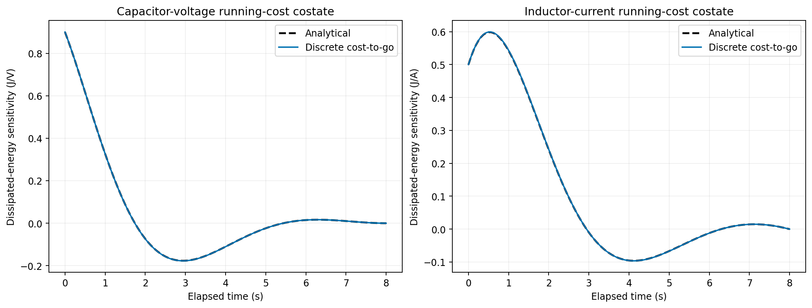
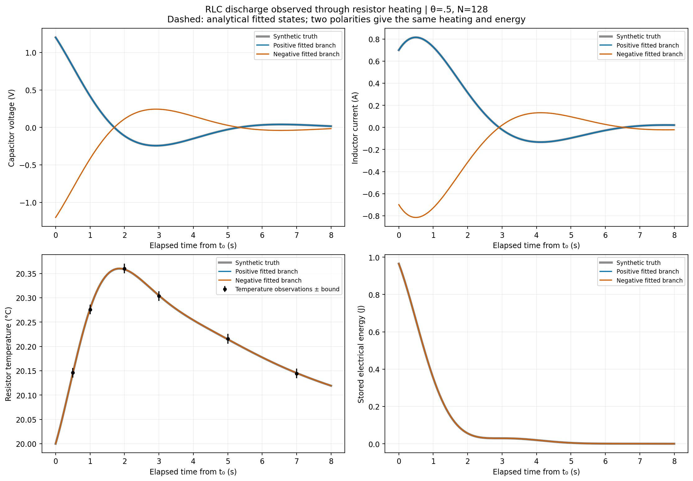
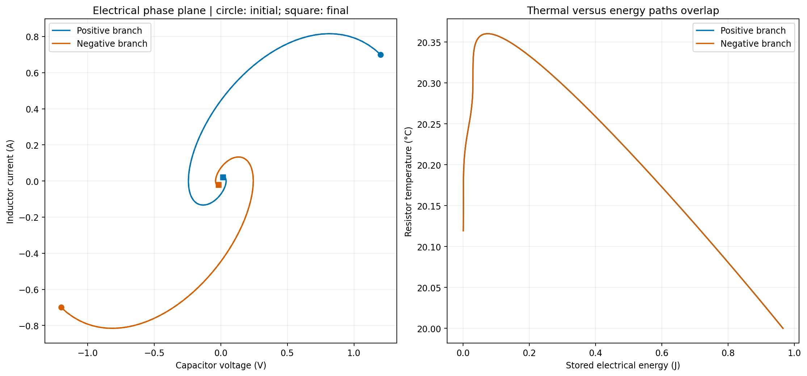
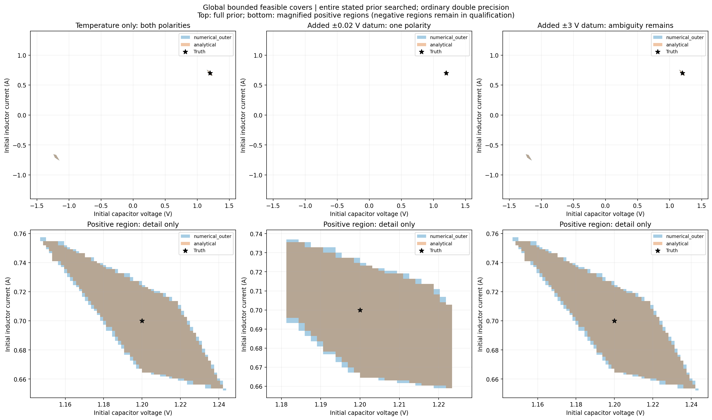
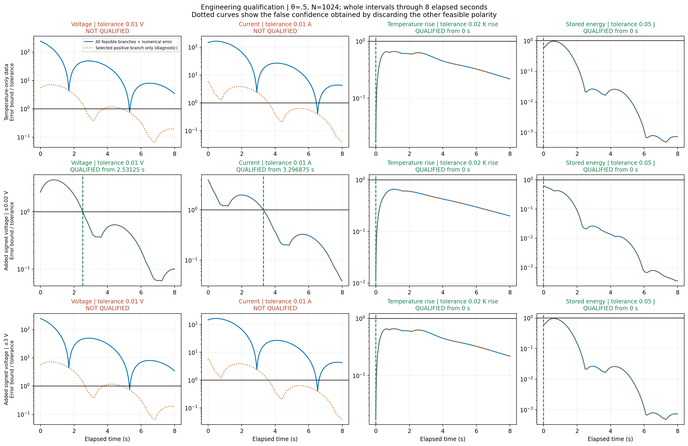
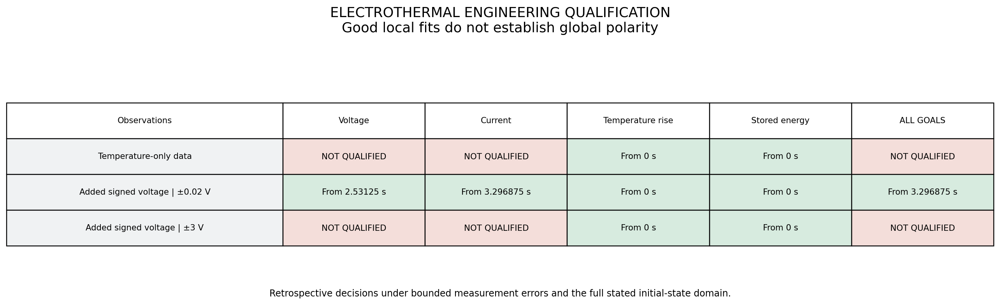
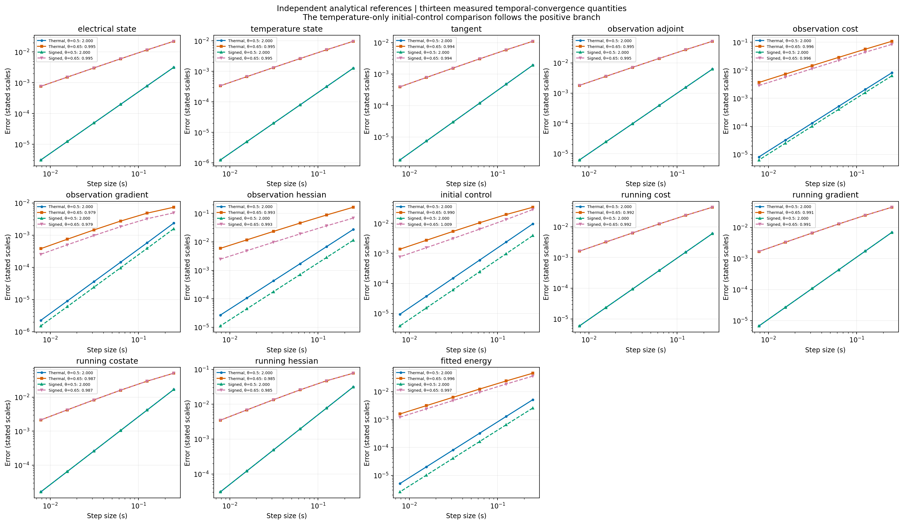

# Finding electrical state from resistor temperature: local certainty and global ambiguity

This experiment asks what a resistor's measured temperature can tell us about
the initially stored electrical state of a discharging RLC circuit. We want to
recover initial capacitor voltage and inductor current, then decide which
engineering predictions are accurate enough to use. Joule heating supplies a
physical nonlinear measurement mechanism: a current and its negative generate
the same heat.

The example exercises the complete C++20 theta-consistent discrete optimality
system on three coupled states and two initial-state controls. It adds a shared
bounded-set search that retains disconnected feasible regions. The important
failure is a full-rank local inverse problem whose global electrical polarity
remains ambiguous. We compare temperature-only observations, an informative
signed-voltage datum, and a signed datum too uncertain to resolve the ambiguity.

## 1. Model, scales, and unknowns

Consider an isolated series RLC discharge with constant component properties:

| Quantity | Value |
|---|---|
| Resistance R | 1 Ω |
| Inductance L | 1 H |
| Capacitance C | 1 F |
| Resistor effective heat capacity Cth | 2 J/K |
| Conductance to ambient Gth | 0.4 W/K |
| Known ambient temperature Tamb | 20 °C |
| Interval [t0,tf] | [2,10] s |
| True initial (V0,i0) | (1.2 V, 0.7 A) |
| Known initial resistor temperature | Tamb |
| Qualification prior | V0 ∈ [−1.6,1.6] V, i0 ∈ [−1.4,1.4] A |

This is an idealized, analytically tractable engineering benchmark with
manufactured observations, not an experimentally calibrated circuit. Resistance
is temperature independent, the resistor is a lumped thermal mass, ambient is
constant, and sensor lag is neglected. Those assumptions keep the references
exact while preserving the electrical-to-thermal coupling we want to test.

Let u = T − Tamb denote temperature **rise**, in kelvin. The state is
x = (V,i,u), and the unknown initial-state control is ξ = (V0,i0). Kirchhoff's
laws and the resistor heat balance give

$$
\dot V=-\frac{i}{C},\qquad
\dot i=\frac{V-Ri}{L},\qquad
\dot u=\beta i^2-\kappa u,
\quad \beta=\frac{R}{C_{\rm th}},\quad \kappa=\frac{G_{\rm th}}{C_{\rm th}}.
$$

Here β = 0.5 K/(A² s) and κ = 0.2 s^−1. The initial map is
x(t0) = (ξ1,ξ2,0). There is no unknown forcing or time-dependent control.
Figures use elapsed time τ = t − t0, from zero to eight seconds. Absolute
resistor temperature is plotted in °C; uncertainty in its rise is labeled K.
Negative voltage and current are signed electrical quantities, not negative
absolute temperatures.

The stored electrical energy and its physical balance are

$$
E=\tfrac12CV^2+\tfrac12Li^2,\qquad \dot E=-Ri^2.
$$

The resistor gains that dissipated power and loses Gth u to ambient. Thus
(d/dt)(E + Cth u) = −Gth u. We use these balances to check signs and units
independently of the optimizer.

## 2. Derive the analytical electrical and thermal states

Eliminating i gives the damped electrical oscillator. Set

$$
\gamma=\frac{R}{2L}=0.5\ {\rm s}^{-1},\qquad
\omega=\sqrt{\frac1{LC}-\gamma^2}=\frac{\sqrt3}{2}\ {\rm s}^{-1}.
$$

The exact electrical solution is

$$
V(\tau)=e^{-\gamma\tau}\left[
V_0\cos(\omega\tau)+\frac{\gamma V_0-i_0/C}{\omega}\sin(\omega\tau)\right],
$$
$$
i(\tau)=e^{-\gamma\tau}\left[
i_0\cos(\omega\tau)+\frac{V_0/L-\gamma i_0}{\omega}\sin(\omega\tau)\right].
$$

Write these as (V,i) = F(τ)ξ. To obtain temperature, solve the linear thermal
equation with its electrical forcing:

$$
u(\tau)=\beta e^{-\kappa\tau}\int_0^\tau
 e^{\kappa s}i(s)^2\,ds.
$$

Define a = i0, b = (V0/L − γ i0)/ω, and z = κ − 2γ. Expanding
(a cos ωs + b sin ωs)² into constant, cosine, and sine parts gives

$$
F_0(\tau)=\frac{e^{z\tau}-1}{z},\qquad
F_c(\tau)+\mathrm{i}F_s(\tau)=
\frac{e^{(z+2\mathrm{i}\omega)\tau}-1}{z+2\mathrm{i}\omega},
$$
$$
u(\tau)=\beta e^{-\kappa\tau}
\left[\tfrac12(a^2+b^2)F_0+
\tfrac12(a^2-b^2)F_c+abF_s\right].
$$

Consequently u(τ) = ξᵀQ(τ)ξ for a known symmetric 2×2 matrix Q. With
avec = (0,1) and bvec = (1/(Lω),−γ/ω),

$$
Q(\tau)=\beta e^{-\kappa\tau}
\left[\tfrac12(F_0+F_c)a_{\rm vec}a_{\rm vec}^T+
\tfrac12(F_0-F_c)b_{\rm vec}b_{\rm vec}^T+
\tfrac12F_s(a_{\rm vec}b_{\rm vec}^T+b_{\rm vec}a_{\rm vec}^T)\right].
$$

No reference time integration is needed. C++ evaluates these closed expressions
and checks their initial value, derivative, thermal ODE, and energy balance.
The actual reconstruction calls the library's nonlinear forward solver rather
than substituting these expressions for a theta step.

## 3. Why polarity is globally invisible

Changing ξ to −ξ changes V and i to their negatives. The source Ri² remains
unchanged, so u and the entire resistor-temperature history remain unchanged.
The two initial states are physically different but thermally indistinguishable.
Stored energy is also unchanged.

We retain six temperature-rise observations at elapsed times 0.5, 1, 2, 3, 5,
and 7 s. Each has scale and deterministic absolute error bound σ = 0.01 K.
Manufactured offsets are σ times (0.1,−0.15,0.2,−0.1,0.12,−0.08). We use these
same values, times, and scales throughout refinement.

The analytical temperature observation gradient is 2Qj ξ. Away from zero,
several such rows can distinguish nearby directions. They do not distinguish
ξ from −ξ globally. This differs from the preceding insulated thermal example,
where a continuous missing direction made the local information matrix singular.

The observation objective is

$$
J(\xi)=\tfrac12\sum_j
\frac{(\xi^TQ_j\xi-y_j)^2}{\sigma_j^2}.
$$

Its thermal part is an even quartic polynomial. The independent analytical
noisy-data optimum on the positive branch is approximately
(1.20128739351 V, 0.699084564591 A); its negative has exactly the same cost.
The optimum of this analytical observation model is found by a separate C++
Newton solve using the closed objective and derivatives. The **state solution**
is closed form; the noisy-data optimum is not claimed to have an elementary
closed-form expression or a general global-optimization proof.

## 4. Exercise the nonlinear discrete optimality system

For each interval, the library solves

$$
x_{n+1}-x_n=h_n[(1-\theta_n)f(x_n)+\theta_n f(x_{n+1})].
$$

Its nonlinear Jacobian is

$$
\nabla_x f=\begin{pmatrix}
0&-1/C&0\\1/L&-R/L&0\\0&2\beta i&-\kappa
\end{pmatrix}.
$$

The tangent solves the derivative of this same theta equation, with initial
s0 = (δξ1,δξ2,0). Temperature sensitivities include the dependence of heating
on the electrical trajectory. The discrete adjoint propagates the nodal
measurement sources through those same implicit step Jacobians. There is no
observation at tf and no terminal cost, so λ(tf) = 0.

For comparison, the continuous costate between observation times satisfies

$$
\dot\lambda=-\nabla_x f(t,x(t))^T\lambda,
$$

or explicitly

$$
\dot\lambda_V=-\lambda_i/L,\quad
\dot\lambda_i=\lambda_V/C+(R/L)\lambda_i-2\beta i\lambda_u,\quad
\dot\lambda_u=\kappa\lambda_u.
$$

Thermal observations add sources in the u component. Their effects reach the
electrical controls through the term 2β i λu. The analytical nonlinear flow
Jacobian supplies an independent backward-source reference: its electrical
block is F(Δ), its thermal/electrical row is 2Q(Δ)(V,i), and its thermal/thermal
entry is exp(−κΔ). Summing the pullbacks of all subsequent sources gives the
analytical observation costate, including a source at the current node.

The incremental adjoint must also differentiate the Jacobian entry 2βi.
For a thermal residual rj, the exact reduced Hessian contribution is

$$
H_j=\sigma_j^{-2}\left[
g_jg_j^T+2r_jQ_j\right],\qquad g_j=2Q_j\xi.
$$

The second term is residual curvature. A Gauss–Newton matrix omits it. We
compare the library Hessian-vector products with this full formula at a
nonstationary probe, where the difference is substantial, as well as checking
finite differences, symmetry, and tangent–adjoint duality.

Both positive and negative discrete optima are stationary and have full-rank
local Hessians. On the refined temperature-only grid, their smallest Hessian
eigenvalue is about 709 and their costs agree, about 0.04988. Positive curvature
therefore does not settle global polarity.

The existing nonlinear Newton optimizer handles this model without a shared
optimizer modification. This example requests a 10^−7 gradient tolerance and
10^−12 objective roundoff slack for line search near stationarity; it still
checks the gradient independently. The slack avoids rejecting a final Newton
correction whose predicted cost reduction is smaller than forward-evaluation
roundoff. It is not added measurement uncertainty.

## 5. Exercise theta cost quadrature and physical balances

A separate fixed-control verification objective is total Joule heat:

$$
J_{\rm heat}=\int_{t_0}^{t_f}Ri(t)^2\,dt
=E(t_0)-E(t_f)=\xi^TD_E\xi.
$$

Here DE = E_matrix(0) − E_matrix(tf−t0), with
E_matrix(τ) = 1/2 F(τ)ᵀ diag(C,L)F(τ). The exact gradient is 2DE ξ and the
Hessian is 2DE. The running-cost continuous costate has electrical components
2DE(tf−t)(V(t),i(t)) and zero thermal component. We compare against the matching
theta-quadrature cost, adjoint gradient, incremental-adjoint Hessian, and
`cost_to_go_adjoint` convention. This verification functional does not add
information to the inverse problem.



Care is needed when checking numerical energy. The theta electrical equations
imply, with xθ = (1−θ)xn + θxn+1,

$$
\Delta E+hRi_\theta^2=(\tfrac12-\theta)
[C(\Delta V)^2+L(\Delta i)^2].
$$

The theta-weighted endpoint quadrature of i² differs from iθ² by
θ(1−θ)(Δi)². We test these identities rather than incorrectly asserting exact
agreement of endpoint heat quadrature and electrical energy loss on a finite
step. The discrete thermal equation independently satisfies

$$
C_{\rm th}\Delta u+\Delta t\,G_{\rm th}u_\theta
=\Delta t\,R[(1-\theta)i_n^2+\theta i_{n+1}^2],
$$

where Δt denotes step length. The energy identities and quadrature converge
to the same continuous balances on refinement.

## 6. Reconstruct both branches and compare analytical trajectories

We optimize from (1.1 V,0.6 A) and its negative, using the actual discrete
forward, cost, adjoint, and Hessian-vector products. Each temperature-only
solution mirrors the other. Their thermal states and objective values agree;
their electrical states have opposite signs. Additional noisy-data analytical
fits use the independently evaluated exact model.



This figure uses midpoint N = 128 to display small discrete/reference
differences. Qualification uses N = 1024. The temperatures remain close to
20 °C, with a rise of roughly a third of a kelvin. Both polarities reproduce
that rise. The opposite voltage and current paths are physically different,
even when the thermal curves overlap perfectly.



The electrical phase paths are related by reflection through the origin. Their
thermal-versus-energy paths overlap because both plotted quantities are
invariant under the polarity reversal.

## 7. Why finding two optima is insufficient for qualification

Multistart optimization demonstrates nonuniqueness but does not establish that
all physically admissible initial states have been found. Qualification instead
searches the **entire stated prior domain** against deterministic measurement
bounds. A small local covariance or uncertainty region around one optimum would
miss the other polarity.

The new shared header `bounded_sets.hpp` supplies:

- Finite two-dimensional boxes and membership tests.
- Bounds for scalar linear/quadratic functions on boxes.
- Bounds for time-polynomial quadratic functions over a whole interval.
- Adaptive subdivision that retains every box not excluded by conservative
  measurement-range tests.
- Union goal bounds that automatically include every retained box.

For q(x) = q0 + bᵀx + xᵀQx, put x = m + δ, |δj| ≤ rj. The implementation uses

$$
|q(x)-q(m)|\le
\sum_i|[b+(Q+Q^T)m]_i|r_i+
\sum_{ij}|Q_{ij}|r_ir_j.
$$

A box is rejected only if such a measurement range is disjoint from an allowed
measurement strip. Otherwise it is bisected until both widths reach the target:
0.003125 V and 0.002734375 A. If the subdivision budget is exhausted, unresolved
boxes are retained and resolution is flagged incomplete; they are never silently
dropped. These experiments reach the requested resolution.

The refined temperature-only numerical cover retains 1008 positive-voltage boxes
and 1008 negative-voltage boxes. No retained box crosses V0 = 0. These are
outer covers, not assertions that every point in every box fits the data.
An independent analytical cover and analytically feasible probe population
validate retention of feasible points. Local minima are not used as a completeness
argument.

All geometry uses ordinary double precision and explicit rounding allowances.
The algebraic bounds are conservative, but this is **not a formal outward-rounded
interval certificate**. The subdivision framework can accept a validated range
backend later without changing its retain-or-reject contract.

## 8. Include numerical model error without using exact error as the budget

The electrical state is linear in ξ and the discrete thermal rise is quadratic.
Three actual basis forward solves build numerical coefficient maps Fh,n and
Qh,n; further nonlinear forward solves validate their representation. Exact F
and Q are used for reference checks, not substituted into the inverse solve.

On each interval, reconstruct the electrical states and temperature rise by
quadratics matching the two endpoints and the left differential equation. The
shared linear-theta defect routine bounds the electrical residual uniformly
over the prior. With C = L = 1 in the stated energy scales, the electrical
Euclidean norm is an energy norm and has logarithmic-norm bound zero. Thus
Ee,n+1 = Ee,n + Δt De,n bounds the electrical reconstruction error.

Write the reconstructed current as a quadratic in the interval fraction s.
Then its square is a fourth-degree polynomial. The reconstructed thermal
residual

$$
r_u(s)=\dot{\widetilde u}(s)+\kappa\widetilde u(s)
-\beta\widetilde i(s)^2
$$

is a polynomial whose coefficients are quadratic functions of ξ. The shared
box bounds enclose every coefficient over the entire prior, giving a uniform
bound Du on |ru|. If M bounds |itilde|, then

$$
|i^2-\widetilde i^2|\le E_e(2M+E_e).
$$

Consequently the thermal error comparison uses forcing
Du + β Ee(2M+Ee) and decay −κ. The shared defect-propagation routine evaluates
that scalar comparison on each interval. It includes thermal memory rather
than treating a temperature observation as an instantaneous power measurement.

These numerical allowances cover time discretization and reconstruction under
the stated known-parameter model; they do not include component-parameter
uncertainty or physical model discrepancy.

Numerical observation strips are widened by the appropriate electrical or
thermal allowance. For whole-interval qualification, each retained initial box
is propagated through the polynomial goal reconstruction. The union bound
includes all boxes. Numerical allowances are added for voltage, current, and
rise; the stored-energy allowance is M_e Ee + Ee²/2 in the stated energy norm.
Endpoint and interior analytical probes independently check these budgets and
the final physical envelopes.

This construction also treats a quadratic engineering goal—stored energy—over
a disconnected nonlinear feasible set. A linearized single-branch variance is
not used for the final verdict.

## 9. Add signed data and test whether it is sufficient

The informative experiment adds a real initial-voltage datum,
yV = 1.202 V, with scale and deterministic bound 0.02 V. We add its nodal cost,
reoptimize, rebuild the global bounded cover, and recompute qualification.
The retained cover contains 620 positive-voltage boxes and no negative ones.

The weak experiment uses the same retained voltage value but a 3 V scale/bound.
The negative truth differs from this datum by 2.402 V, so it remains admissible.
Both polarity regions remain in the global cover. Reoptimization finds a
slightly preferred positive minimum and a stationary negative minimum with
higher cost, about 0.3707. A preference in weighted least squares does not remove
a state that is still consistent with the stated hard error bounds.



The upper row shows the full prior, and the lower row magnifies the positive
regions for inspection; those zooms do not discard negative regions from
qualification. The analytical and numerical covers nearly overlap at this
resolution. The important change is the disappearance of the negative region only for the
sufficiently accurate signed datum. Merely adding a signed measurement is not
enough; its retained value and uncertainty must actually separate the branches.

## 10. Engineering decisions and the danger of discarding a branch

All decisions use midpoint N = 1024 and the complete prior/measurement set.
The tolerances are 0.01 V for voltage, 0.01 A for current, 0.02 K for resistor
temperature rise, and 0.05 J for stored energy. Qualification must hold over
**every remaining whole interval** through eight elapsed seconds. It uses all
data retrospectively; it is not an online filtering decision.

| Observation design | Voltage | Current | Temperature rise | Stored energy | All goals |
|---|---|---|---|---|---|
| Temperature only | Unqualified | Unqualified | From 0 s | From 0 s | NOT QUALIFIED |
| Added ±0.02 V datum | From 2.53125 s | From 3.296875 s | From 0 s | From 0 s | From 3.296875 s |
| Added ±3 V datum | Unqualified | Unqualified | From 0 s | From 0 s | NOT QUALIFIED |

For comparison only, discarding negative-voltage boxes would qualify voltage
from 4.859375 s and current from 3.609375 s in the temperature-only case.
Those are **incorrect global conclusions** because the discarded initial
states satisfy the measurement bounds. The code retains this deliberately
incomplete calculation as a labeled diagnostic and tests that the actual union
verdict remains unqualified.



Blue curves include all feasible boxes and numerical error. Dotted orange
curves retain only the selected positive region. Both are normalized by the
goal tolerance, with a horizontal threshold of one. Oscillatory dips in voltage
or current uncertainty must not be mistaken for persistent qualification.
The temperature and energy goals can qualify despite global electrical ambiguity
because they are invariant under the polarity reversal and the remaining
within-region uncertainty is sufficiently small.

The ambiguity is not a permanent nondecaying mode: both electrical trajectories
eventually decay toward zero. This example's signed goals remain unqualified
on the **specified finite horizon**. We do not claim that they can never
qualify on a longer horizon.



## 11. Temporal convergence against exact references

Use N = 32, 64, 128, 256, 512, 1024 and θ = 0.5 or 0.65, retaining observation
times and values. For both temperature-only and informative signed-data designs,
record thirteen errors: electrical state, thermal state, tangent, observation
adjoint, observation cost/gradient/Hessian, initial control on the positive
branch, running cost/gradient/costate/Hessian, and fitted initial energy.

State errors use fixed 1 V, 1 A, and 1 K scales. Tangent directions are fixed;
objective and derivative errors use nonzero analytical reference magnitudes.
Maximum state and costate errors are taken over nodes. The final-pair rate is
log2(eN/e2N).

Midpoint gives approximately 1.9999–2.0001 across these quantities. Theta = 0.65
gives approximately 0.979–1.009, approaching first order. The optimization
reference uses the same retained noisy data and polarity branch. Convergence of
a selected initial control does not establish global uniqueness. We make no
second-order claim for qualification times, which are quantized to interval starts.



## 12. What this adds to the shared library

The existing nonlinear forward, tangent, adjoint, and incremental-adjoint system
supports the electrothermal coupling and its residual Hessian curvature. The
new extension is a reusable way to represent and propagate **disconnected
bounded feasible sets**, including quadratic goals and whole-interval time
polynomials. Its budget behavior preserves uncertainty instead of manufacturing
an empty or overly narrow set.

Three separate questions now have explicit tests: whether a local optimizer
converged, whether data distinguish physically different states, and whether a
particular engineering goal qualifies after all admitted states and numerical
error are included. This example shows those answers can differ.

```bash
make electrothermal-plots
make test qualification-plots
```

The C++ executable writes 349 checks, observations, analytical and discrete
fits, branch-local Hessian diagnostics, optimizer traces, convergence errors
and orders, running costates, feasible boxes, numerical error envelopes, and
qualification verdicts under `results/electrothermal/`. Python renders seven
figures from those retained values and makes no inference or qualification
decisions. See [the API](api.md) for the shared bounded-set contracts.
