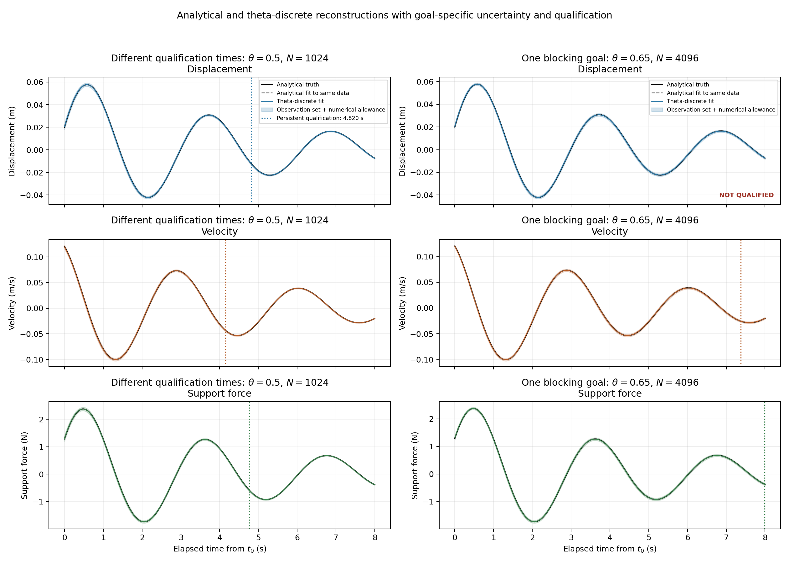
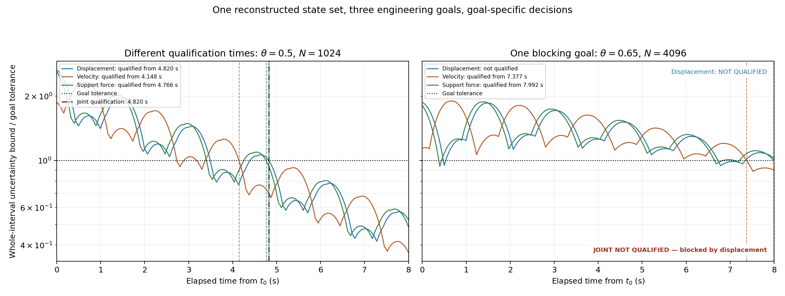
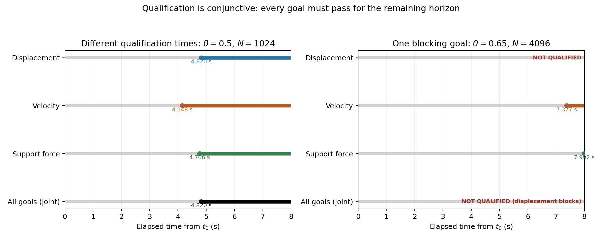

# Goal-dependent state qualification

## Purpose

A reconstructed state is shared by all engineering predictions, but its
uncertainty need not be the same for every prediction. Displacement, velocity,
and support force are different linear functions of the same oscillator state.
Their uncertainty bounds therefore evolve differently, and each must be
compared with its own physical tolerance.

This cross-cutting test makes that distinction explicit. It checks two outcomes:

1. All goals qualify, but at different persistent times. Joint qualification
   begins at the latest individual time.
2. Two goals qualify while one remains unqualified. The joint decision must
   remain unqualified and report the blocking goal.

This is not a new physical model. It reuses the analytically solvable oscillator
and the same C++20 discrete optimality and bounded-qualification machinery as
the hidden-state example.

## State, observations, and goals

The state is displacement and velocity,

$$
\boldsymbol{x}(t)=\begin{bmatrix}q(t)\\v(t)\end{bmatrix},
\qquad t\in[t_0,t_f],\qquad \boldsymbol{x}(t_0)=\boldsymbol{\xi}.
$$

Only displacement is observed at the fixed elapsed times
$$
0.5,\;1,\;2,\;3,\;4,\;6\ \mathrm{s}.
$$
The optimizer produces one fitted initial state for each experiment. The
qualification calculation then constructs one shared observation-consistent
set of possible initial states, including the stated measurement error and
numerical-model allowance. It propagates that same set to all three goals:

| Goal | State function | Tolerance |
|---|---|---:|
| Displacement | $q(t)$ | $0.001$ m |
| Velocity | $v(t)$ | $0.002$ m/s |
| Support force | $kq(t)+cv(t)$ | $0.04$ N |

For goal $g$, let $B_g(t)$ be the uncertainty bound on its prediction error and
$\tau_g$ its engineering tolerance. It qualifies persistently from $t_g$ if
$$
B_g(t)\leq\tau_g\qquad\text{for every }t\in[t_g,t_f].
$$
The all-goals decision is the conjunction of these requirements. If every goal
qualifies, its start time is
$$
t_{\mathrm{joint}}=\max_g t_g.
$$
If even one goal has no qualifying persistent suffix, the joint decision is
unqualified. Passing one goal cannot compensate for failing another.

## Test designs and findings

The first design uses midpoint stepping with $N=1024$ and a 95% simultaneous
Gaussian noise box. The individual persistent times differ:

| Goal | Persistent qualification time |
|---|---:|
| Velocity | 4.1484375 s |
| Support force | 4.765625 s |
| Displacement | 4.8203125 s |
| **All goals jointly** | **4.8203125 s** |

The displacement goal is the last to qualify, so it determines the joint time.
The different times arise from the directions in state space each physical
goal measures and each goal's own tolerance. They are computed from the same
fitted state and the same feasible set, not from separate state estimates.

The second design uses $\theta=0.65$, $N=4096$, and deterministic bounded
measurement errors. Velocity qualifies persistently from 7.376953125 s and
support force from 7.9921875 s. Displacement briefly falls below its tolerance,
then its uncertainty bound rises above it again; it never qualifies
persistently. Therefore the all-goals decision remains **NOT QUALIFIED**, with
displacement reported as the blocker.

The two designs use different measurement-error assumptions to illustrate the
two logical outcomes; their qualification times are not a comparison of
Gaussian and deterministic uncertainty models. The qualification calculation
includes the full observation-consistent set and propagated numerical error,
and checks whole time intervals rather than only mesh nodes.

## Outputs and reproduction

The C++20 executable performs the fits, feasible-set construction, bound
propagation, qualification-time calculation, and assertions. It writes:

- `decisions.csv`: each goal's persistent time and the joint decision;
- `envelopes.csv`: nodal and whole-interval uncertainty bounds;
- `state_reconstruction.csv`: analytic truth, analytic least-squares fit,
  theta-discrete fit, and nodal uncertainty bound for each physical goal;
- `checks.csv`: validation checks, including distinct goal times, the joint-time
  maximum rule, and the single-blocker result.

Python only plots these retained values.

```bash
make goal-dependence
make goal-dependence-plots
```

The whole-interval bound divided by tolerance is plotted below. A curve must
stay at or below one through the end of the horizon to qualify. Vertical dashed
lines mark individual persistent qualification times; the black dash-dot line
marks joint qualification when it exists.

The state figure compares the truth, continuous analytical fit, and theta-
discrete fit for the same data. Shading shows the observation-consistent set
with its numerical-model allowance. A vertical marker appears at a goal's
persistent qualification time; `NOT QUALIFIED` is shown when no such time exists.





The timeline shows that joint qualification starts at the latest individual
time, and that an unqualified goal blocks the joint decision.


