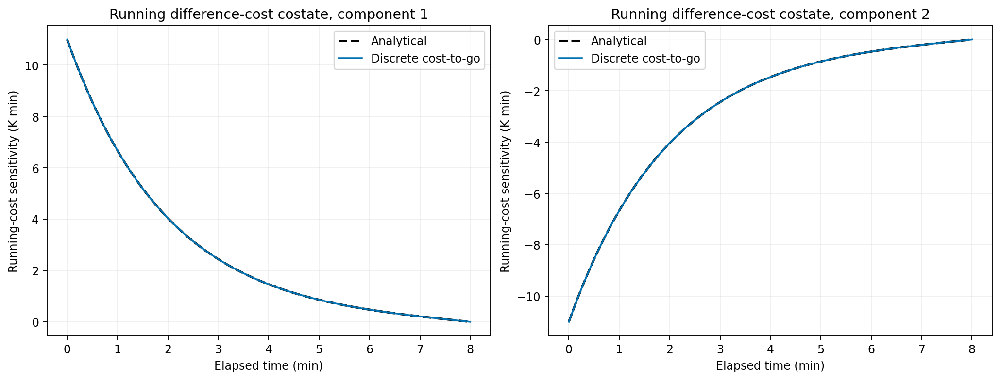
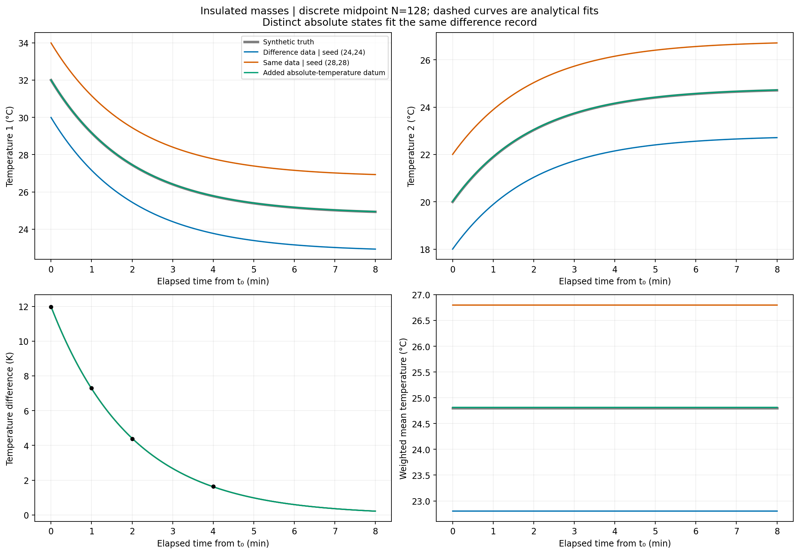
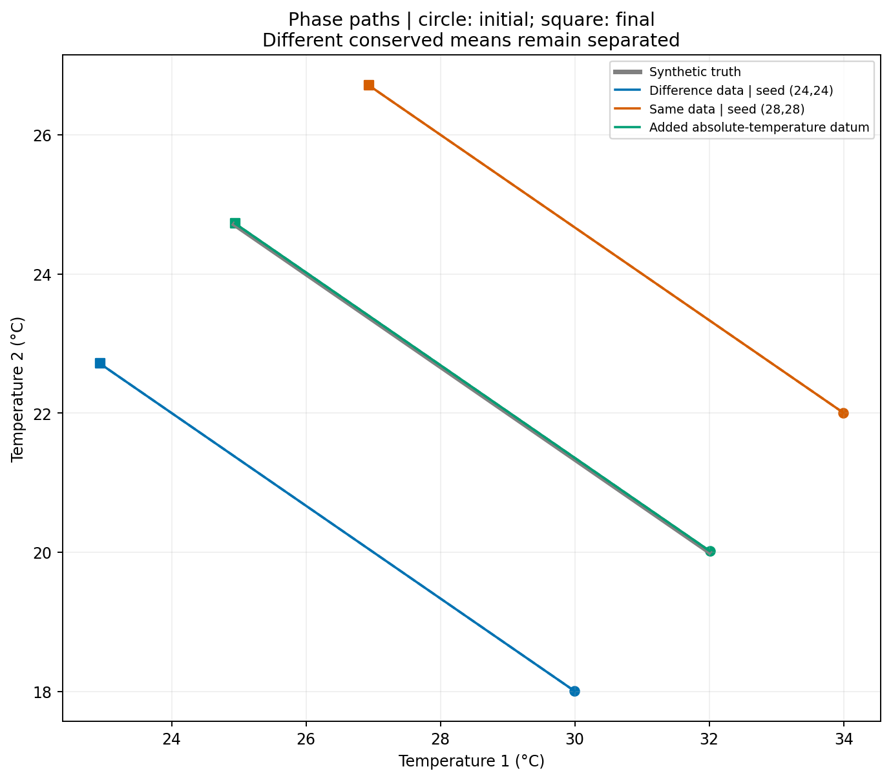
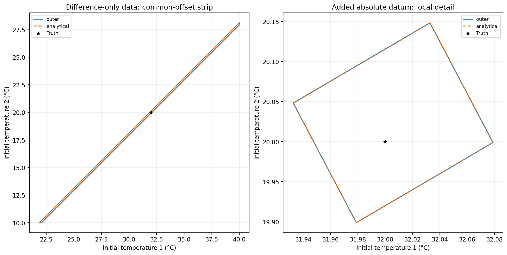
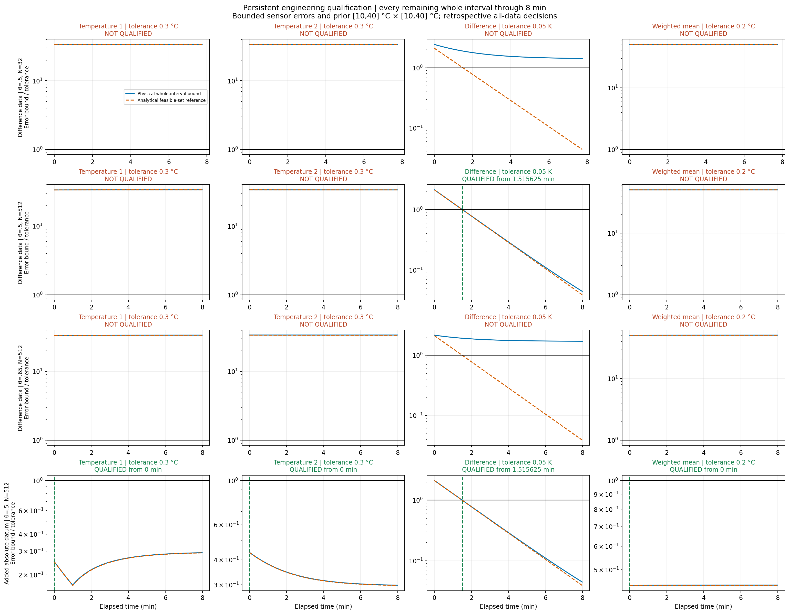
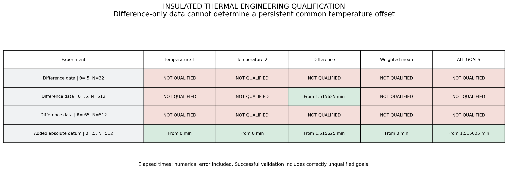
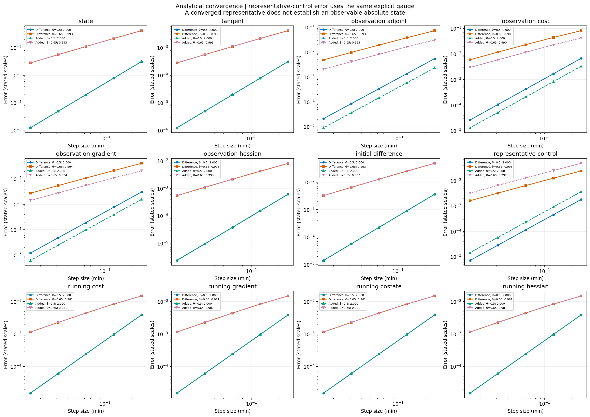

# Finding what the data determine: an insulated two-mass thermal system

This experiment tests whether our C++20 discrete optimality library can handle
an inverse problem with a genuinely missing initial-state direction. The goal is
not merely a small observation residual. We must identify which engineering
predictions the measurements support, preserve the uncertainty they leave, and
report qualified and unqualified goals correctly.

We observe only the temperature difference between two insulated thermal masses.
That difference decays, but a common temperature offset persists and remains
invisible. We first reconstruct a representative of the nonunique optimum,
then qualify predictions over a bounded feasible set. Finally, we add one actual
absolute-temperature observation and repeat the entire inference and qualification.
Analytical solutions independently validate the discrete forward, tangent,
adjoint, Hessian, optimization, and convergence results.

## 1. Physics, units, and initial-state controls

Two well-mixed masses exchange heat through a known conductance k. Neither
exchanges heat with the environment. Their heat capacities are C1 = 2 kJ/K and
C2 = 3 kJ/K, and k = 0.6 kJ/(min K). Energy balance gives

$$
C_1\dot T_1=-k(T_1-T_2),\qquad
C_2\dot T_2=k(T_1-T_2).
$$

The states are temperatures in degrees Celsius. A temperature difference of
one kelvin equals a difference of one Celsius degree; the difference plots use
K, while absolute-temperature plots use °C. Negative temperature differences,
if present, would not mean negative absolute Kelvin temperatures.

Use t in [t0,tf] = [2,10] min. Figures use elapsed time τ = t − t0, running from
zero to eight minutes. The unknown vector ξ = (T1(t0),T2(t0)) contains only
initial temperatures. Capacities, conductance, insulation, and inputs are known;
there is no unknown time-dependent heat source.

The synthetic truth is ξtrue = (32,20) °C. The qualification prior is the explicit
rectangle [10,40] °C × [10,40] °C. This finite domain provides a bound on the
otherwise unresolved offset; it is not an extra temperature observation.

## 2. Derive the complete analytical solution

Add the energy equations. The total sensible heat relative to the Celsius
reference, E = C1 T1 + C2 T2, is constant. Thus the capacity-weighted mean

$$
m=\frac{C_1T_1+C_2T_2}{C_1+C_2}=w_1T_1+w_2T_2,
\qquad w_1=0.4,\quad w_2=0.6,
$$

is constant. Its true value is 24.8 °C. Subtract the temperature equations:

$$
D=T_1-T_2,\qquad \dot D=-rD,\qquad
r=k\left(\frac1{C_1}+\frac1{C_2}\right)=0.5\ {\rm min}^{-1}.
$$

Consequently D(τ) = D0 exp(−rτ), and solving for the temperatures gives

$$
T_1(\tau)=m+w_2D_0e^{-r\tau},\qquad
T_2(\tau)=m-w_1D_0e^{-r\tau}.
$$

Equivalently, x(τ) = Φ(τ)ξ, where

$$
\Phi(\tau)=\begin{pmatrix}
w_1+w_2e^{-r\tau}&w_2(1-e^{-r\tau})\\
w_1(1-e^{-r\tau})&w_2+w_1e^{-r\tau}
\end{pmatrix}.
$$

The constant Jacobian of the differential equation is

$$
A=\nabla_x f=\begin{pmatrix}-.3&.3\\.2&-.2\end{pmatrix}\ {\rm min}^{-1}.
$$

Its eigenvalues are zero and −r. The neutral right eigenvector n = (1,1)
satisfies Φ(τ)n = n. Its conserved left eigenvector is w = (0.4,0.6).
The decaying right direction is (w2,−w1). Because capacities differ, the
conserved weighted mean is **not** the arithmetic mean.

These formulas supply independent references. The optimization still calls the
library's numerical forward solve and discrete derivatives.

## 3. What the observations can identify

Measure D at elapsed times 0, 1, 2, and 4 min. Each retained observation is

$$
y_j=D_{0,\rm true}e^{-r\tau_j}+\epsilon_j,
$$

with scale and deterministic bound σ = 0.1 K. The manufactured offsets are
σ times (−0.2, 0.3, −0.4, 0.1). We retain exactly these observations on every
grid, so refinement changes numerical error rather than the data.

Let v = (1,−1). Each analytical observation row is
hj = exp(−rτj) vᵀ. Since hj n = 0, adding αn to any initial state leaves every
predicted difference unchanged. The measurement information matrix is

$$
H=\sum_j\frac{h_j^Th_j}{\sigma^2}=\alpha vv^T,
\qquad \alpha=\sum_j\frac{e^{-2r\tau_j}}{\sigma^2}.
$$

It has eigenvalues 2α and zero. More difference observations can reduce error
in D0, but cannot reveal the common offset. This is a structural missing mode,
not an optimizer tolerance issue. Its temperature error does not dissipate.

The independent scalar least-squares solution is

$$
\widehat D_0=
\frac{\sum_j e^{-r\tau_j}y_j/\sigma^2}
     {\sum_j e^{-2r\tau_j}/\sigma^2}.
$$

The set of unconstrained optimal initial states is the line ξ1 − ξ2 = Dhat0.
Intersecting it with the prior still leaves a continuum of representatives.

## 4. Explicit treatment of nonuniqueness in the shared library

The previous interior Newton driver can solve nonsingular examples, but does
not explicitly report identifiability. This example adds
`include/theta_opt/identifiability.hpp`, containing two-control PSD spectral
diagnostics, compatible pseudoinverse solves, and a projected quadratic optimizer.
It is shared library code, not a special analytical optimization shortcut.

`minimize_quadratic_psd_2d` obtains the gradient from the discrete adjoint and
assembles the reduced Hessian from incremental-adjoint Hessian-vector products.
For a convex quadratic objective it computes

$$
\delta\xi=-H_h^+g_h,\qquad \widehat\xi_h=\xi_{\rm seed}+\delta\xi.
$$

Only eigenvectors with eigenvalues above a stated relative cutoff participate.
The default cutoff is 10^−12 times the largest eigenvalue. An incompatible
right-hand side in a discarded direction is rejected rather than silently
projected away. Negative curvature is rejected. The optimizer checks stationarity,
cost decrease, and Hessian agreement at the endpoints of its correction.
Its contract requires a convex quadratic reduced cost; these endpoint checks
are not a proof that an arbitrary nonlinear function is quadratic everywhere.
The original nonlinear Newton optimizer remains available and unchanged.

The seed's Euclidean null-space component is preserved. With equal 1 K control
scales, this fixes the arithmetic mean of the initial temperatures. It is an
explicit representative-selection convention, often called a gauge. It does
not assert that the arithmetic mean is measured, known, or physically conserved.
No diagonal regularization or undisclosed initial-state penalty is added.

Starting from (24,24) °C produces the analytical representative approximately
(29.9950162332,18.0049837668) °C. Starting from (28,28) shifts both fitted
initial temperatures by exactly four Celsius degrees. Their difference
predictions and minimized costs agree. The discrete calculation reproduces
this behavior, and its information matrix has numerical rank one.

The cutoff determines numerical rank in the supplied coordinates. Here both
controls have the same temperature scale, and the analytical null direction
independently proves the missing information. A small eigenvalue alone would
not establish structural nonidentifiability in a different problem.

A pseudoinverse of H must **not** be interpreted as a full covariance matrix
with zero uncertainty in the null direction. The null eigenvalue means missing
measurement information. Our engineering decision instead retains that direction
in a bounded feasible set.

## 5. The complete theta-consistent numerical calculation

For interval n, define

$$
B_n=I-h_n\theta_n A,\qquad C_n=I+h_n(1-\theta_n)A.
$$

The forward solve enforces Bn xn+1 = Cn xn. The actual library forward solver is
used; an independent modal recurrence validates it:

$$
m_{n+1}=m_n,\qquad
D_{n+1}=\frac{1-h_n(1-\theta_n)r}{1+h_n\theta_n r}D_n.
$$

The discrete total-heat identity C1 ΔT1 + C2 ΔT2 = 0 is checked independently.
The neutral mode remains constant to floating-point accuracy rather than
converging with a measurable temporal order.

A tangent direction s0 obeys Bn sn+1 = Cn sn. In particular, choosing s0 = n
must give sn = n at every node. Its observation perturbations vanish. The tests
assemble observation Jacobians from actual tangent solves and verify this.

The observation objective is a sum of isolated nodal costs,

$$
J_h=\tfrac12\sum_j[(v^Tx_{n_j}-y_j)/\sigma]^2.
$$

Nodal measurements receive no artificial timestep weight. At node n, let an
observation source be bn = v(vᵀxn − yj)/σ², adding sources if necessary. The
reverse state pullback satisfies

$$
\lambda_n=b_n+C_n^TB_n^{-T}\lambda_{n+1}.
$$

There is no final observation or terminal cost, so λN = 0. The initial map is
x0 = ξ; hence ∇ξ Jh = λ0. The analytical continuous observation costate is

$$
\lambda(t)=\sum_{t_j\ge t}\Phi(t_j-t)^Tv
\frac{v^T\Phi(t_j-t_0)\xi-y_j}{\sigma^2}.
$$

The node convention includes an observation source at that node. The gradient
is orthogonal to n, and the incremental-adjoint Hessian annihilates n. Tests
check both identities, tangent–adjoint pairing, finite differences, Hessian
symmetry, and agreement with analytical information matrices.

## 6. Exercise cost quadrature independently

Difference observations alone do not exercise running-cost quadrature. At the
fixed initial state ξ = (30,19) °C, use the separate verification functional

$$
J_{\rm run}=\tfrac12\int_{t_0}^{t_f}D(t)^2\,dt
=\tfrac12\xi^TQ(t_f-t_0)\xi,
$$
$$
Q(L)=\frac{1-e^{-2rL}}{2r}vv^T.
$$

Its exact gradient is Qξ, its Hessian-vector product is Qs, and its continuous
costate is λrun(t) = Q(tf−t)x(t), with λrun(tf) = 0. The library uses theta
quadrature, the matching discrete adjoint, and the incremental adjoint for all
three comparisons. `cost_to_go_adjoint` supplies the running costate convention
that excludes the preceding interval's endpoint quadrature source.

This functional is not additional measurement information and is not included
in either reconstruction objective.



The second component is negative because it differentiates a difference cost
with respect to T2. Costate values are sensitivities, not temperatures.

## 7. Add one actual absolute-temperature measurement

The augmented experiment adds T1 at elapsed one minute, with scale and bounded
error 0.05 °C and retained offset +0.01 °C. The new observation row has nonzero
response to n, restoring rank two. The executable adds its nodal cost,
reoptimizes with library derivatives, rebuilds the feasible polygon, and
recomputes all qualification bounds. Different optimizer seeds then give the
same optimum.

An independent reference is especially simple. Difference data determine Dhat0
as before. Because the mean was free, the single absolute datum can be matched
exactly by choosing

$$
\widehat m=y_{\rm abs}-w_2\widehat D_0e^{-r\tau_{\rm abs}}.
$$

Recover ξhat1 = mhat + w2 Dhat0 and ξhat2 = mhat − w1 Dhat0.
This also explains why adding one absolute datum does not improve the optimized
difference estimate in this particular unconstrained problem: its mean can
adjust freely. It resolves a missing direction rather than automatically
improving every goal. The bounds and tolerances, not rank alone, decide qualification.



Blue and orange use the same difference data and different seeds; green uses
the actual added absolute datum. Dashed curves are analytical fitted solutions.
Their difference histories overlap while their absolute temperatures can remain
separated. The reconstruction figure uses midpoint N = 128; the qualification
grids below are specified separately.



Each phase path moves along its conserved-mean line toward equal temperatures.
The blue and orange trajectories approach different equilibria. Time integration
accuracy cannot remove that missing physical information.

## 8. Build a bounded physical uncertainty set

For deterministic bounded errors, intersect the prior rectangle with all strips

$$
|h_j\xi-y_j|\le\sigma_j.
$$

The analytical set is a narrow strip along the common-offset direction,
truncated by the prior. After adding the absolute datum it becomes a small
polygon near the true initial state. Every admitted initial state must remain
in the qualification argument; selecting one optimum does not shrink this set.

For the numerical calculation, use the shared quadratic reconstruction,
linear-theta defect bound, and error propagation routines introduced with the
two-tank example. In the infinity norm, μ∞(A) = 0 because both rows sum to
zero and off-diagonal entries are nonnegative. Therefore the uniform numerical
allowance propagates as En+1 = En + hn Dn, starting from E0 = 0.

We maximize the convex defect upper bound over the four prior corners, which
makes the allowance valid throughout the prior. Each numerical measurement strip
is widened by ||cj||1 Ej; for the difference sensor the factor is two, while
for an individual temperature it is one. This ensures that the numerical outer
polygon contains the exact feasible initial states under the stated assumptions.

For a goal cᵀx, bound its error relative to the reconstructed trajectory by

$$
\max_{z\in P_h}|c^TJ_h(t)(z-\widehat\xi_h)|+\|c\|_1E(t).
$$

Vertex maximization handles the polygon. On each whole interval, each vertex's
goal reconstruction is quadratic; we evaluate endpoints and any interior
stationary point. Adding the maximum endpoint allowance bounds between-node
behavior. Goal adjoints are independently compared with these tangent-map
projections.

This shared infinity-norm allowance is deliberately conservative. Although the
actual discrete mean is conserved, the generic state bound need not exploit
that cancellation goal by goal. In particular, first-order theta = 0.65 can
leave even the difference unqualified at N = 512 under this budget. This is
not evidence that its true difference error exceeds tolerance, nor that the
observable mode becomes structurally unobservable.

Analytical trajectories validate the allowance and physical envelopes but do
not construct the numerical error budget. Ordinary double-precision polygon
geometry and explicit step roundoff allowances are used; the result is not a
formal outward-rounded interval-arithmetic certificate.



The panels have different axis ranges. The left exposes the large unresolved
common-offset range. The right zooms into the small set after the added datum.
The black star is the synthetic truth.

## 9. Engineering qualification decisions

Use these absolute goal tolerances:

| Goal | Tolerance |
|---|---|
| T1 | 0.3 °C |
| T2 | 0.3 °C |
| Difference T1 − T2 | 0.05 K |
| Capacity-weighted mean | 0.2 °C |

Qualification must hold over **every remaining whole interval** through eight
elapsed minutes. The calculation uses all retained data and therefore describes
retrospective reconstruction, not an online estimate. The reported times are
grid interval starts; we do not infer subinterval qualification from node samples.

| Experiment | Difference | T1, T2, and weighted mean | Joint result |
|---|---|---|---|
| Difference data; θ = 0.5, N = 32 | Unqualified under numerical budget | Unqualified | NOT QUALIFIED |
| Difference data; θ = 0.5, N = 512 | From 1.515625 min | Unqualified | NOT QUALIFIED |
| Difference data; θ = 0.65, N = 512 | Unqualified under numerical budget | Unqualified | NOT QUALIFIED |
| Shifted seed; θ = 0.5, N = 512 | From 1.515625 min | Unqualified | NOT QUALIFIED |
| Added absolute datum; θ = 0.5, N = 512 | From 1.515625 min | All from zero | QUALIFIED from 1.515625 min |

The analytical-set reference difference time is approximately 1.49229418728 min.
The slightly later refined discrete time includes numerical error and interval
resolution. The difference tolerance is tighter than the absolute-temperature
tolerances, so even the augmented experiment waits for difference uncertainty
to decay before declaring joint qualification.

In the difference-only case, two admissible initial states separated by a common
offset of 2 °C produce identical difference records. Their absolute-temperature
and mean separation remains 2 °C for all time. This analytical witness explains
why waiting longer cannot resolve the missing offset. The bounded-domain test
correctly keeps those goals unqualified; numerical refinement cannot supply
measurements that were never taken.



Bounds are divided by tolerances; the horizontal line is one. Blue is the
computable physical whole-interval bound, orange the analytical feasible-set
reference. Green vertical lines mark persistent qualification times. In
particular, the refined difference panel passes while the absolute goals do not.



## 10. Validate temporal convergence without claiming false uniqueness

For both the difference-only and augmented problems, use N = 32, 64, 128, 256,
512 with θ = 0.5 and θ = 0.65. These grids retain all observations at their
original times. Compute p = log2(eN/e2N) and record the final-pair rates.

Twelve measures cover state, tangent, observation adjoint, observation
cost/gradient/Hessian, recovered initial difference, representative initial
control, and running cost/gradient/costate/Hessian. State, tangent, difference,
and representative errors use a fixed 1 K temperature scale. Other errors are
normalized by nonzero analytical objective or derivative magnitudes. State and
costate errors take the maximum over nodes.

The final measured orders are approximately 2.0000–2.0002 for midpoint and
0.981–0.994 for theta = 0.65. The representative-control comparison uses the
**same seed convention** in the discrete and analytical solutions. It checks
temporal convergence of a selected representative, not recovery of the unknown
true mean from difference data. In the augmented problem the optimum is unique.

The neutral mode and total heat are separately checked to floating-point
accuracy. We assign no temporal order to an invariant that is already exact.
We also make no second-order claim for grid-quantized qualification times.



## 11. Reproduce the experiment

```bash
make insulated-thermal-plots
make test qualification-plots
```

The C++ executable writes individual checks, convergence errors and orders,
initial fits, optimizer traces, information spectra, observations, analytical
and discrete trajectories, running costates, feasible polygons, uncertainty
envelopes, and explicit decisions to `results/insulated_thermal/`. Python reads
these retained values and renders seven figures; it performs no forward solve,
optimization, reference integration, or qualification decision.

The implementation is in `examples/insulated_thermal_model.hpp`,
`insulated_thermal_qualification_model.hpp`, and `insulated_thermal.cpp`.
Shared rank-aware routines are described in [the API](api.md). The existing
nonlinear optimizer is unchanged. The new quadratic driver deliberately reports
rank and preserves the selected null component, while qualification independently
accounts for the entire bounded uncertainty set.
