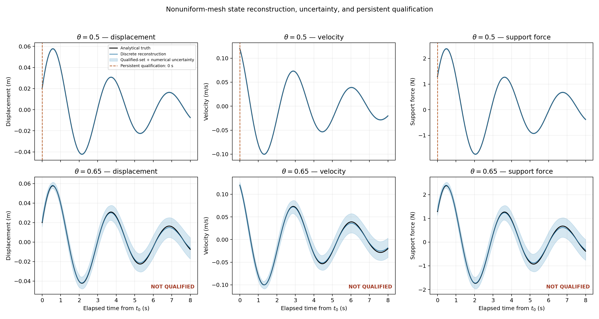
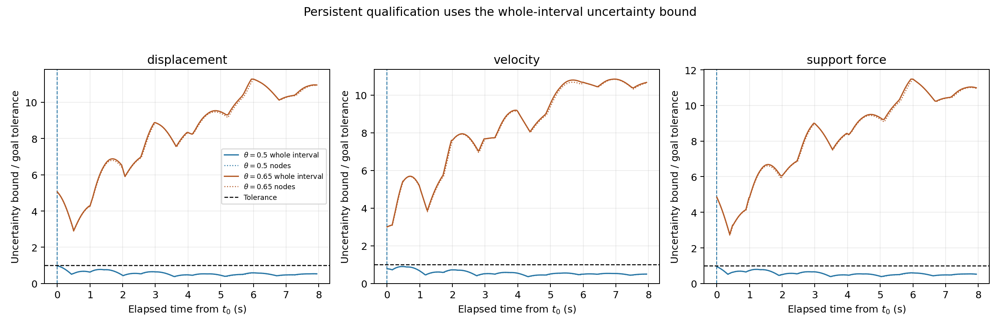
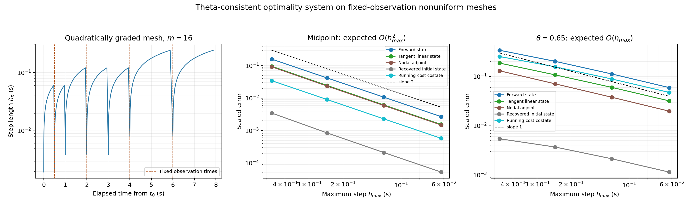
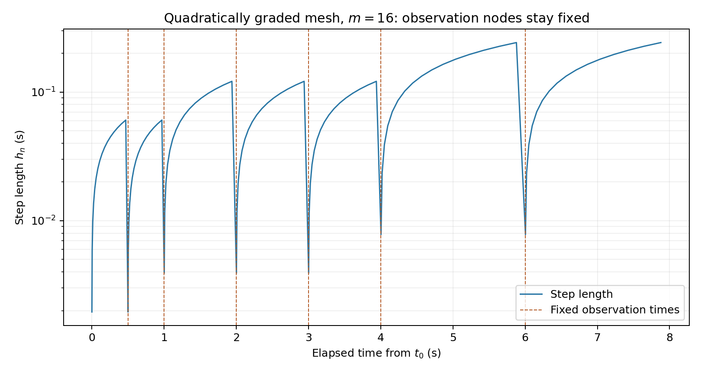
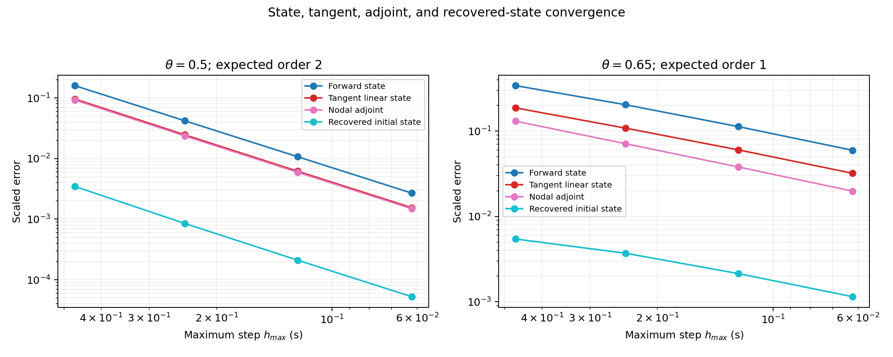
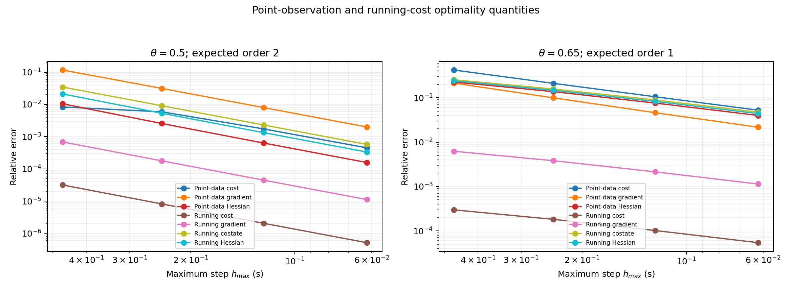
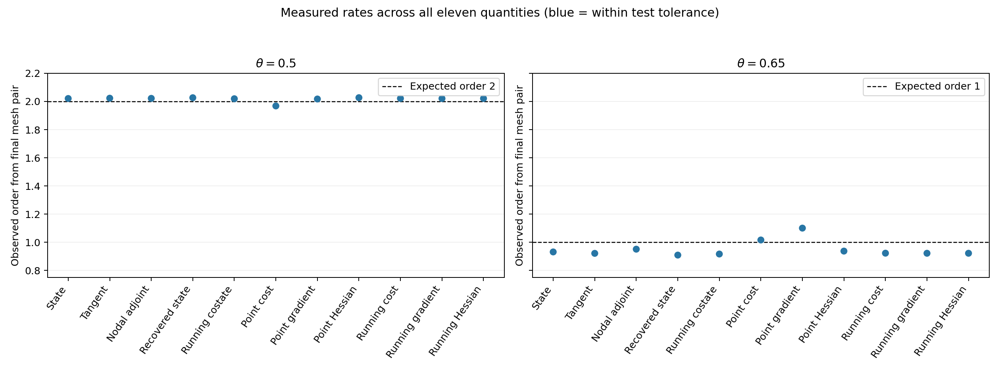

# Nonuniform time-step test for the discrete optimality system

## Purpose

This experiment checks whether the library's **single theta-consistent discrete
optimality system** remains correct when the time steps vary. It keeps physical
observation times unchanged while refining the mesh. That isolates the effect of
nonuniform stepping: a change in the reconstructed state or gradient must come
from discretization error, not from moving the sensors or changing the data.

The oscillator is used because its exact state, tangent, observation objective,
running-cost quadrature, costates, gradients, and Hessians are available as
independent references. The experiment checks both the inverse problem with
point observations and a separate exactly integrable running-cost functional.
The running functional verifies quadrature and costate behavior; it is not an
additional observation.

## Model and fixed observations

The state is displacement and velocity, with

$$
\dot{\boldsymbol x}=A\boldsymbol x,\qquad
\boldsymbol x(t_0)=\boldsymbol\xi,\qquad
\boldsymbol x(t)=\Phi(t-t_0)\boldsymbol\xi,
$$

where the damped-oscillator parameters and physical scales are those in
[`oscillator_model.hpp`](../examples/oscillator_model.hpp). The six displacement
observations remain fixed at elapsed times

$$
0.5,\;1,\;2,\;3,\;4,\;6\;\mathrm{s}.
$$

The inverse objective is the same weighted sum of nodal least-squares costs on
every mesh. A second system uses the running verification functional

$$
J_{\rm run}(\boldsymbol\xi)
=\frac12\int_{t_0}^{t_f}q(t)^2\,dt,
$$

whose exact value, gradient, Hessian, and costate follow from the oscillator's
analytical observability Gramian.

## Nested, nonuniform refinement family

The endpoints and all six observation times partition the time interval into
fixed segments. Each segment $[a_j,a_{j+1}]$ is subdivided using

$$
t_{j,k}=a_j+(a_{j+1}-a_j)\left(\frac{k}{m}\right)^2,
\qquad k=0,\ldots,m.
$$

The step lengths within a segment are therefore

$$
h_{j,k}=(a_{j+1}-a_j)\frac{2k-1}{m^2}.
$$

The experiment uses $m=8,16,32,64$. Doubling $m$ retains every coarse node,
keeps each observation at precisely the same mesh node, and reduces the maximum
step by approximately a factor of two. The smallest steps shrink faster, so the
ratio $h_{\max}/h_{\min}$ grows; the grids are genuinely graded rather than
uniform grids with shifted observations.

On each interval the state solver uses

$$
\boldsymbol x_{n+1}-\boldsymbol x_n
=h_n\left[(1-\theta)f(t_n,\boldsymbol x_n)
 +\theta f(t_{n+1},\boldsymbol x_{n+1})\right].
$$

The running objective uses the matching node weights assembled from those same
$h_n$ and $\theta$. Point observations remain nodal costs and receive no time
step multiplier. The tangent, adjoint, and incremental adjoint differentiate
this discrete system on the fixed prescribed grid.

## What is checked

For both $\theta=0.5$ and $\theta=0.65$, the C++ test checks:

1. Every grid is nonuniform, every observation remains on the grid, and each
   refinement retains all nodes of the preceding grid.
2. The fixed-control forward state and tangent agree with the exact analytical
   trajectory and state transition map.
3. The nodal adjoint agrees with the exact point-observation costate.
4. The discrete point-data objective, gradient, Hessian, and recovered initial
   state converge to their exact-model references.
5. Tangent–adjoint pairing agrees with the discrete objective gradient. The
   gradient and incremental-adjoint Hessian also agree with finite differences
   of the discrete objective on the nonuniform grid.
6. For the running verification functional, the discrete quadrature, gradient,
   costate, and Hessian converge to the exact Gramian-based quantities.
7. The observed refinement orders for all eleven quantities match the expected
   order for the selected $\theta$ value.

The test reports **second-order convergence** for midpoint and approximately
**first-order convergence** for $\theta=0.65$ across state, tangent, adjoint,
point objective and derivatives, recovered controls, running objective and
derivatives. The measured orders are in `results/nonuniform_oscillator/orders.csv`;
the per-grid error values and mesh sizes are in `convergence.csv` and
`mesh.csv`. The C++ run completes 919 checks.

## State uncertainty and engineering qualification

The finest mesh ($m=64$) also runs the oscillator's bounded-error state
qualification experiment from [oscillator.md](oscillator.md). The reconstruction
uses the same six displacement observations, bounded observation errors, the
known initial-state box $|q_0|\le 0.08$ m, $|v_0|\le 0.30$ m/s, and a
propagated numerical-model allowance. Each displacement observation has a
deterministic error bound of $0.0005$ m. At every node the plots show analytical
truth and fitted discrete state, with a band for the full observation-consistent
initial-state set plus numerical error. The shaded band is deterministic
uncertainty, not a Gaussian confidence interval.

Qualification is tested for displacement, velocity, and support force. The
criterion is the uncertainty bound divided by that goal's tolerance over every
whole time interval; qualification time is the beginning of a suffix on which
the bound remains below one. For this setup, the midpoint case qualifies all
three goals from $t_0$, while $\theta=0.65$ qualifies none over the eight-second
horizon. This shows how the larger first-order discretization error can prevent
engineering qualification even though the discrete optimality system still
converges at its expected rate under refinement. The tolerances are 0.001 m in
displacement, 0.002 m/s in velocity, and 0.04 N in support force.

The first plot overlays analytical truth, discrete reconstruction, and the
state uncertainty band. Dashed vertical lines mark persistent qualification
times; “NOT QUALIFIED” means the required bound does not stay below tolerance
through the end of the horizon. The second plot normalizes node and whole-
interval bounds by their tolerances. Whole-interval bounds determine the
decision; node curves are included for comparison.







The run also writes separate diagnostic figures for the mesh spacing, state
and optimality-system convergence, objective derivatives, and measured orders:









The corresponding C++ outputs are retained in `qualification.csv`,
`state_uncertainty.csv`, and `qualification_envelopes.csv`.

Run the numerical experiment and plot its retained outputs with:

```bash
make nonuniform-oscillator-plots
```

All simulation, optimization, analytical comparisons, and order calculations
run in C++20. Python only renders the CSV outputs. The test is also part of
`make test` and CTest.
