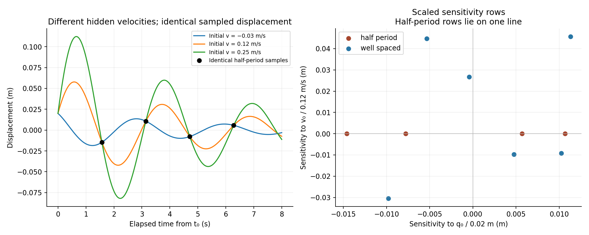
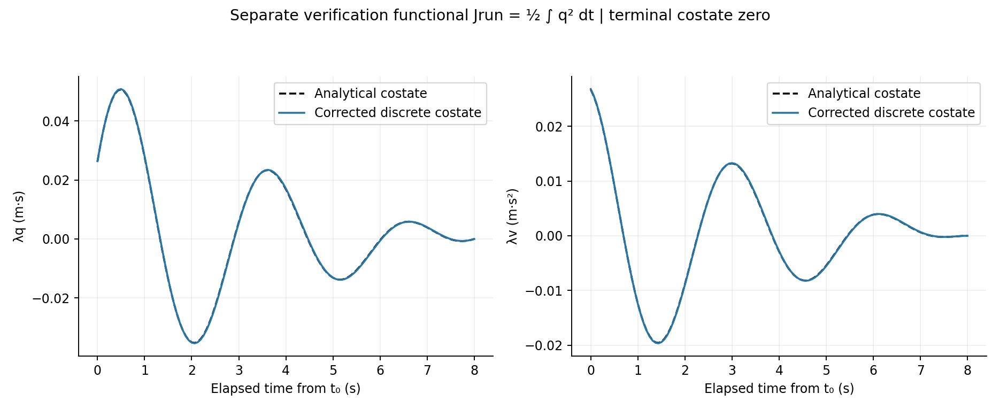
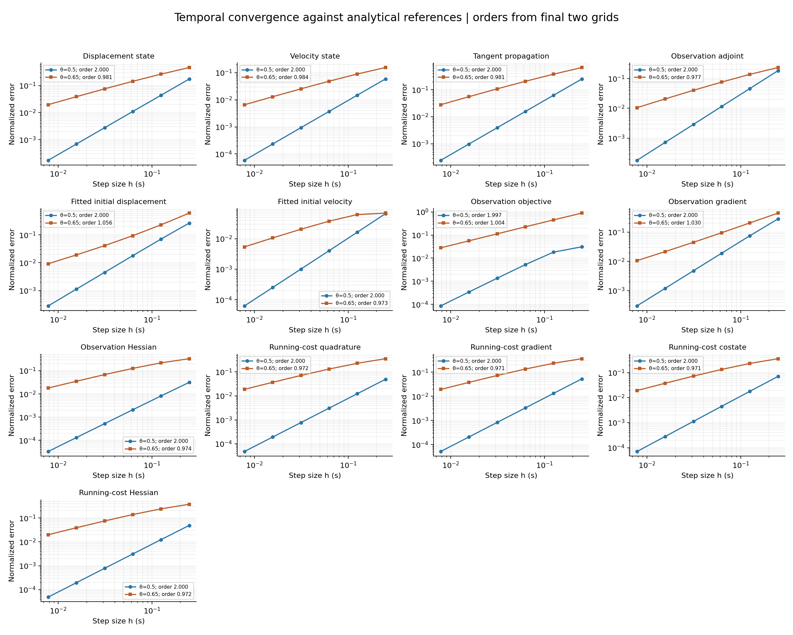
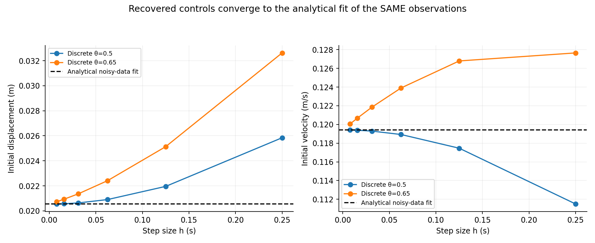
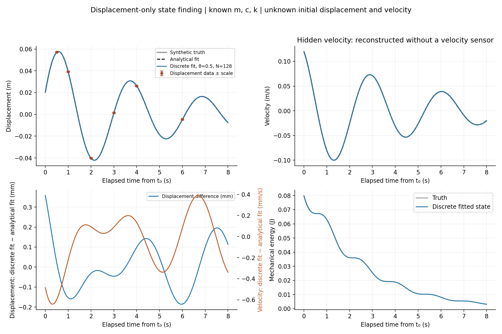
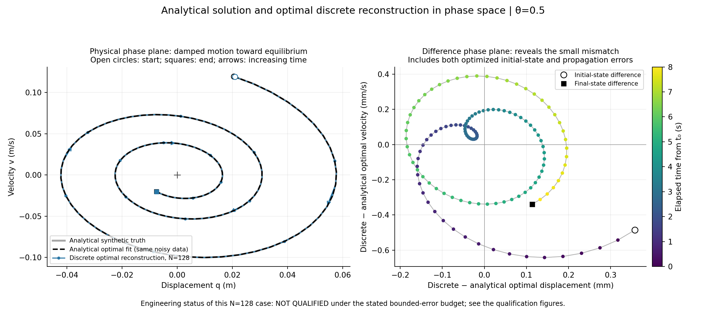
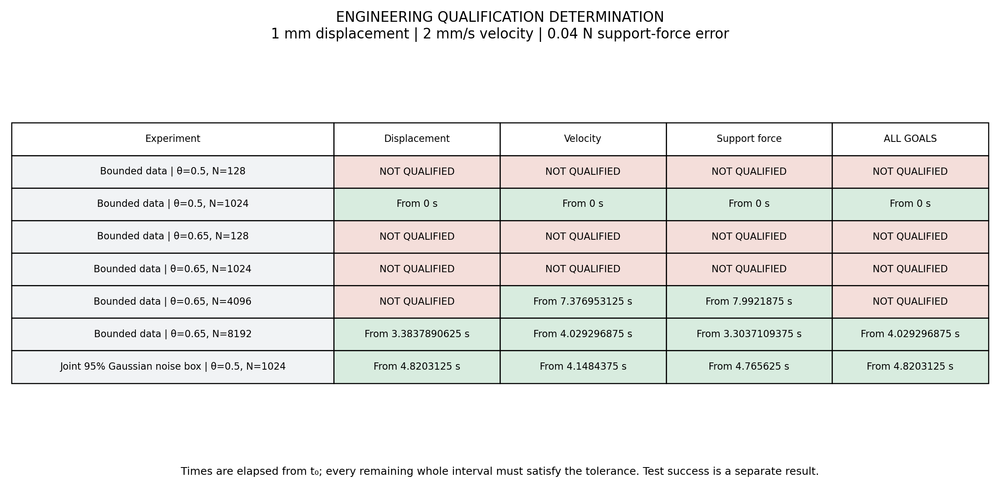
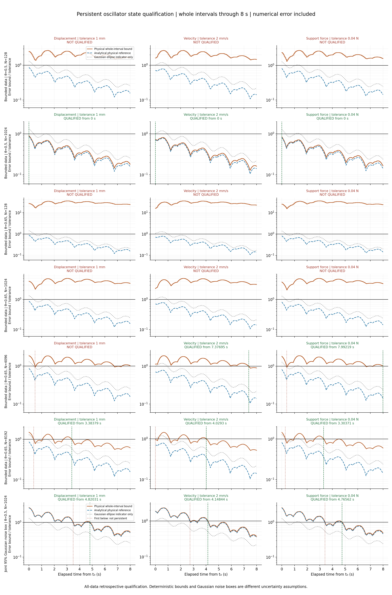

# Finding hidden velocity from displacement measurements

We want to reconstruct the initial state of a vibrating mechanical system when
we can measure displacement but cannot measure velocity. This tests an important
state-finding idea: an unmeasured state component can be recoverable because it
changes the future measured response. Conversely, poorly timed measurements can
leave that component completely hidden.

This example compares our actual C++20 discrete forward solution, tangent,
adjoint, objective, gradients, Hessians, and reconstructed initial conditions
against elementary analytical references. It also tests running-cost quadrature
and its continuous costate with a separate verification functional. No analytical
propagator supplies a numerical forward step or an optimization derivative.

```bash
make oscillator
make oscillator-plots
make test
```

All modeling, fitting, analytical references, error calculations, and convergence
orders run in C++20. Python only renders the CSV files. This example adds no
change to `optimize.hpp`; it uses the existing optimizer with zero additional
cost-roundoff slack.

## 1. Define the engineering state and the unknowns

Consider a mass attached to a linear spring and viscous damper:

$$
m\ddot q+c\dot q+kq=0.
$$

Displacement $q$ is relative to equilibrium; negative values are physically
meaningful. Let $v=\dot q$, so the state and unknown initial state are

$$
\boldsymbol x(t)=\begin{bmatrix}q(t)\\v(t)\end{bmatrix},\qquad
\boldsymbol x(t_0)=\boldsymbol\xi=\begin{bmatrix}q_0\\v_0\end{bmatrix}.
$$

Mass, damping, and stiffness are known. We do not estimate a time-varying forcing
or an unknown control history. The evolution is

$$
\dot{\boldsymbol x}=f(\boldsymbol x)=
\begin{bmatrix}v\\-(k/m)q-(c/m)v\end{bmatrix}.
$$

Use $m=10$ kg, $c=4$ N s/m, and $k=40.4$ N/m. The decay rate is
$a=c/(2m)=0.2$ s$^{-1}$, and the damped angular frequency is
$\omega=\sqrt{k/m-a^2}=2$ rad/s. The period is $2\pi/\omega=\pi$ s.
The observation horizon is $t\in[t_0,t_f]=[2,10]$ s. Figures use elapsed time
$\tau=t-t_0\in[0,8]$ s.

The synthetic initial state is

$$
q_0^*=0.02\text{ m},\qquad v_0^*=0.12\text{ m/s}.
$$

Only displacement is observed. Neither initial component is supplied to the
optimizer: it starts from $(0,0)$.

## 2. Obtain an exact solution before testing the numerical one

The underdamped solution is

$$
q(t)=e^{-a\tau}\left[q_0\cos(\omega\tau)
+\frac{v_0+aq_0}{\omega}\sin(\omega\tau)\right].
$$

Differentiation gives velocity. Together they define

$$
\boldsymbol x(t)=\Phi(\tau)\boldsymbol\xi,
$$

$$
\Phi(\tau)=e^{-a\tau}
\begin{bmatrix}
\cos(\omega\tau)+\frac a\omega\sin(\omega\tau)&
\frac1\omega\sin(\omega\tau)\\
-\frac{a^2+\omega^2}{\omega}\sin(\omega\tau)&
\cos(\omega\tau)-\frac a\omega\sin(\omega\tau)
\end{bmatrix}.
$$

This provides both the exact state and its initial-state sensitivity:
$\partial\boldsymbol x(t)/\partial\boldsymbol\xi=\Phi(\tau)$.
We independently check its semigroup property,
$\Phi(1.3)=\Phi(1.0)\Phi(0.3)$.

The mechanical energy is

$$
E=\tfrac12kq^2+\tfrac12mv^2,\qquad
\frac{dE}{dt}=-cv^2\le0.
$$

This balance supplies an additional physical verification independent of fitting.

## 3. Understand when velocity is visible

A displacement observation at elapsed time $\tau_j$ is

$$
y_j=\boldsymbol h_j^T\boldsymbol\xi+\epsilon_j,
\qquad \boldsymbol h_j^T=(1,0)\Phi(\tau_j).
$$

Its sensitivity to initial velocity is

$$
\frac{\partial q(t_j)}{\partial v_0}
=e^{-a\tau_j}\frac{\sin(\omega\tau_j)}\omega.
$$

At integer half-periods, $\tau_j=j\pi/\omega$, this sensitivity is zero.
Every such observation depends on $q_0$ but contains no information about $v_0$.
Repeating these measurements more accurately cannot restore the missing direction.

We demonstrate this with three different initial velocities, all with the same
initial displacement. Their trajectories differ substantially, yet intersect at
every half-period observation time.



The right panel shows sensitivity rows after scaling initial displacement by
0.02 m and initial velocity by 0.12 m/s. The poor-design rows all lie on one
line; the well-spaced rows span the two-dimensional control space. Scaling is
necessary before interpreting a condition number because the two controls have
different units.

The poor design is an analytical observability diagnostic, not a separately
optimized data-assimilation case. We do not let artificial numerical phase errors
turn its missing physical information into an apparent identification result.

## 4. Specify the actual reconstruction experiment

Use displacement samples at elapsed times

$$
\tau_j\in\{0.5,1,2,3,4,6\}\text{ s}.
$$

The measurement scale is $\sigma=0.0005$ m. Generate a reproducible noisy record
from the exact trajectory:

$$
y_j=q^*(t_j)+\sigma d_j,\qquad
(d_1,\ldots,d_6)=(0.4,-0.6,0.2,0.8,-0.3,0.5).
$$

These are deterministic synthetic perturbations, not random draws or real
measurements. We retain them unchanged on every grid; otherwise refinement would
compare different inverse problems.

Minimize

$$
J_{\mathrm{obs}}(\boldsymbol\xi)
=\frac12\sum_j\frac{[q(t_j;\boldsymbol\xi)-y_j]^2}{\sigma^2}.
$$

The continuous-time analytical problem is quadratic. Its normal equations are

$$
H\boldsymbol\xi_{\mathrm{ref}}=\boldsymbol b,\qquad
H=\sum_j\frac{\boldsymbol h_j\boldsymbol h_j^T}{\sigma^2},\qquad
\boldsymbol b=\sum_j\frac{y_j\boldsymbol h_j}{\sigma^2}.
$$

The well-spaced design has positive definite $H$. Its condition number is about
17.106 after the stated control scaling. Solving these independent analytical
normal equations gives

| Initial component | Synthetic truth | Analytical fit to noisy data |
|---|---:|---:|
| Displacement (m) | 0.020000000000 | 0.020543752726 |
| Velocity (m/s) | 0.120000000000 | 0.119410974018 |

The analytical noisy-data fit is the correct reference for convergence of the
numerical inverse problem. Its difference from the truth is measurement-induced
error, not a time-stepping error. A separate noiseless analytical check recovers
the truth to roundoff.

If the scales are interpreted as known independent Gaussian standard deviations,
$H^{-1}$ is the exact covariance of this linear estimator. Its initial-state
standard deviations are approximately 0.00053556 m and 0.00081472 m/s. That
statistical interpretation is an assumption, not established by our deterministic
perturbation record, and is not a state-qualification verdict.

## 5. Solve the discrete problem with the library

For each grid, the library solves the theta update

$$
\boldsymbol x_{n+1}=\boldsymbol x_n+h_n\left[
(1-\theta)f(\boldsymbol x_n)+\theta f(\boldsymbol x_{n+1})\right].
$$

For this linear model, define

$$
B_n=I-h_n\theta\nabla_x f,\qquad
C_n=I+h_n(1-\theta)\nabla_x f.
$$

The update is $B_n\boldsymbol x_{n+1}=C_n\boldsymbol x_n$.
We nevertheless execute the library's implicit forward Newton solver, then check
its result against an independent explicit two-by-two rational formula for this
same theta step.

The tangent update is

$$
B_n\boldsymbol s_{n+1}=C_n\boldsymbol s_n,
\qquad\boldsymbol s_0=\delta\boldsymbol\xi.
$$

The discrete observation objective samples the numerical displacement at the
same physical observation times. Those samples are isolated **nodal costs**;
they must not acquire quadrature weights when the mesh changes.

The library adjoint accumulates those nodal sources while solving the transpose
step equations. It returns the gradient of this exact discrete objective. The
incremental adjoint supplies its Hessian-vector products. The Newton driver
therefore minimizes the discrete problem actually evaluated by the forward model.
Because the problem is quadratic and the information matrix is nonsingular, one
full Newton correction suffices; the tests check this on every grid.

The analytical continuous-time observation costate is

$$
\boldsymbol\lambda(t)=
\sum_{t_j\ge t}\Phi(t_j-t)^T
\begin{bmatrix}(q(t_j)-y_j)/\sigma^2\\0\end{bmatrix}.
$$

At observation nodes we compare the convention that includes that node's source
(the left limit). Between observations it obeys the homogeneous adjoint equation.
The last observation precedes $t_f$, so $\boldsymbol\lambda(t_f)=0$.

## 6. Exercise genuine running-cost quadrature separately

Discrete point measurements do not test running-cost quadrature. To exercise that
part of the theory without inventing extra sensor data, use the additional
verification functional

$$
J_{\mathrm{run}}(\boldsymbol\xi)
=\frac12\int_{t_0}^{t_f}q(t;\boldsymbol\xi)^2\,dt.
$$

We evaluate and differentiate it at a fixed nonzero initial state; we do not use
it as extra information when reconstructing velocity. Its units are m$^2$ s.
The exact reference is

$$
Q(L)=\int_0^L\Phi(s)^T
\begin{bmatrix}1&0\\0&0\end{bmatrix}\Phi(s)\,ds,
$$

$$
J_{\mathrm{run}}=\tfrac12\boldsymbol\xi^TQ(8)\boldsymbol\xi,
\qquad\nabla_\xi J_{\mathrm{run}}=Q(8)\boldsymbol\xi,
\qquad H_{\mathrm{run}}=Q(8).
$$

There is no numerical reference quadrature. To compute $Q$ analytically, let

$$
I_0=\frac{1-e^{-2aL}}{2a},\qquad
I_c+iI_s=\frac{e^{(-2a+2i\omega)L}-1}{-2a+2i\omega}.
$$

Then $I_{cc}=(I_0+I_c)/2$, $I_{ss}=(I_0-I_c)/2$, and
$I_{cs}=I_s/2$ are the weighted integrals of cosine squared, sine squared, and
their product. Writing $r=a/\omega$ gives

$$
Q(L)=\begin{bmatrix}
I_{cc}+2rI_{cs}+r^2I_{ss}&(I_{cs}+rI_{ss})/\omega\\
(I_{cs}+rI_{ss})/\omega&I_{ss}/\omega^2
\end{bmatrix}.
$$

The continuous costate satisfies

$$
-\dot{\boldsymbol\lambda}
=\nabla_x f(\boldsymbol x(t))^T\boldsymbol\lambda
+\begin{bmatrix}q(t)\\0\end{bmatrix},
\qquad\boldsymbol\lambda(t_f)=0,
$$

and has the exact expression

$$
\boldsymbol\lambda(t)=Q(t_f-t)\boldsymbol x(t).
$$

The library evaluates $J_{\mathrm{run},h}$ with matching theta quadrature and
differentiates that same quadrature. For pointwise continuous-costate comparison,
we use `cost_to_go_adjoint`, which subtracts the preceding interval's running-cost
endpoint contribution from the raw nodal adjoint. This aligns conventions; it
does not alter the optimization gradient or substitute an analytical adjoint.
At $t_0$ no subtraction is needed, and the corrected terminal costate is zero.



## 7. Compare refinement rates and recovered states

Run both $\theta=0.5$ and $\theta=0.65$ on

$$
N\in\{32,64,128,256,512,1024\},\qquad h=8/N.
$$

All observation times coincide with nodes on every grid. At the fixed probe
$\boldsymbol\xi=(0.013\text{ m},0.085\text{ m/s})$, compare state, tangent,
adjoints, cost, gradient, and Hessian against the exact references. Fixed controls
prevent fitting changes from contaminating the forward discretization comparison.
Separately, reoptimize on each grid and compare the recovered controls with the
analytical noisy-data fit.

For a quantity with error $E_h$, estimate the final observed order by

$$
p_{\mathrm{obs}}=\log_2(E_{2h}/E_h).
$$

Errors are nondimensionalized with fixed physical scales: state and control
components use 0.02 m and 0.12 m/s, respectively; the tangent uses the direction
$(0.02\text{ m},0.12\text{ m/s})$ and those same output scales. Other errors use
fixed analytical cost, gradient, Hessian, or maximum costate scales. No division
by a time-local zero crossing is used. State, tangent, and costate errors are
maxima over all grid nodes. Full details appear directly in `oscillator.cpp`.

| Comparison | Order, theta = 0.5 | Order, theta = 0.65 |
|---|---:|---:|
| Displacement state | 1.999962 | 0.981047 |
| Velocity state | 1.999981 | 0.983564 |
| Directional tangent | 1.999803 | 0.981180 |
| Observation adjoint | 1.999922 | 0.976591 |
| Fitted initial displacement | 1.999676 | 1.056236 |
| Fitted initial velocity | 2.000122 | 0.972961 |
| Running cost | 2.000008 | 0.971633 |
| Running-cost gradient | 2.000003 | 0.971402 |
| Running-cost costate | 1.999931 | 0.971402 |
| Running-cost Hessian | 1.999885 | 0.971585 |
| Observation objective | 1.997135 | 1.003816 |
| Observation gradient | 1.999742 | 1.030262 |
| Observation Hessian | 1.999621 | 0.974135 |

These results support second-order temporal convergence for theta = 0.5 and
first-order convergence for theta = 0.65. They concern time refinement, not the
local convergence order of Newton optimization. Here Newton solves a quadratic
problem in one correction, so a multi-iteration quadratic Newton-rate experiment
would not be meaningful.



At the finest midpoint grid the reconstructed initial conditions are

| Component | Analytical noisy-data fit | Discrete fit, N = 1024 |
|---|---:|---:|
| Initial displacement (m) | 0.020543752726 | 0.020549373048 |
| Initial velocity (m/s) | 0.119410974018 | 0.119403399775 |

Halving the step size reduces the asymptotic midpoint errors by approximately
four, including the hidden initial velocity error.

### Midpoint improves the actual numerical solution

The midpoint result is not merely easier to qualify because of a smaller
conservative allowance. **For this oscillator, at the same sufficiently small
timestep, theta = 0.5 produces a more accurate discrete state than theta = 0.65.**
The direct comparisons against the analytical state demonstrate this separately
from the qualification analysis. The recovered initial conditions improve too.

At N = 1024, the absolute differences from the analytical optimal fit to the
same noisy observations are:

| Method | Initial-displacement error (m) | Initial-velocity error (m/s) |
|---|---:|---:|
| theta = 0.5 | $5.62032\times10^{-6}$ | $7.57424\times10^{-6}$ |
| theta = 0.65 | $1.83357\times10^{-4}$ | $6.46221\times10^{-4}$ |

The midpoint initial-velocity error is about **85 times smaller**. These are
errors in the recovered initial state, not maximum trajectory errors; the
separate state convergence panels measure forward trajectory error at fixed
initial conditions. Both comparisons support midpoint's greater accuracy here.

The common cause is cancellation of the leading first-order temporal error at
theta = 0.5. It improves the numerical trajectory and its reconstruction of the
initial state, and our consistent residual analysis also obtains a smaller,
second-order numerical-error allowance. Qualification then asks whether the
combined measurement and numerical error budget is below the engineering
tolerances. Thus actual numerical accuracy, a conservative error bound, and an
engineering qualification decision are related but distinct quantities.

Second-order convergence means approximately fourfold error reduction when the
timestep is halved in the asymptotic regime. It does not guarantee that midpoint
has smaller error for every model and every timestep; it does in the refinement
regime demonstrated by this experiment. This is temporal refinement, not Newton
iteration convergence.



The primary trajectory plot uses N = 128 to make the remaining numerical
difference visible. The lower-left panel compares the two fitted trajectories,
so it includes both forward discretization and the changed optimal initial state.
The fixed-probe convergence tests above isolate those effects separately.



### Phase-plane comparison

Plot velocity against displacement instead of plotting each against time. The
analytical solution and the optimal discrete reconstruction should trace nearly
the same inward spiral as damping removes mechanical energy.



The left panel overlays three distinct references: the analytical synthetic truth,
the analytical optimal fit to the noisy observations, and the numerical trajectory
from the optimized discrete initial state (theta = 0.5, N = 128). Open circles
mark the start, squares mark the end, and arrows indicate increasing time. The
origin is the mechanical equilibrium. The analytical optimum and synthetic truth
need not coincide because the observations contain perturbations.

The right panel magnifies the difference by plotting discrete-minus-analytical
optimal displacement against discrete-minus-analytical optimal velocity. Its axes
are millimetres and millimetres per second, respectively; color indicates elapsed
time. This comparison includes both the difference in recovered initial conditions
and the numerical propagation error. It is not a pure forward-error test at fixed
initial conditions; those tests remain in the convergence section above.

## 8. Check a physical balance as well as analytical error

For the theta state $\boldsymbol x_\theta=(1-\theta)\boldsymbol x_n+
\theta\boldsymbol x_{n+1}$ and increment $\Delta\boldsymbol x$, the exact
algebraic identity for the numerical update is

$$
E_{n+1}-E_n
=-h_nc\,v_\theta^2
-(\theta-\tfrac12)\left[k(\Delta q)^2+m(\Delta v)^2\right].
$$

The first term represents viscous dissipation. At theta = 0.5 the additional
numerical-dissipation term vanishes. At theta = 0.65 it is nonpositive and removes
additional energy. This identity is checked on every grid. Passing it verifies
the implemented discrete balance, not exact continuous amplitude or phase.

## 9. What the tests establish

The original reconstruction/convergence portion supplies **117 checks**, including independent theta-step
comparisons, physical energy balance, analytical semigroup and noiseless recovery,
optimizer stationarity, one-step quadratic optimization, tangent–adjoint duality,
finite-difference gradient/Hessian-vector checks, terminal costate conditions, and
all 26 observed-order checks (13 quantities for each theta). The finite differences
use a fixed moderate perturbation: the discrete objective is exactly quadratic,
so central differencing has no mathematical truncation error here, and extremely
small perturbations would only increase subtractive roundoff.

The mass–spring–damper dynamics and its observation operator are linear. This
example adds oscillatory hidden-state observability and tests the full discrete
machinery on that problem; it does not replace the earlier nonlinear forward and
adjoint tests.

The engineering qualification analysis below is now a required part of this
example. Its 128 additional checks bring the oscillator suite to **245 checks** on
the tested build. Passing those checks verifies the expected qualified and
unqualified cases; a test-suite pass is not itself an engineering decision.

The executable is `examples/oscillator.cpp`; its model and exact references are
in `examples/oscillator_model.hpp`. CSVs and all eight figures are under
`results/oscillator`. The existing core library implementation is reused.

## 10. Make an engineering state-qualification decision

Reconstructing a state and demonstrating convergence are necessary checks, but
they do not establish that a prediction is accurate enough for an engineering
use. We now specify three illustrative goal tolerances before making that
separate decision:

| Goal | Linear goal row $\boldsymbol c^T$ | Absolute error tolerance |
|---|---|---:|
| Displacement | $(1,0)$ | 0.001 m (1 mm) |
| Velocity | $(0,1)$ | 0.002 m/s (2 mm/s) |
| Signed support force $kq+cv$ | $(k,c)$ | 0.04 N |

The force sign is a convention; reversing the signed force does not change its
absolute-error qualification. These tolerances illustrate the method and are not
acceptance limits for a particular industrial asset.

All parameters, forcing, and observation times are assumed known. The initial
state is known to lie in the physical domain

$$
D=\{(q_0,v_0): |q_0|\le0.08\text{ m},\quad
|v_0|\le0.30\text{ m/s}\}.
$$

This is a deterministic prior domain, not a regularization penalty. It must be
valid for the conclusions to apply. There is no added model-parameter uncertainty.

We distinguish two measurement-error assumptions:

1. **Bounded data:** every displacement error has magnitude at most $\sigma$.
   The retained synthetic perturbations satisfy this assumption.
2. **Gaussian data:** errors are independent, zero-mean Gaussian with known
   standard deviation $\sigma$. The library constructs a simultaneous 95% noise
   box of radius $r=0.00131551914227$ m for all six observations. Its radius solves
   $[2\Phi_{\mathrm{normal}}(r/\sigma)-1]^6=0.95$.

The second interpretation is conditional on the Gaussian assumptions. The
synthetic record remains a deterministic test record; it does not constitute a
sampling study that validates Gaussian coverage. A deterministic $\pm\sigma$
set and a simultaneous 95% Gaussian noise box are different uncertainty sets.

## 11. Bound numerical model error without using the exact trajectory

The uncertainty set must describe the physical ODE, not merely the discrete
model. Otherwise a coarse grid can give a precise answer to the wrong inverse
problem. We compute an error allowance uniformly over the entire prior domain.
The analytical trajectory is used to validate this allowance, not to construct it.

Introduce scaled coordinates

$$
\boldsymbol z=S\boldsymbol x,
\qquad S=\begin{bmatrix}\omega&0\\a&1\end{bmatrix}.
$$

Both components have velocity units. The transformed dynamics are

$$
\dot{\boldsymbol z}=
\begin{bmatrix}-a&\omega\\-\omega&-a\end{bmatrix}\boldsymbol z.
$$

Consequently the transformed Euclidean norm contracts exactly as $e^{-a\tau}$.
For a goal row $\boldsymbol c^T$, its dual factor is

$$
\kappa_{\boldsymbol c}=\|S^{-T}\boldsymbol c\|_2
=\sqrt{\left(\frac{c_q-ac_v}{\omega}\right)^2+c_v^2},
\qquad
|\boldsymbol c^T\boldsymbol e|\le
\kappa_{\boldsymbol c}\|S\boldsymbol e\|_2.
$$

We need a continuous reconstruction between numerical nodes. A piecewise linear
interpolant gives an unnecessarily first-order residual bound, even at midpoint.
Instead define, on each step with $s=(t-t_n)/h\in[0,1]$,

$$
\widetilde{\boldsymbol x}(s)=\boldsymbol x_n
+hsA\boldsymbol x_n
+s^2(\Delta\boldsymbol x-hA\boldsymbol x_n),
\qquad A=\nabla_x f,\quad
\Delta\boldsymbol x=\boldsymbol x_{n+1}-\boldsymbol x_n.
$$

This quadratic matches both numerical endpoints. At midpoint, when the algebraic
step residual vanishes, it also matches the ODE derivatives at both ends. This
is the continuous reconstruction used for between-node engineering decisions;
the plotting script's lines connecting saved node values are only visual guides.

Let the actual algebraic step residual be

$$
\boldsymbol r=\Delta\boldsymbol x
-h[(1-\theta)A\boldsymbol x_n+\theta A\boldsymbol x_{n+1}].
$$

Differentiating the reconstruction and subtracting the model gives

$$
\widetilde{\boldsymbol x}'-A\widetilde{\boldsymbol x}
=(2\theta-1)sA\Delta\boldsymbol x
+h\theta s(1-s)A^2\Delta\boldsymbol x
+s(1-s)A\boldsymbol r+\frac{2s}{h}\boldsymbol r.
$$

Thus a whole-step defect bound in transformed norm is

$$
D_n=|2\theta-1|\|SA\Delta\boldsymbol x\|_2
+\frac{h\theta}{4}\|SA^2\Delta\boldsymbol x\|_2
+\frac14\|SA\boldsymbol r\|_2+\frac2h\|S\boldsymbol r\|_2.
$$

We take the maximum over the four prior corners, because these quantities are
norms of linear functions of the initial state and attain their maximum over a
rectangle at a corner. The code adds a small scale-dependent floating-point
safety allowance when evaluating the residual terms.

Starting with $E_0=0$, propagate

$$
E_{n+1}=e^{-ah}E_n+\frac{1-e^{-ah}}aD_n.
$$

Then $E_n$ bounds the transformed state error at nodes. Over a whole interval,
$\max(E_n,E_{n+1})$ bounds the corresponding scalar error-envelope solution.
For midpoint, the first defect term vanishes and the remaining leading term is
$O(h^2)$ because $\Delta\boldsymbol x=O(h)$. The computed maximum allowance has
refinement order **2.00000763** between N = 128 and N = 1024. The theta = 0.65
allowance retains the first-order term.

These are conservative analytical bounds implemented in ordinary double
precision. They are checked against the exact solution at prior corners and
intermediate points, but this is not a directed-rounding interval certificate.
Parameter uncertainty and physical model discrepancy remain outside the budget.

## 12. Construct a physical initial-state set

Let $\boldsymbol g_{j,h}$ be the numerical displacement sensitivity to the initial
state, obtained from the library tangent or adjoint goal pullback. A physical
initial state consistent with a measurement-error radius $r$ must satisfy

$$
|\boldsymbol g_{j,h}^T\boldsymbol\xi-y_j|
\le r+\kappa_qE_{n_j},\qquad\kappa_q=1/\omega.
$$

We intersect these expanded strips with $D$ by convex polygon clipping in C++20.
The resulting polygon $P_h$ is an outer set for the physical initial-state
feasible set under the stated assumptions. We do not silently treat numerical
model mismatch as sensor noise: it is a separate term in each strip.

For independent validation, construct the analytical polygon using exact
$\Phi(\tau_j)$ and no numerical allowance. Tests check that the numerical outer
polygon contains every vertex of that analytical polygon, and that both contain
the known synthetic truth.

For the fitted initial state $\widehat{\boldsymbol\xi}_h$, the node goal bound is

$$
B_{n,\boldsymbol c}=
\max_{\boldsymbol v\in\operatorname{vertices}(P_h)}
|\boldsymbol g_{n,h,\boldsymbol c}^T
(\boldsymbol v-\widehat{\boldsymbol\xi}_h)|
+\kappa_{\boldsymbol c}E_n.
$$

The first term propagates measurement/initial-state uncertainty through the
numerical model; the second covers physical-versus-numerical evolution.

For an entire interval, the difference between a vertex trajectory and the
fitted trajectory is quadratic in $s$. Its scalar goal has the form
$b_0+b_1s+b_2s^2$. We evaluate its absolute maximum at both endpoints and, if it
lies in $(0,1)$, the stationary point $s=-b_1/(2b_2)$. Maximize over all polygon
vertices, then add $\kappa_{\boldsymbol c}\max(E_n,E_{n+1})$.

This supplies a bound over every point in the interval, not a dense sampling
heuristic. Separate tests evaluate analytical physical-set trajectories between
nodes to catch mistakes in the implementation of that bound.

The polygon and its projection are exact for the affine discrete state map,
apart from ordinary floating-point arithmetic. No linearization remainder is
needed for these three linear goals.

## 13. Require persistent qualification and report the decision

A goal qualifies from an interval start only if its bound is below tolerance on
**every remaining whole interval through elapsed 8 s**. We apply the library's
suffix qualification helper to the already bounded intervals; the helper is not
being asked to infer between-node behavior from sampled node values. The joint
time is the latest individual time if every requested goal qualifies. A missing
goal time makes the joint decision unqualified.

The analytical reference independently finds every stationary point and zero
crossing of each vertex's damped sinusoidal goal error, then locates the last
threshold exit by bisection. This avoids confusing the first crossing with a
persistent crossing.

| Experiment | Displacement | Velocity | Support force | All requested goals |
|---|---:|---:|---:|---:|
| Bounded data, theta = 0.5, N = 128 | Unqualified | Unqualified | Unqualified | **Unqualified** |
| Bounded data, theta = 0.5, N = 1024 | 0 s | 0 s | 0 s | **0 s** |
| Bounded data, theta = 0.65, N = 128 | Unqualified | Unqualified | Unqualified | **Unqualified** |
| Bounded data, theta = 0.65, N = 1024 | Unqualified | Unqualified | Unqualified | **Unqualified** |
| Bounded data, theta = 0.65, N = 4096 | Unqualified | 7.376953125 s | 7.9921875 s | **Unqualified** |
| Bounded data, theta = 0.65, N = 8192 | 3.3837890625 s | 4.029296875 s | 3.3037109375 s | **4.029296875 s** |
| Joint 95% Gaussian noise box, theta = 0.5, N = 1024 | 4.8203125 s | 4.1484375 s | 4.765625 s | **4.8203125 s** |

For the Gaussian noise-box case, the corresponding analytical reference times
are 4.762984728 s, 4.120461150 s, and 4.714790262 s. The numerical decisions are
more conservative because their error budget includes the numerical allowance,
an expanded uncertainty set, and a whole-interval start-time criterion.

The coarse midpoint case cannot establish qualification despite passing the
numerical convergence tests. This does not prove that the actual trajectory
error exceeds tolerance: its conservative uniform error budget is insufficient.
Refinement reduces that allowance enough to establish the requested result.

The refined first-order case (theta = 0.65, N = 1024) is now also tested.
It remains unqualified under the same bounded-data assumptions, prior domain,
goals, and tolerances. At the final whole interval, its displacement, velocity,
and force bounds are about 3.39, 3.15, and 3.34 times their tolerances. This is
failure to establish the engineering accuracy with the conservative budget,
not evidence that the actual trajectory error exceeds those limits. First-order
numerical allowances decrease more slowly than the midpoint allowances.

### Refining theta = 0.65 until the goals qualify

With the data, physical prior, and all three tolerances fixed, a doubling probe
from N = 1024 tested N = 2048, 4096, and 8192. N = 2048 did not qualify any goal.
N = 4096 qualified velocity and support force late in the horizon, but displacement
still blocked joint qualification. **N = 8192 qualifies all three goals from
elapsed 4.029296875 s through 8 s.** The N = 4096 and N = 8192 cases are now part
of the C++ regression experiment and both qualification figures.

At N = 8192, h = 8/8192 = 0.0009765625 s. The first persistent goal times are
3.3837890625 s for displacement, 4.029296875 s for velocity, and 3.3037109375 s for
support force. Velocity therefore determines the joint time.

N = 8192 is the first fully qualifying grid in that doubling search, **not a claim
of the smallest qualifying N**. Qualification decisions can depend on grid
alignment and oscillatory envelopes; a monotonic or globally minimal threshold
has not been proved. Observation times must remain grid nodes (N a multiple of
16 for this uniform-grid experiment).

This result demonstrates that theta = 0.65 can qualify with sufficient refinement.
It requires eight times as many steps as the already-qualified bounded-data
midpoint N = 1024 case, and the midpoint case qualifies over the entire horizon
from elapsed zero. Both statements use the same conservative qualification method
and measurement bounds.

All these decisions are **retrospective**, using the complete observation record.
Qualification from elapsed zero does not mean an online estimator knew the state
before later measurements arrived. Times are elapsed from $t_0$, not clock times.
The conclusion is persistent only through the specified finite horizon.





Orange whole-interval bounds drive the final decisions. Blue dashed curves are
analytical physical-set references. Gray dotted Gaussian-ellipse indicators use
a different set construction and omit numerical error; they do not determine the
engineering verdict. The Gaussian indicators in bounded-data panels are shown
only for comparison under their separate statistical assumptions.

In the Gaussian noise-box case, displacement first has an acceptable whole
interval at **3.4921875 s**, then exceeds tolerance again. Persistent qualification
begins only at **4.8203125 s**. The C++ tests explicitly check this rebound.

## 14. Connect the qualification calculation to the library

| Library machinery | Oscillator use |
|---|---|
| Nonlinear-capable theta forward solver | Reconstruct numerical trajectories, including prior corners |
| Matching running-cost quadrature | Independent exact-integral verification functional |
| Tangent linear model | Map initial-state polygon vertices into the numerical trajectory |
| Discrete adjoint | Optimize the displacement-data objective |
| Incremental adjoint / Hessian-vector products | Newton updates; verify information actions |
| Goal gradient / state pullback | Displacement, hidden velocity, and support-force sensitivities |
| Gaussian noise-box radius | Calibrate the simultaneous six-observation 95% set |
| Local goal variance | Separate Gaussian-ellipse indicator |
| Box support | Verify prior-domain projection bounds |
| Persistent qualification helper | Find a suffix of whole intervals satisfying each goal |
| Joint qualification helper | Report the all-goals decision, including missing-goal cases |

`make test` runs this qualification calculation automatically. The numerical
suite, the qualified cases, and the intentionally unqualified cases are all
required to pass their respective checks. This exercises the complete workflow;
it is not a claim of 100% source-line or branch coverage.

The new code is `examples/oscillator_qualification_model.hpp`, called from
`examples/oscillator.cpp`. Machine-readable outputs are
`qualification_decisions.csv`, `qualification_envelopes.csv`, and
`qualification_polygons.csv`. Both qualification figures read their statuses and
times directly from these C++ outputs. `make oscillator-plots` regenerates all
oscillator figures; `make qualification-plots` now draws all four worked examples.
