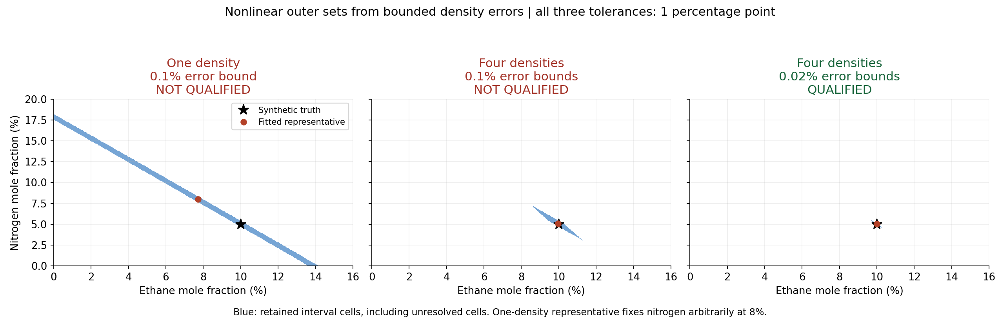
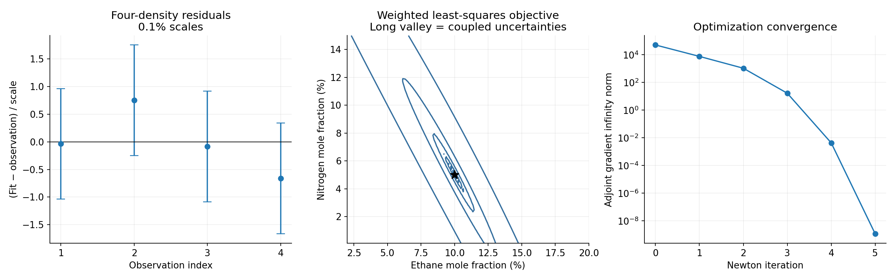
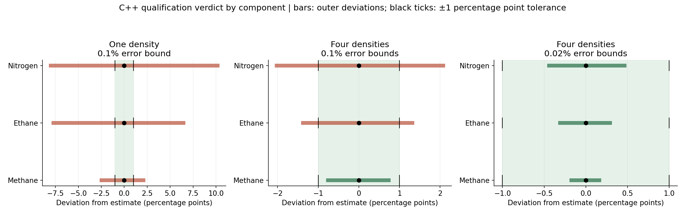

# Reconstructing a gas mixture with Peng–Robinson

We want to infer the composition of a gas from measured bulk thermodynamic
properties. A property evaluator answers “what density does this composition
produce?” Our inverse problem asks “which compositions could have produced these
densities, and how accurately have we determined each component?” Those are
different questions: an excellent fit can coexist with large composition
uncertainty.

This example uses the actual scalar CPU backend of
[ThermoGPU](https://github.com/rdm375/ThermoGPU), pinned at
`5a1a4174231a389b1724571eb646d48bfddb98e7`. The required upstream files and license
are included unchanged in `third_party/ThermoGPU`. We use the library's mixture
rule, precise PR constants, cubic solver, largest-root selection, density, and
root diagnostics. We add an analytically differentiated composition adapter and
inverse experiment; we do not replace its forward EOS implementation.

The experiment is deliberately small: a **known three-component species list**,
unknown mole fractions, and density observations at known temperatures and
pressures. Species discovery, uncertain temperature/pressure, interaction
parameter estimation, phase equilibrium, and EOS discrepancy are outside this
first experiment. Its qualification verdict is conditional on these assumptions.

## Run and inspect the result

```bash
make gas
make gas-plots
make test
```

No CUDA, GPU, or external package is needed to compile the C++20 example. Plotting
requires Python, NumPy, and Matplotlib. All thermodynamics, optimization,
derivatives, interval subdivision, and qualification decisions run in C++20.
Python renders the CSV outputs.

| Experiment | Composition result at tolerance 0.01 per mole fraction |
|---|---|
| One density, 0.1% bounded error | Not qualified |
| Four densities, 0.1% bounded errors | Methane qualifies; ethane and nitrogen do not |
| Four densities, 0.02% bounded errors | All three qualify |

Here 0.01 means **one absolute percentage point**, not 1% of a component's value.
There is no qualification time in this static experiment. The qualification
variable is which observations and accuracy bounds are available.



Blue cells form conservative outer sets. Every composition consistent with the
bounded observations and stated prior domain is retained. Some retained cells
may contain no feasible point: subdivision produces an enclosure, not an exact
contour. The one-density red marker is one fitted representative obtained by
arbitrarily fixing nitrogen at 8%; the observations do not identify that choice.
In the other panels the marker is the nonlinear least-squares estimate. The
black star marks the synthetic truth.

## 1. Specify what is unknown

Let the component order be methane, ethane, nitrogen. Use two independent controls

\[
\boldsymbol\xi=(e,n),\qquad
\boldsymbol x=(1-e-n,e,n).
\]

These are mole fractions. The relation enforces the sum-to-one constraint exactly
at the mathematical level. The optimization accepts only interior controls
\(e>0,n>0,e+n<1\). We use interior Newton stationarity, not a boundary KKT solver.
The qualification domain additionally imposes

\[
0\le e\le0.30,\qquad0\le n\le0.20.
\]

Thus methane is at least 50%. This is an explicit piece of prior physical
information; it is not a regularization term or an inferred conclusion. Boundary
compositions are included in qualification even though the optimizer is interior.

The synthetic truth is \((x_{CH_4},x_{C_2H_6},x_{N_2})=(0.85,0.10,0.05)\).
It lets us test recovery and enclosure without claiming to validate PR against
real experimental measurements.

The component constants come directly from upstream `data/components.csv`:

| Component | Critical temperature (K) | Critical pressure (Pa) | Acentric factor | Molar mass (kg/mol) |
|---|---:|---:|---:|---:|
| Methane | 190.564 | 4599200 | 0.01142 | 0.01604246 |
| Ethane | 305.322 | 4872200 | 0.0995 | 0.03006904 |
| Nitrogen | 126.192 | 3395800 | 0.0372 | 0.0280134 |

All nine binary interaction coefficients are explicitly set to zero. Upstream's
CSV supplies diagonal zero entries only; we do not interpret it as a measured
off-diagonal interaction database.

## 2. Define the forward thermodynamic map

For each species, ThermoGPU evaluates

\[
a_i=\Omega_a\frac{R^2T_{c,i}^2}{P_{c,i}},\quad
b_i=\Omega_b\frac{RT_{c,i}}{P_{c,i}},\quad
\alpha_i(T)=\left[1+\kappa_i(1-\sqrt{T/T_{c,i}})\right]^2,
\]

\[
\kappa_i=0.37464+1.54226\omega_i-0.26992\omega_i^2.
\]

Its constants are \(\Omega_a=0.4572355289213822\),
\(\Omega_b=0.0777960739038884\), and
\(R=8.31446261815324\) J/(mol K). We retain those precise constants throughout.
The mixture coefficients are

\[
a_m=\sum_i\sum_jx_ix_ja_{ij},\quad
a_{ij}=\sqrt{a_i\alpha_i a_j\alpha_j}(1-k_{ij}),\qquad
b_m=\sum_i x_i b_i,\qquad M=\sum_i x_iM_i.
\]

At known \((T,P)\), define \(A=a_mP/(RT)^2\), \(B=b_mP/(RT)\).
The compressibility factor solves

\[
F(Z,A,B)=Z^3+(B-1)Z^2+(A-3B^2-2B)Z-AB+B^2+B^3=0.
\]

The upstream evaluator selects its largest real root and returns

\[
\rho(T,P;\boldsymbol\xi)=\frac{PM(\boldsymbol\xi)}{ZRT}.
\]

Our inverse adapter rejects multiple-root diagnostics and near-multiple roots
\(|F_Z|<10^{-5}\). The fitted states have unique roots, small cubic residuals,
and negative isothermal \(\partial P/\partial v\), which we test. These checks
support the chosen smooth gas branch; they do not implement a mixture stability
or vapor–liquid equilibrium calculation. No claim of global phase stability is
made.

## 3. Construct observations and distinguish error models

The four thermodynamic conditions are

| Index | Temperature (K) | Pressure (MPa) |
|---|---:|---:|
| 1 | 300 | 1 |
| 2 | 300 | 5 |
| 3 | 350 | 10 |
| 4 | 400 | 20 |

At the truth, generate \(\rho_j^*\). Set scales
\(s_j=\epsilon\rho_j^*\) and retain the deterministic synthetic record

\[
y_j=\rho_j^*+s_jd_j,\qquad
(d_1,d_2,d_3,d_4)=(0.4,-0.6,0.2,0.8).
\]

The baseline uses \(\epsilon=0.001\); the improved-precision experiment uses
\(\epsilon=0.0002\) and generates its own new observations at those scales.
These are reproducible synthetic data, not random samples or laboratory data.
The noiseless test separately sets every perturbation to zero.

For fitting we minimize weighted least squares,

\[
J(\boldsymbol\xi)=\frac12\sum_j
\frac{[\rho_j(\boldsymbol\xi)-y_j]^2}{s_j^2}.
\]

This is also the Gaussian negative log likelihood up to a constant **if** the
scales are known independent Gaussian standard deviations. The local covariance
below uses that interpretation only as an optional linear indicator.

For nonlinear qualification, instead assume deterministic bounds
\(|\rho_j(\boldsymbol\xi)-y_j|\le s_j\). This is a different uncertainty model.
The interval results are not “95% Gaussian confidence sets.” The synthetic truth
satisfies these bounds because every \(|d_j|<1\).

We use mass density directly. We do not count density and a compressibility
computed from that same density as independent measurements. Multiple pressures
and temperatures change PR's composition sensitivities and can supply additional
information.

## 4. Differentiate the same forward map

There are no finite-difference gradients in optimization. With \(Z\) held fixed,
write subscripts \(i,j\) for composition derivatives including the dependence of
\(A\) and \(B\) on \(e,n\). Differentiating \(F(Z(\boldsymbol\xi),\boldsymbol\xi)=0\)
gives

\[
F_ZZ_i+F_i=0,\qquad Z_i=-F_i/F_Z.
\]

Differentiate once more:

\[
Z_{ij}=-\frac{F_{ij}+F_{Zi}Z_j+F_{Zj}Z_i+F_{ZZ}Z_iZ_j}{F_Z}.
\]

A small second-order forward AD adapter evaluates the partials of the polynomial
and mixture coefficients. It seeds \(Z\)'s **value** with the actual ThermoGPU
root, then uses these implicit formulas to obtain its first and second
derivatives. Differentiating \(PM/(RTZ)\) completes the density gradient and
Hessian. This differentiates the smooth EOS root map, rather than branching
through Cardano's implementation or holding \(Z\) constant.

For a density residual \(r_j=\rho_j-y_j\), the cost derivatives are

\[
\nabla J=\sum_j\frac{r_j}{s_j^2}\nabla\rho_j,\qquad
H_J=\sum_j\frac{\nabla\rho_j\nabla\rho_j^T+r_jH_{\rho_j}}{s_j^2}.
\]

The second residual-curvature term is included in the incremental adjoint.
The Gauss–Newton information matrix omits it deliberately; it is not generally
the exact Hessian for noisy observations.

## 5. Connect to our discrete optimality library honestly

This is a static specialization of `System<2,2>`. The state is composition,
\(X_0=\boldsymbol\xi\), and its carry equation is \(X'=0\). Observation nodes
are experiment indices, not physical elapsed time. The theta update is exactly

\[
X_{j+1}=X_j.
\]

Each node has an unweighted observation cost. There is no running integral to
approximate, and no meaningful temporal truncation error. The tangent gives
\(S_0=I\), \(S_{j+1}=S_j\). If \(\ell_{j,X}\) is that node's cost gradient,
the discrete adjoint is

\[
\lambda_m=\ell_{m,X},\qquad
\lambda_j=\ell_{j,X}+\lambda_{j+1},\qquad
\nabla_{\xi}J=\lambda_0.
\]

We actually execute the library's forward, tangent, adjoint, goal pullback,
incremental adjoint, and Newton optimizer; these are not merely formulas added
after fitting. Their results are checked against independent composition chain
rules. The cost uses the library's nodal cost mechanism.

**This example does not exercise nontrivial time stepping or running-cost
quadrature.** Those remain covered by decay and temperature tests, including
second-order convergence for theta = 0.5. Changing theta here must leave the fit
unchanged, which is tested. A later dynamic tank experiment can couple this EOS
to a genuine evolution model. Claiming quadratic temporal convergence for this
static experiment would be misleading.

The Newton driver accepts an optional `cost_roundoff_slack` (default zero). This
example sets it to \(10^{-11}\) in dimensionless cost units: tiny thermodynamic
root evaluation differences can obscure the final Armijo decrease. The explicit
adjoint gradient stopping test remains \(10^{-7}\). The slack does not relax
stationarity or measurement bounds. Nearby starting guesses converge to the
same solution; the interior Newton solver is not a global constrained optimizer.
Distant guesses can approach a simplex boundary and fail its line search.

## 6. Interpret the fitted composition and information

For the baseline four-density record the result is approximately

\[
(\hat x_{CH_4},\hat e,\hat n)
=(0.849314248675,0.099595241490,0.051090509835),
\qquad J=0.505918409.
\]

The noiseless record reconstructs the truth to numerical accuracy. With noise,
recovering the truth exactly is neither expected nor the optimization objective.

For a single density, its Jacobian row is \(g^T\), so its information matrix is
\(gg^T/s^2\), rank at most one. The nonzero direction \((g_2,-g_1)\) is invisible
to the linearized observation. Thus one excellent scalar fit cannot locally
identify two unknown fractions. Our one-density representative fixes nitrogen
at 8% and solves the remaining scalar density equation by bisection. That
arbitrary choice is explicitly not a recovered nitrogen concentration.

For four measurements, form

\[
I=\sum_jg_jg_j^T/s_j^2,\qquad C_{\mathrm{local}}=I^{-1}.
\]

The library goal pullbacks supply these control sensitivities. The reported local
standard deviations are approximately 0.0025694 for ethane and 0.0046550 for
nitrogen. They describe a local Gaussian approximation under the Gaussian model;
they are not the nonlinear bounded-error qualification result.



The residual panel shows the fit errors divided by the density scales. The
objective contours expose a long valley: ethane and nitrogen can partially
compensate in bulk density. The final panel plots the actual adjoint gradient
norm during Newton iterations. A small gradient establishes stationarity, not
composition qualification.

## 7. Enclose the full nonlinear feasible set

To avoid using a local ellipse as a global certificate, define

\[
\mathcal F=\{\boldsymbol\xi\in D:
|\rho_j(\boldsymbol\xi)-y_j|\le s_j\ \text{for every }j\}.
\]

For a candidate composition cell, interval arithmetic encloses all mixture
coefficients and molar masses in that cell. Each measured density is allowed to
range over \([y_j-s_j,y_j+s_j]\); molar volume consequently lies in the interval
\(v=M/\rho\). We then evaluate the PR pressure equation

\[
P=\frac{RT}{v-b_m}
-\frac{a_m}{v(v+b_m)+b_m(v-b_m)}
\]

over these intervals. If the known observed pressure is outside the resulting
interval, no point in the cell can satisfy that observation; discard the cell.
Otherwise bisect its longest side until its width is at most the requested
resolution. Unresolved denominator signs cause retention, never exclusion.
The algorithm starts from the entire stated prior rectangle, so it also retains
separate feasible regions if they exist. Its pressure test is necessary rather
than sufficient: it may retain other roots or infeasible points, making the
outer set conservative.

Each arithmetic operation expands its bounds with `std::nextafter`. This is an
outward enclosure for the fixed floating-point coefficient model used here,
compiled without fast-math. Component constants and temperature-dependent
coefficients returned by ThermoGPU are held fixed; their empirical uncertainty,
transcendental evaluation error, and EOS model error are not independently
certified. This is not a metrological or real-gas accuracy guarantee. It is a
nonlinear composition enclosure conditional on the specified PR model and
measurement bounds.

Baseline subdivision resolution is 0.0005 per independent mole fraction; the
improved-precision case uses 0.000125. Smaller cells can reduce conservatism but
cannot manufacture information absent from the observations. The maximum box
budget is explicit; exceeding it stops the program rather than claiming success.

For each component, take the minimum and maximum over every retained cell.
Methane uses \(1-e-n\), with outward arithmetic. If its outer interval is
\([L_k,U_k]\), our bound about the reported representative is

\[
E_k=\max(|L_k-\hat x_k|,|U_k-\hat x_k|).
\]

We qualify component \(k\) only when \(E_k\le0.01\); all requested components
qualify only when every component does. No temporal persistence condition applies.



Bars show nonlinear outer deviations from the representative; black dots mark
zero deviation and black ticks the plus/minus one-percentage-point tolerance. Green/red colors come from C++ verdict fields.
The four-density baseline certifies methane, while its ethane and nitrogen
bounds remain too wide. At improved precision the worst bounds are approximately
0.0017183, 0.0030929, and 0.0046647 for methane, ethane, and nitrogen respectively:
all are below 0.01.

## 8. What we validate and what remains to test

The executable checks noiseless truth recovery, convergence from several nearby
starts, implicit density gradients and Hessians, the library tangent and adjoint
pairing, off-solution cost gradients, exact incremental adjoints, Hessian
symmetry, the single-measurement null direction, full-rank information for four
measurements, independent density-to-pressure consistency, and mechanical
stability at the fitted states. Qualification checks retain the synthetic truth
and feasible probe points and test the expected separate verdicts.

Finite differences are validation references only. `derivative_check.csv` records
a perturbation sweep for the Hessian-vector product: the central-difference
error decreases quadratically before EOS evaluation roundoff dominates. This is
**derivative-check convergence**, not theta convergence. Both the analytic
control derivative tests and the noiseless reconstruction are more informative
than checking the residual at one fitted point alone.

Useful next experiments are real measurements with calibrated error bounds,
uncertain pressure and temperature, nonzero measured interactions, additional
species, different thermodynamic observables with their measurement covariance,
phase-aware composition constraints, and finally a transient energy or mass
balance. Those changes require explicit model and uncertainty extensions.

Files to start with:

- `examples/peng_robinson_model.hpp`: upstream adapter, implicit derivatives,
  observations, static optimality system, and information matrix.
- `examples/peng_robinson_bounds.hpp`: outward interval operations and nonlinear
  set subdivision.
- `examples/peng_robinson_inverse.cpp`: experiment, numerical checks, output,
  and qualification decisions.
- `third_party/ThermoGPU/PROVENANCE.md`: pinned source and license details.
- `results/peng_robinson/`: data, checks, optimizer trace, outer cells, decisions,
  objective surface, and figures.
