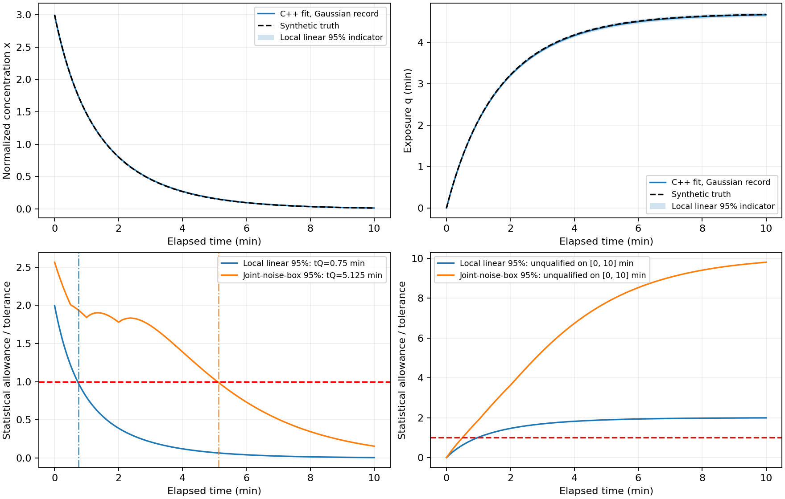
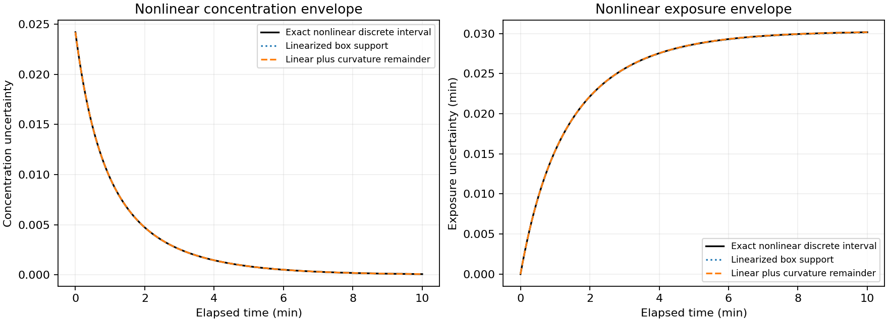
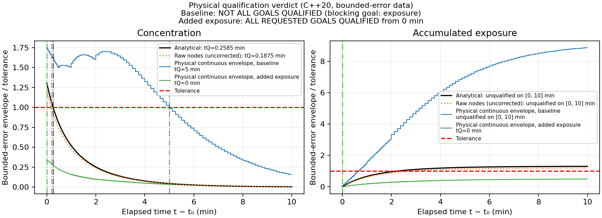
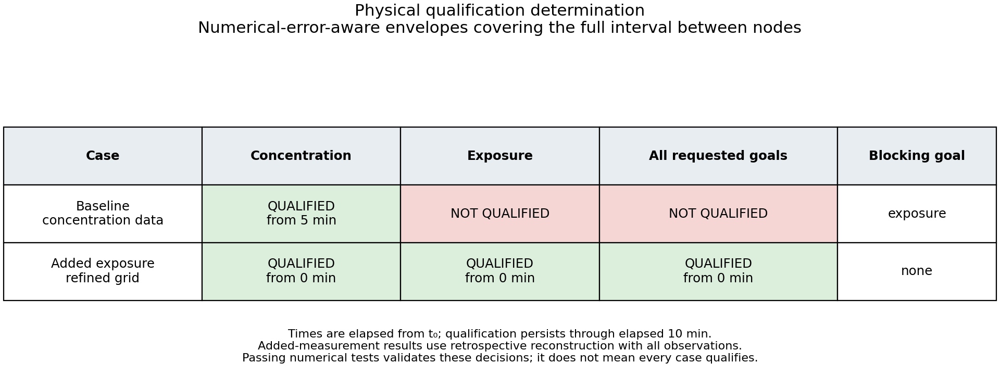
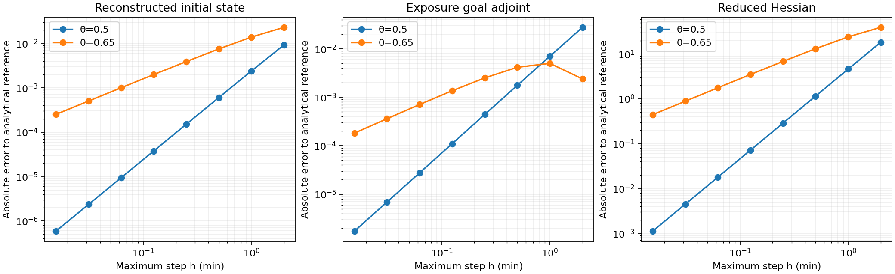
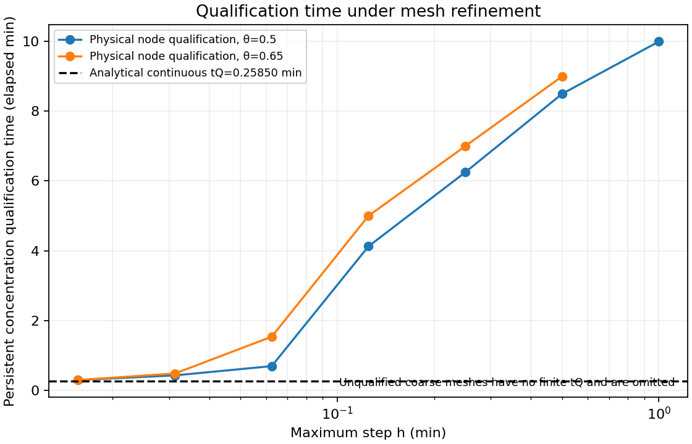

# Decay state qualification using the C++20 discrete optimality library

## What we want to establish

A reconstructed state is useful only if the engineering predictions made from it are accurate enough. Here we ask two specific questions: when is instantaneous concentration known to within **0.02**, and when is accumulated exposure known to within **0.025 minutes**? The second question can have a different answer because exposure retains the integral of earlier uncertainty after concentration differences have decayed.

This experiment performs the complete numerical workflow in C++20: synthetic measurement records, theta forward solves, measurement-cost assembly, tangent propagation, adjoint optimization, exact incremental-adjoint curvature, measurement information, goal adjoints, local statistical uncertainty, nonlinear bounded-error sets, discretization allowances, interval-wide prediction envelopes, and qualification decisions. The optional Python script only reads the C++ CSV outputs and draws plots. Analytical state and derivative formulas are independent references; they are not substituted into numerical forward steps or the inverse optimizer.

## 1. Physical model, controls, and measurements

We retain $t\in[t_0,t_f]=[2,12]$ minutes, with elapsed time $\tau=t-t_0$. Normalized concentration $x$ is dimensionless and accumulated exposure $q$ has units of minutes:

$$
\dot x=-a x-bx^2,\qquad\dot q=x,
\qquad a=0.5,\quad b=0.1,
\qquad x(t_0)=\xi>0,\quad q(t_0)=0.
$$

Only the initial concentration $\xi$ is unknown. Initial exposure and the two coefficients are known exactly. We do not include parameter, boundary-condition, or model-form uncertainty. Synthetic truth is $\xi^\dagger=3$. The observation offsets are $0,0.25,0.5,1,2,4,6,8,10$ minutes. Every mesh contains these times exactly.

There are **two separate measurement records**, retained from the earlier Python experiment. The Gaussian record has independent zero-mean errors with known standard deviation $\sigma=0.03$. The bounded record was generated with independent uniform errors in $[-0.04,0.04]$; its qualification analysis only requires the absolute error bound $\delta=0.04$, not a probability distribution. Values are embedded as constants and exported by the C++ executable, so results do not depend on a C++ random-number distribution implementation. The original Gaussian record used seed 20261017 and the bounded record used seed 2711.

## 2. Use the actual discrete optimality system for reconstruction

The library advances $(x,q)$ with the same theta update described in the formulation notes. The inverse objective is now the measurement functional

$$
J_h(\xi)=\frac12\sum_j\frac{[x_h(t_j;\xi)-y_j]^2}{\sigma^2}.
$$

These are isolated observations, so their costs are **nodal terms**. A sample is not multiplied by a time interval merely because the integration mesh is refined. The library's new `Problem::nodal` interface assembles their values and derivative sources consistently. If a true running cost is included, the existing theta quadrature still applies to that term. The earlier verification objective involving a running penalty, terminal target, and prior remains a separate test; it is not the assimilation objective here.

At each optimizer iteration, the library solves the nonlinear forward trajectory, forms observation residuals, solves the discrete adjoint, and obtains the reduced gradient. It uses its tangent and incremental adjoint to form the full reduced Hessian. The C++ Newton driver starts at $\xi=1$; analytical gradients never drive this optimization. For the bounded record we use the same concentration-residual normalization as a least-squares fitting convention, without interpreting that weight as a Gaussian noise model.

The primary mesh has 16 subdivisions of each observation interval, 128 steps total, $h_{\max}=0.125$ minutes, and $\theta=0.65$. Its Gaussian fit is **2.99165245072**, compared with the analytical-model fit **2.99363982414**. The final adjoint gradient magnitude is about $1.1\times10^{-10}$. The bounded-data fits are **3.01115208985** numerically and **3.01314630678** analytically.

## 3. Measurement information and goal adjoints

The tangent gives $S_j=\partial x_h(t_j;\xi)/\partial\xi$. Local information is

$$
I_h=\sum_j S_j^2/\sigma^2,\qquad P_h=I_h^{-1}.
$$

The executable also computes this information through a tangent–adjoint action: propagate a unit control direction, apply observation weights to its measurement perturbations, and pull those sources backward using `state_pullback`. The two values must agree. On the primary fit, $P_h\approx0.000415566723442$.

The full reduced objective Hessian contains additional residual-weighted curvature. We use that full Hessian for optimization, and the Gauss–Newton/Fisher information $I_h$ for the local noise indicator. They are not interchangeable.

For either prediction goal $G_h(t)=x_h(t)$ or $q_h(t)$, `goal_gradient` puts a state source at the chosen time node and solves the same discrete adjoint backward. The resulting scalar $g_h(t)$ is compared with the corresponding tangent component at every primary-grid node. Local linearized prediction variance is

$$
V_G(t)=g_h(t)^2P_h,
\qquad E_{G,\mathrm{local95}}(t)=1.9599639845\sqrt{V_G(t)}.
$$

These are local statistical indicators, not exact finite-noise confidence statements for nonlinear estimation. The concentration indicator eventually falls below its tolerance; exposure grows from zero and can remain too uncertain for persistent qualification.



The upper panels show the Gaussian-record reconstruction with local uncertainty bands. The lower panels compare those local indicators with a different, finite-noise construction described next. A local indicator can be much tighter because the finite-noise construction protects a simultaneous observation-error event and includes numerical error.

## 4. A nonlinear finite-noise confidence construction

For $m=9$ independent Gaussian errors, select $d$ such that

$$
\Pr(|e_j|\le d\text{ for every }j)
=[2\Phi(d/\sigma)-1]^m=0.95.
$$

The C++ helper uses the normal CDF and scalar bisection to obtain **$d=0.0829658875302$**. Inverting the nonlinear observation constraints $|x(t_j;\xi)-y_j|\le d$ produces a confidence set with 95% coverage of the fixed true initial state under the stated independent-Gaussian assumptions. This does not assume a Gaussian estimator distribution or linearize the observation map.

For this record, the analytical-model confidence interval is approximately **[2.94035318313, 3.02873261165]**. The numerical-error-aware outer interval on the primary mesh is **[2.94035318313, 3.04053391140]**. It encloses the analytical set, and numerical goal allowances are added when propagating it. Because all goal times are propagated from the same initial set, its mathematical event is simultaneous in the prediction goals; the plotted finite-noise envelopes are evaluated at nodes. This is a different construction from the local marginal $1.96$ indicator.

## 5. Nonlinear deterministic uncertainty from bounded observations

For the bounded record, define

$$
\mathcal A=\{\xi>0:|x(t_j;\xi)-y_j|\le0.04\text{ for all }j\}.
$$

Both $x(t;\xi)$ and $q(t;\xi)$ increase with $\xi$. Therefore each observation restricts an interval of initial concentrations, and their intersection is an interval. The analytical reference is

$$
\mathcal A=[2.98695499961,\;3.01635701136].
$$

The executable constructs this independently using the analytical trajectory, and constructs the numerical counterpart using repeated **library forward solves** and bracketed scalar inversions. Nonlinear interval endpoints are not obtained by linearizing a covariance.

For a chosen nominal fit $\widehat\xi$, the exact nonlinear envelope is

$$
E_G(t)=\max_{\xi\in\mathcal A}|G(t;\xi)-G(t;\widehat\xi)|.
$$

Monotonicity means evaluating both interval endpoints suffices. The nominal least-squares fit need not belong to the box-consistent set; least squares minimizes total residual rather than enforcing every individual error bound. Our envelope remains valid when the nominal fit is outside the interval.

The code separately checks the local support-plus-remainder construction

$$
E_{G,h}(t)\le |g_h(t)|r+\frac12 M_h(t)r^2,
\qquad r=\max_{\xi\in\mathcal A_h}|\xi-\widehat\xi_h|,
$$

where $M_h$ encloses discrete goal curvature over the hull containing the interval and nominal control. The discrete curvature enclosure is propagated analytically along the positive monotone theta branch, using the library's endpoint trajectories. Its agreement with the nonlinear endpoint envelope is tested in C++.



## 6. Include numerical error in inference as well as prediction

On the primary grid, using the same $0.04$ observation bounds with an uncorrected numerical forward model produces

$$
\mathcal A_h=[2.98695499961,\;2.99329198607].
$$

This interval **excludes the true value 3**, even though the discrete adjoint gradient is correct. A numerical model discrepancy has been mistaken for measurement information. Inflating only the final prediction band would not repair this invalid inferred set.

We instead compute a physical discretization allowance $\eta_x(t_j)$ uniform over the initial prior interval supplied by the initial observation, $[y_0-\delta,y_0+\delta]$. Then impose

$$
|x_h(t_j;\xi)-y_j|\le\delta+\eta_x(t_j).
$$

This gives an error-aware outer set $\mathcal A_h^+$ containing the analytical consistency set. On the primary mesh it is

$$
\mathcal A_h^+=[2.98695499961,\;3.04569360918].
$$

The final physical prediction error budget is

$$
E_G^{\mathrm{physical}}(t)
\le\max_{\xi\in\mathcal A_h^+}
|G_h(t;\xi)-G_h(t;\widehat\xi_h)|+\eta_G(t).
$$

Thus numerical error enters twice for two different reasons: observation preimages must be widened before inference, and numerical goal propagation must then be allowed for. The initial prior interval comes from measured data and its error bound; the code does not use synthetic truth to construct the numerical allowance.

## 7. How the computable physical allowance works

Let $x_h$ interpolate numerical concentration linearly on each step. Its defect is $d=x_h'+ax_h+bx_h^2$. The error $e=x_h-x$ satisfies

$$
e'=-[a+b(x_h+x)]e+d.
$$

On the positive branch, the contraction rate is at least $a$. If $|d|\le D_n$ on a step, then

$$
E_{n+1}=e^{-ah_n}E_n+\frac{1-e^{-ah_n}}aD_n
$$

encloses its endpoint concentration error. For $g(x)=ax+bx^2$, the piecewise-linear defect is monotone along a decreasing step and its endpoint magnitudes are bounded by

$$
D_n=\max(\theta_n,1-\theta_n)|g(x_n^{\rm upper})-g(x_{n+1}^{\rm upper})|
+\varepsilon_{\rm solve}/h_n.
$$

The upper trajectory starts at the prior's upper endpoint. The positive monotone step condition is checked; it ensures the endpoint difference bounds all initial conditions in the interval. Integrating the concentration error gives the exposure allowance. The difference between theta exposure quadrature and the linear reconstruction's trapezoidal integral adds $h_n|\theta_n-1/2||x_{n+1}^{\rm upper}-x_n^{\rm upper}|$ per completed step. The configured nonlinear solve tolerance is included in both state and exposure allowances.

These formulas use only numerical trajectories, known dynamics, step sizes, and solve tolerances. Analytical solutions are used afterward to test them. The defect bound is intentionally conservative and can converge more slowly than the actual second-order state error. It is evaluated in ordinary floating point; this is not a directed-rounding interval implementation.

## 8. Qualification over the whole time horizon

Persistent qualification means the chosen total error envelope remains below tolerance for every later time up to $t_f$. The C++ program reports node-only results separately, and also builds **whole-step envelopes** relative to the piecewise-linear numerical nominal trajectory.

For concentration on a step, the numerical endpoint spread is bounded by the larger spread at the two endpoints. The concentration discrepancy allowance is bounded by the larger endpoint $E$ because the scalar constant-defect comparison solution is monotone over that step.

For exposure, an intermediate-step allowance starts from the previous endpoint allowance, adds the full-step integral of the concentration comparison bound, and adds $h_n\max(\theta_n,1-\theta_n)|x_{n+1}^{\rm upper}-x_n^{\rm upper}|+\varepsilon_{\rm solve}$ to cover the difference between the linearly reconstructed exposure and the concentration integral at any point inside the step. Combining this with the larger numerical endpoint spread encloses the entire step. Taking suffix maxima of these step bounds gives continuous-time qualification from a reported step start through $t_f$ under the stated assumptions.

The analytical bounded-data reference qualifies concentration after **0.258496929913 minutes**, while exposure remains unqualified. The primary numerical model with its conservative physical allowance qualifies concentration after **5 minutes** and still cannot qualify exposure. Its uncorrected discrete envelope suggests **0.1875 minutes**, but that inference used an interval excluding truth and is not physically justified.



The black curves show analytical bounded-data envelopes. The dotted orange curves show what the uncorrected numerical model would suggest. The blue step envelopes include numerical error in both inference and prediction, and cover the entire time step. Qualification occurs only after all subsequent envelopes stay below the red tolerance line. A transient early crossing is insufficient. `nan` in an output CSV means no qualification over the given horizon, not a time of zero.

The C++ test output now ends with a readable qualification-time table. Its companion `qualification_times.csv` records the case, criterion, goal, status, elapsed qualification time, and absolute time. Unqualified entries have an explicit status and empty time fields, while a zero time explicitly means qualification from the beginning. Existing numerical summary columns retain `nan` for compatibility. The plots read this C++ report, draw vertical qualification-time markers, and put the time or the unqualified status in the corresponding curve legend. Analytical, uncorrected node-only, physical continuous, local Gaussian, and joint-noise-box results remain separately identified.

After the diagnostic table, the program prints a separate **PHYSICAL QUALIFICATION DETERMINATION** for the bounded-data baseline and added-exposure case. Each determination states **concentration qualified**, **exposure qualified**, and **all requested goals qualified**, or explicitly says **NOT QUALIFIED** and identifies the blocking goal. The joint persistent time is the maximum of the two individual persistent times if both exist; otherwise joint qualification is not established. Thus the baseline concentration qualifies after 5 minutes, but the baseline **does not qualify for all requested goals** because exposure remains unqualified. The added-measurement case qualifies both goals, jointly, from elapsed zero. Test success means the code correctly reproduces both expected outcomes, not that every reconstruction qualifies. “Not qualified” means the stated measurements and error budgets do not establish the requested accuracy; it does not by itself prove the actual prediction error exceeds tolerance.



`qualification_decisions.csv` stores the per-goal and joint statuses, times, and blocking goals in C++20. The renderer uses those stored decisions for the final verdict figure and qualification-plot heading; it does not reinterpret local confidence indicators as continuous physical qualification. Both physical decisions use bounded-error data, include numerical model error, and cover the entire interval between time nodes.

## 9. Add information that targets the unqualified goal

We now assimilate a bounded exposure measurement at elapsed time 2 minutes, $y_q=q(2;3)+0.002$, with absolute error bound 0.005 minutes. It is an additional nodal cost in the actual optimizer; its exposure-state adjoint source and Hessian contribution are checked against finite differences. For the bounded-data least-squares convention, its residual is normalized by 0.005; that weight is not asserted to be a Gaussian standard deviation.

The analytical initial consistency interval narrows to **[2.99672752584, 3.00763959202]**. The updated analytical fit is **3.00291274763**. We use $\theta=0.5$ with 512 subdivisions per observation interval (4096 steps, maximum step 0.00390625 minutes) so the conservative numerical allowance is small compared with the new sensor's accuracy. The library obtains fit **3.00291266101** and the error-aware outer set **[2.99590167907, 3.00846613677]**.

Both concentration and exposure then meet their tolerances over the entire reconstructed horizon, including between nodes. The green envelopes in the figure include both the added measurement and its numerical error budget. This is an actual numerical assimilation and qualification result, not just an analytical sensor thought experiment. It is retrospective reconstruction using all observations; qualifying the state at $t_0$ does not mean the future exposure measurement was available at $t_0$.

## 10. Validate the measurement-to-qualification workflow

The executable checks analytical set containment, true-state containment, numerical physical allowances against multiple exact trajectories, nonlinear curvature envelopes, tangent/adjoint information equivalence, goal adjoints against tangents, and observation-cost gradients and Hessians against finite differences. Added exposure contributions are checked explicitly. Whole-step envelopes are independently sampled at quarter, midpoint, and three-quarter times against the analytical truth; their mathematical derivation, not this sampling alone, supplies the between-node bound.

Across eight nested observation-aligned meshes for each theta, it repeats the inverse solve, bounded-data inversion, and physical qualification analysis. For $\theta=0.5$, the measured finest-pair orders for state, cost, tangent, exposure goal adjoint, gradient, Hessian, and reconstructed control are all within about $6\times10^{-5}$ of two. The corresponding $\theta=0.65$ values approach one. This is convergence of the measurement-driven inverse problem, separately from the earlier running-cost verification example.





Qualification times and conservative envelope widths need not converge at second order: a conservative defect bound, a threshold crossing, and reporting only step starts can set different rates. The C++ refinement CSV records node qualification times and initial-set endpoints alongside the state/derivative/control errors; it does not label every qualification output second order.

## Reproduce and inspect the C++ outputs

```bash
make test qualification
```

No Python package is required for that computation. To redraw figures afterward:

```bash
python3 -m pip install matplotlib
python3 tools/plot_qualification.py
```

`make test` includes the state-qualification run and its time table. `make validation` runs only the library validation. `make test qualification-plots` runs all checks and renders the annotated figures.

`examples/decay_qualification_model.hpp` defines data, observation costs, nonlinear preimage intersections, and decay-specific error/curvature allowances. `examples/decay_qualification.cpp` assembles and executes the workflow using `System`, `minimize`, `goal_gradient`, `state_pullback`, and the qualification helpers. The generic library implements the discrete optimality machinery; it has no decay-specific hidden solve.

`results/qualification/summary.csv` records fits, intervals, qualification times, and convergence orders. `checks.csv` records every test and tolerance. `observations.csv`, `curves.csv`, `continuous_envelopes.csv`, `added_exposure.csv`, and `refinement.csv` contain the C++ numerical outputs used by the figures. The library's standard validation suite separately tests mixed running/nodal costs, direct-control derivatives, global block-system equivalence, and qualification helper behavior.
