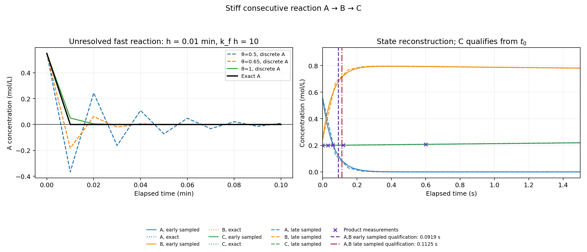
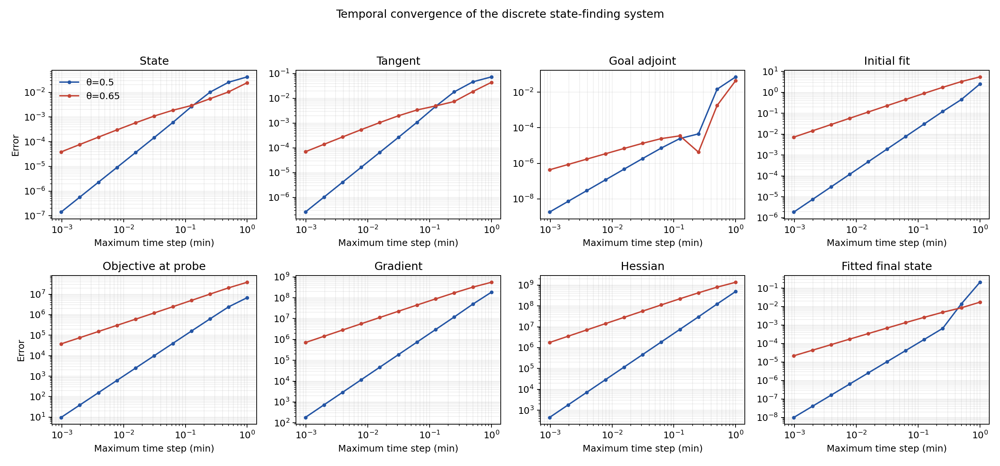
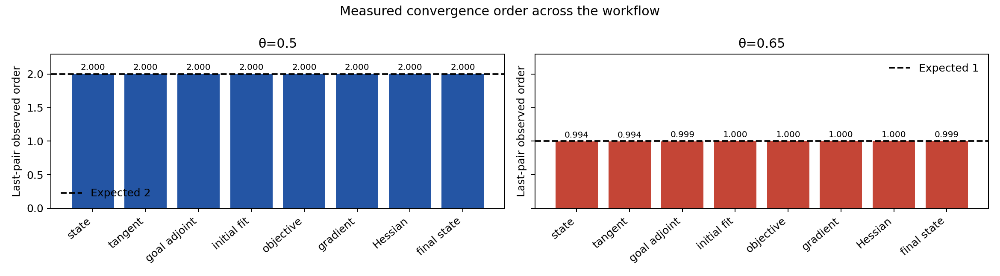

# Stiff consecutive reaction: full discrete state-finding test

## Purpose

This example tests the shared theta-method optimality system on a chemical
system with two very different reaction timescales. It asks two separate
questions:

1. Does the discrete forward and inverse workflow converge to the exact
reaction solution when the fast timescale is resolved?
2. What can go wrong when a stable theta step is much larger than the fast
reaction timescale, even though the slow reaction is well resolved?

The mechanism is the consecutive first-order reaction

$$
A \xrightarrow{k_f} B \xrightarrow{k_s} C,
\qquad k_f=1000\;\mathrm{min}^{-1},\quad
k_s=1\;\mathrm{min}^{-1}.
$$

The fast-to-slow rate ratio is 1000. The corresponding half-lives are about
0.000693 min (0.0416 s) and 0.693 min (41.6 s). Concentrations are in mol/L,
time is in minutes, and the known total concentration is 1 mol/L.

## Independent exact solution

Mass action gives

$$
\dot A=-k_f A,\qquad
\dot B=k_f A-k_s B,\qquad
\dot C=k_s B.
$$

Because $A+B+C$ is conserved, the implementation uses the two independent
states $\boldsymbol x=(A,B)^T$ and reconstructs $C=1-A-B$. The dynamics are
linear, with

$$
\boldsymbol x(t)=\begin{bmatrix}
e^{-k_f\tau} & 0\\
\dfrac{k_f}{k_f-k_s}\left(e^{-k_s\tau}-e^{-k_f\tau}\right)&e^{-k_s\tau}
\end{bmatrix}\boldsymbol\xi,
\qquad \tau=t-t_0.
$$

This exact propagator provides independent state and sensitivity references.
There is no estimation of rate constants: both rates and the total concentration
are known. The unknown control is only the initial composition
$\boldsymbol\xi=(A(t_0),B(t_0))^T$.

The true initial composition used to generate the observations is
$(0.55,0.25,0.20)$ mol/L. The stated prior is

$$
0.05\le A(t_0)\le0.80,\quad
0.05\le B(t_0)\le0.80,\quad
A(t_0)+B(t_0)\le0.90.
$$

The final inequality ensures a nonnegative initial $C$. The experiment observes
only product concentration $C(t)$, with deterministic perturbations generated
at a nominal sensor standard deviation of $5\times10^{-6}$ mol/L. The bounded
data analysis allows each observation an error of at most twice that value.

## Why this is a stiffness test

For the isolated fast mode, a theta step of size $h$ has amplification factor

$$
R(-k_fh)=\frac{1-(1-\theta)k_fh}{1+\theta k_fh}.
$$

The diagnostic uses $h=0.01$ min, so $k_fh=10$. The exact fast-mode factor over
that step is $e^{-10}=4.54\times10^{-5}$. The discrete factors are:

| Method | Fast-mode factor | Consequence at this coarse step |
|---|---:|---|
| $\theta=0.5$ | $-0.6667$ | Stable, but the fast mode changes sign and decays very slowly numerically. |
| $\theta=0.65$ | $-0.3333$ | More damping, but still sign-changing and far from the exact decay. |
| Backward Euler, $\theta=1$ | $0.09091$ | Stronger damping and nonnegative species in this diagnostic. |

The midpoint result is stable in the linear stability sense but produces
negative intermediate species concentrations. The example deliberately does
not hide this by clipping concentrations or constraining the forward solve.
That distinction matters: stability, positivity, and accuracy are different
properties. The conserved total remains exactly one because $C$ is reconstructed
from $A+B$.

## State finding and measurement timing

The C++ program runs two product-sensor schedules. `early_sampled` includes
several measurements during the fast transient; `late_sampled` begins after
the fast reaction has largely completed. Both use the same rate constants,
noise scale, prior, final time, and exact physical model. The first schedule
contains nine observations; the second contains seven.

For each schedule, the program:

1. Generates the noisy product data from the exact solution.
2. Runs the library's implicit theta forward model and minimizes the matching
   sum of isolated nodal least-squares costs.
3. Compares the numerical estimate with the exact least-squares estimate for
   the same retained data.
4. Checks the tangent against state finite differences, the discrete adjoint
   gradient against cost differences, the incremental-adjoint Hessian-vector
   product against gradient differences, and the Hessian against the exact
   information matrix.
5. Builds a bounded feasible polygon in the stated initial-composition prior.
   Its measurement bounds include the sensor allowance and a numerical-model
   discrepancy allowance computed over the prior polygon's vertices.
6. Propagates every feasible polygon vertex through the exact reaction
   solution. For each species and each time interval, it computes the maximum
   absolute deviation from the polygon's vertex-average reference. The
   two-exponential formula is checked at interval endpoints and at any interior
   stationary point, so the qualification envelopes cover between-node times.

The requested tolerance is 0.005 mol/L for each species. Product concentration
$C$ qualifies from $t_0$ because the known total and product observations tightly
constrain it. The hidden reactant and intermediate concentrations do not
qualify initially; their uncertainty falls below tolerance after the rapid
transient. The current run reports persistent qualification at approximately
0.00153125 min (0.0919 s) for the early schedule and 0.001875 min (0.1125 s)
for the late schedule. These are retrospective decisions using all observations
through $t_f=2$ min.

The fit itself is unconstrained Newton optimization. The prior and its feasible
set are used for the bounded qualification calculation; they are not silently
treated as optimizer constraints.

## Temporal convergence of the complete workflow

For the early observation schedule, the mesh is refined independently on every
fixed observation interval. The same observation times and data are used on all
grids. The C++ program compares the discrete results with the exact propagator
and exact observation least-squares problem for eight quantities:

- state;
- tangent sensitivity;
- goal adjoint;
- recovered initial composition;
- objective at a fixed nonoptimal composition;
- objective gradient;
- Hessian;
- fitted final state.

The last refinement pair gives rates close to two for $\theta=0.5$ and close to
one for $\theta=0.65$. The objective is evaluated at a fixed probe composition
so its rate is not artificially raised by evaluating a nearly stationary
optimized cost. The program checks the observed rates directly.

The right panel overlays the reconstructed discrete trajectories with their
analytic trajectories. Its vertical lines mark the persistent qualification
times for A and B under the early and late observation schedules; C is marked
as qualified from $t_0$. The time axis is in seconds so the fast-transient
qualification times can be read against the state evolution.







## Run it

Run the standalone C++ experiment:

```bash
make stiff-reaction
```

Run it and regenerate the figures:

```bash
make stiff-reaction-plots
```

The outputs are written beneath `results/stiff_reaction/`. `orders.csv` retains
the rate at every adjacent refinement pair; the console reports the final pair.
All modeling, forward solves, optimization, derivative calculations,
confidence-set construction, and qualification decisions run in C++20. Python
only renders the retained CSV files.

This example exercises the existing shared C++20 API. It adds no generic
library interface. It adds 76 case-specific checks covering stiffness response,
mass balance, physical positivity failure on unresolved midpoint steps,
reconstruction, tangent/adjoint/Hessian consistency, temporal convergence, and
bounded qualification.
