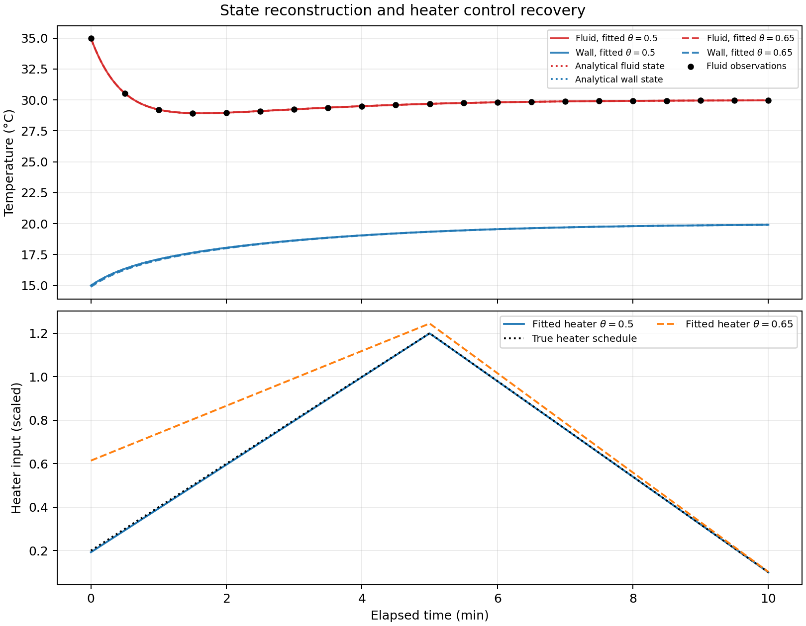
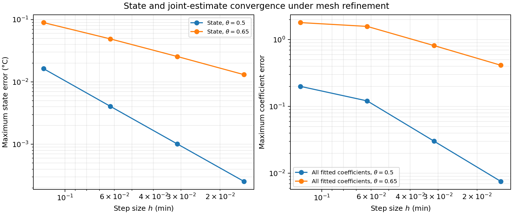
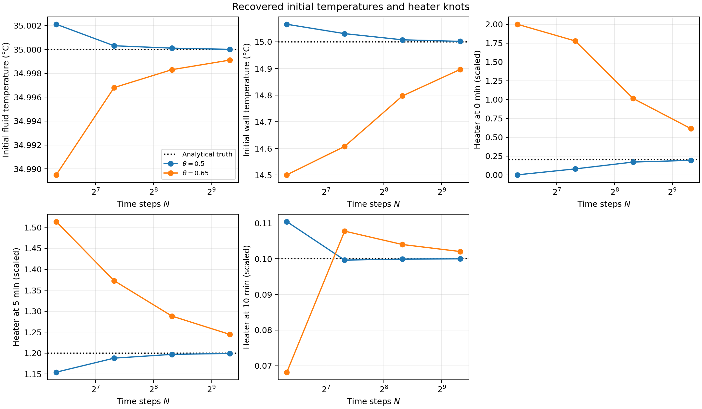
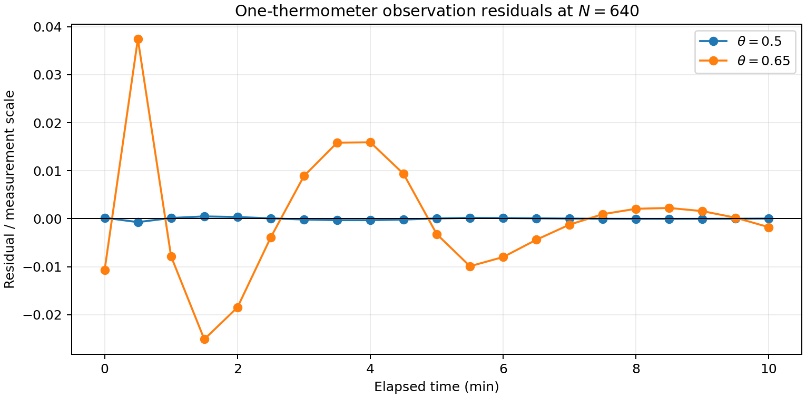
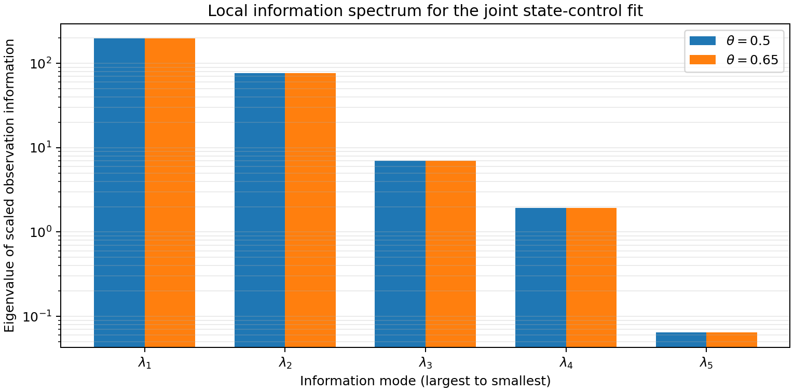
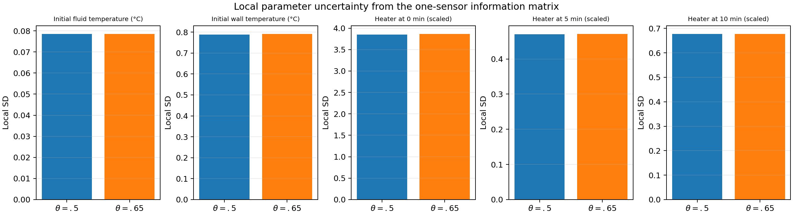

# Time-varying two-temperature reconstruction

## Experiment

This case extends the two-node thermal model. The fluid and wall temperatures
are hidden states, and the only sensor measures fluid temperature every
0.5 min over a 10 min experiment. Heater input varies linearly between three
knots at 0, 5, and 10 min. The reconstruction estimates five coefficients:

$$
\boldsymbol{\xi}=(T_{f,0},T_{w,0},u_0,u_5,u_{10})^T.
$$

The model is

$$
\dot{\mathbf T}=A(\mathbf T-\mathbf T_{eq})+b u(t),\qquad
A=\begin{bmatrix}-2&1\\0.25&-0.5\end{bmatrix},\quad
b=\begin{bmatrix}0.15\\0\end{bmatrix},\quad
\mathbf T_{eq}=\begin{bmatrix}30\\20\end{bmatrix}\,^{\circ}\mathrm C.
$$

The heater values are scaled inputs for this pedagogical model. The initial
state and heater schedule are both unknown to the inverse problem. Synthetic
fluid-temperature observations are generated from the exact forced solution
with true coefficients $(35,15,0.2,1.2,0.1)$. The least-squares objective uses
an observation scale of 0.08 °C. The observations are noiseless here so that
reconstruction and discretization error can be studied separately from random
measurement error.

## Why the exact solution is available

Within each control interval, $u(t)=u_k+s_k(t-t_k)$. The matrix $A$ has two
distinct real eigenvalues, so its propagator is a sum of two spectral
projectors. For each eigenvalue $\lambda$, the input contribution over an
interval of length $h$ is

$$
b_\lambda\left[u_k\frac{e^{\lambda h}-1}{\lambda}
+s_k\frac{e^{\lambda h}-1-\lambda h}{\lambda^2}\right],
$$

where $b_\lambda$ is the corresponding projector applied to $b$. This gives
an independent analytical trajectory for both temperatures at arbitrary
times, and analytical fluid observations for the inverse problem.

## Discrete optimality system being exercised

The C++ example creates a three-knot `PiecewiseLinearControl`, composes that
schedule into the thermal dynamics, and places the initial temperatures and
heater knots in one five-dimensional optimization vector. Each mesh uses the
same theta discretization for the state, nodal least-squares objective,
tangent linear model, discrete adjoint gradient, and incremental-adjoint
Hessian used by the bounded Newton optimizer. The schedule is piecewise
linear in time; its coefficients are global optimization variables, not
independent controls at every integration step.

The experiment exercises:

1. Exact forced-solution evaluation and mesh-by-mesh comparison of both
   reconstructed temperatures.
2. Dynamic control interpolation through the shared schedule API.
3. Joint initial-state and time-varying-control reconstruction from one sensor.
4. Discrete tangent/adjoint gradient consistency, checked against finite
   differences in the executable.
5. Temporal convergence: observed order is approximately two for $\theta=0.5$
   and approximately one for $\theta=0.65$.
6. The local observation-information spectrum and linearized coefficient
   uncertainty, calculated from the theta-discrete tangent sensitivities.

The finite-mesh fit also illustrates why state agreement alone is not enough.
At $N=640$, the midpoint method estimates the initial wall temperature to
about 0.002 °C and recovers the heater knots closely. With $\theta=0.65$,
the reconstructed trajectory remains close, but the first heater knot is
about 0.61 instead of 0.20 and the initial wall temperature is about
14.90 °C instead of 15 °C. Refinement reduces this joint parameter error at
approximately first order. The control coefficients are inferred indirectly
through the state and their finite-grid errors can be larger than the visible
state error.

It uses box constraints on initial temperatures and heater knot values. It
does not yet compute engineering confidence bounds or a path-constrained KKT
qualification; those are separate analyses from successful optimization and
convergence checks. In particular, numerical recovery in this noiseless
synthetic example does not establish that a real one-thermometer experiment
can identify an unrestricted heater history. The schedule is intentionally
low dimensional. The information matrix is full rank for these five
coefficients, with a condition number around $3.1\times10^3$ in the supplied
coordinates. Its local standard deviations assume independent Gaussian
measurement errors with standard deviation 0.08 °C; they are linearized
diagnostics, not engineering qualification bounds. In particular, the
linearized standard deviation for the first heater knot exceeds its allowed
box width, so the Gaussian approximation is not a literal bounded confidence
region; it signals that the knot is poorly determined by these data.

## Build and run

```sh
make time-varying-thermal-plots
```

The C++ executable writes the state histories and convergence table under
`results/time_varying_thermal/`. The Python script only plots those retained
outputs; it performs no model evaluation, fitting, derivative calculation, or
convergence analysis. It writes a set of complementary figures:

- `reconstruction.png`: analytical and reconstructed fluid/wall temperatures,
  the single-sensor samples, and true/fitted heater histories.
- `convergence.png`: state error and joint coefficient error versus step size.
- `parameter_recovery.png`: each fitted initial temperature and heater knot
  versus mesh size, with the analytical value marked.
- `observation_residuals.png`: fitted residuals scaled by the stated sensor
  standard deviation.
- `information_spectrum.png`: eigenvalues of the scaled observation
  information matrix.
- `local_uncertainty.png`: local linearized standard deviations for all five
  fitted coefficients under the assumed measurement-error model.












