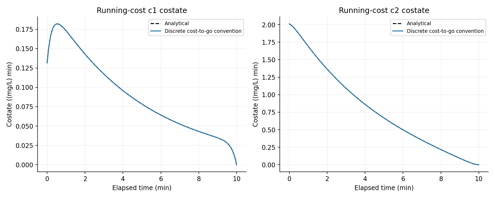
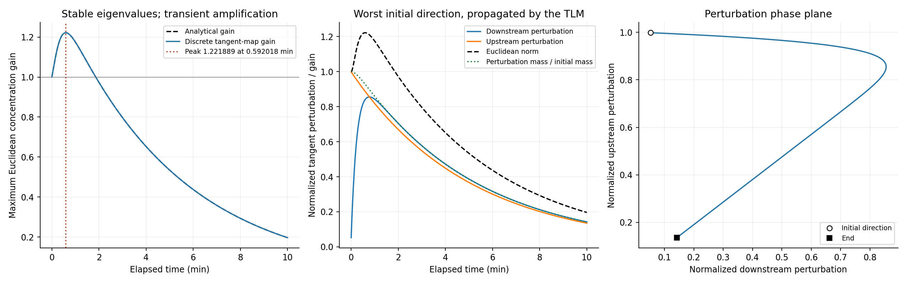
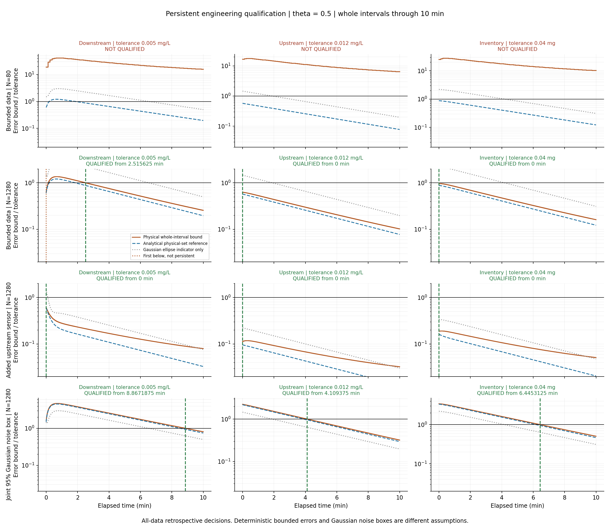
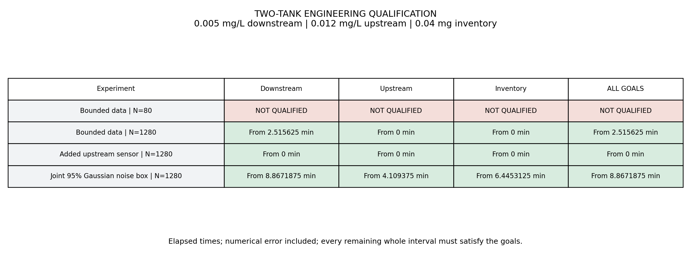
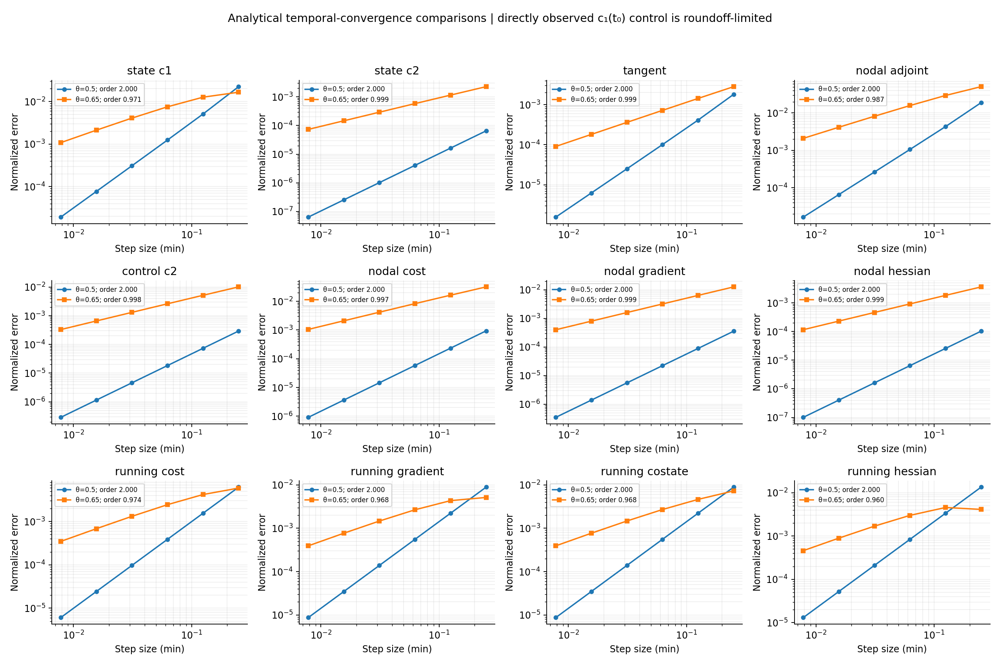
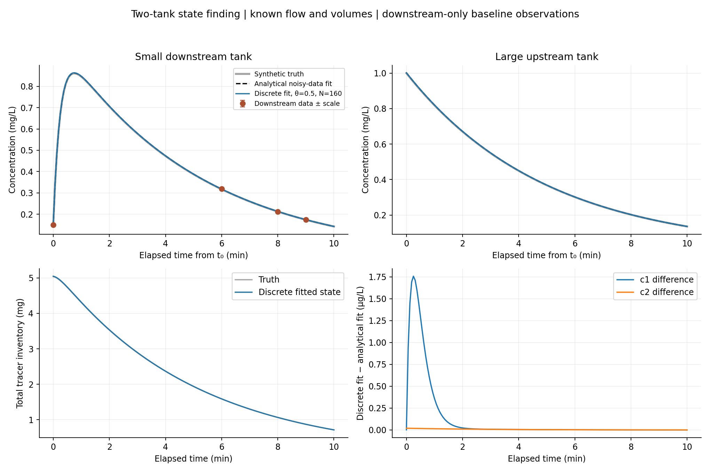

# Finding initial concentrations when stable dynamics amplify uncertainty

This experiment asks whether downstream concentration measurements determine the
initial tracer concentrations in two mixing tanks accurately enough for three
engineering predictions. Its purpose is to test **transient amplification**:
negative decay rates do not guarantee that perturbations decrease monotonically
in every physical norm. A state can satisfy its tolerance initially, fail later,
and qualify persistently only after that transient has passed.

We solve the inverse problem with the C++20 theta-consistent discrete optimality
system. Independently derived analytical solutions validate the forward state,
tangent, discrete adjoint, cost, derivatives, reconstructed initial state, and
amplification. Qualification includes bounded measurement error, numerical model
error, and behavior between nodes. Python only renders the C++ CSV outputs.

## 1. The engineering model and unknowns

Tracer-free fluid flows at the known rate F = 1 L/min into an upstream tank of
volume V2 = 5 L. It then enters a downstream tank of volume V1 = 0.25 L and
leaves the system. Each tank is perfectly mixed, volumes remain constant, and
the tracer neither reacts nor changes the flow. Let C1 and C2 denote downstream
and upstream concentrations in mg/L. Inlet and outlet tracer balances give

$$
V_1\dot C_1=F C_2-F C_1,\qquad V_2\dot C_2=-F C_2.
$$

Thus, with x = (C1,C2),

$$
\dot x=Ax,\quad A=\begin{pmatrix}-a&a\\0&-d\end{pmatrix},
\quad a=4\ {\rm min}^{-1},\quad d=0.2\ {\rm min}^{-1}.
$$

The unknown control vector is only the initial state ξ = x(t0). Flow, volumes,
inputs, and rates are known. This is state finding, not recovery of an unknown
time-dependent inlet signal. Use t0 = 2 min, tf = 12 min, and elapsed time
τ = t − t0 in all figures. The manufactured truth is ξ = (0.15,1) mg/L.

The total inventory is M = V1 C1 + V2 C2, in mg. Its balance is

$$
\dot M=-F C_1.
$$

Nonnegative initial concentrations stay nonnegative, and their inventory
therefore decreases. Checking this balance independently catches errors in the
state ordering, volume factors, and numerical flow terms.

## 2. An independent exact solution

First solve the uncoupled upstream equation: C2(τ) = ξ2 exp(−dτ).
Multiply the downstream equation by exp(aτ), integrate its forcing, and obtain

$$
\Phi(\tau)=e^{A\tau}
=\begin{pmatrix} e^{-a\tau}&\beta(e^{-d\tau}-e^{-a\tau})\\0&e^{-d\tau}\end{pmatrix},
\qquad \beta=\frac{a}{a-d}=\frac{20}{19},\qquad x(\tau)=\Phi(\tau)\xi.
$$

Because the model is linear, its exact tangent in any direction v is Φ(τ)v.
These formulas generate the observations and analytical references; they do
not replace the library forward or tangent calculation used in optimization.

Both eigenvalues, −4 and −0.2 per minute, are negative. Nevertheless A is
nonnormal: its eigenvectors are not orthogonal in the Euclidean concentration
norm. Coupling can move an initially upstream perturbation into the downstream
component before upstream decay removes it.

## 3. What is measured, and what is identifiable?

The baseline records downstream concentration at elapsed times 0, 6, 8, and
9 min. Each observation has scale σ = 0.003 mg/L. We retain deterministic
noise offsets σ times (−0.2, 0.5, −0.4, 0.3). These same physical values,
times, and scales are used on every grid.

An observation at τj has row hj = e1ᵀΦ(τj). The row at zero is (1,0), while
later rows have a nonzero second component. The record therefore identifies
both initial concentrations. Those late observations largely miss the fast
mode: their sensitivity to ξ1 is at most exp(−24). This is a useful distinction
between full rank and uniformly strong sensitivity to all modes.

Minimize the nodal least-squares functional

$$
J_{\rm obs}(\xi)=\tfrac12\sum_j
\left[\frac{h_j\xi-y_j}{\sigma_j}\right]^2.
$$

The analytical information matrix and optimum are

$$
H=\sum_j\frac{h_j^Th_j}{\sigma_j^2},\quad
b=\sum_j\frac{h_j^Ty_j}{\sigma_j^2},\quad \hat\xi=H^{-1}b.
$$

This independently computed analytical noisy-data optimum is approximately
(0.1494, 1.00214333725) mg/L. It differs from the manufactured truth because
we retained noisy observations. The discrete optimum should approach this
analytical optimum, rather than converge to the noiseless truth.

A second experiment adds an actual upstream observation at elapsed 0.5 min,
with scale and deterministic bound 0.001 mg/L and offset +0.0002 mg/L. We
rebuild the objective, optimize again, and rebuild the feasible set. It supplies
information that constrains the upstream direction before substantial transfer.

## 4. The numerically consistent discrete optimality system

On each interval of length h, the actual library forward solve enforces

$$
x_{n+1}-x_n=h[(1-\theta)Ax_n+\theta Ax_{n+1}].
$$

An independent rational step provides a numerical cross-check:

$$
R_h=(I-h\theta A)^{-1}[I+h(1-\theta)A].
$$

The experiment still calls `System::forward`, including its nonlinear-solver
interface. The rational formula validates that solve. The discrete inventory
balance is ΔM + h F [(1−θ)C1,n + θ C1,n+1] = 0.

An isolated measurement is a nodal cost, with no artificial h factor. Define
Bj = I − hj θ A and Cj = I + hj(1−θ)A. The discrete tangent satisfies
Bj δxj+1 = Cj δxj, with δx0 = v. At an observation node the objective contributes
s_n = e_k(x_k,n − y)/σ². Writing λ as the pullback with respect to the node
state gives the reverse recursion

$$
\lambda_n=s_n+C_n^T B_n^{-T}\lambda_{n+1}.
$$

There is no observation at the final node, so λN = 0 for the inverse objective.
The reduced gradient is λ0 because the initial-condition map is x0 = ξ.
Consequently δJ = λ0ᵀv agrees with the tangent calculation of the same discrete
objective. The incremental adjoint supplies Hessian-vector products. Since this
model and its observations are linear, H is independent of ξ and Newton solves
the unconstrained quadratic inverse problem in one substantive correction.
The accepted solution lies inside the stated physical prior; this experiment
does not claim a general bound-constrained optimizer.

The continuous analytical observation adjoint is the sum of backward sources:

$$
\lambda(t)=\sum_{t_j\ge t}\Phi(t_j-t)^T e_{k_j}
\frac{x_{k_j}(t_j)-y_j}{\sigma_j^2}.
$$

At an observation time the comparison uses the convention that includes that
node's source. Tangent/adjoint pairing, finite differences, Hessian symmetry,
and agreement with the independent information matrix verify the implementation.

## 5. Why we also test a running cost

Point observations do not exercise cost quadrature. We therefore use a separate
verification functional at fixed ξ = (0.25,0.85) mg/L:

$$
J_{\rm run}=\tfrac12\int_0^{10}C_1(\tau)^2\,d\tau
=\tfrac12\xi^TQ(10)\xi.
$$

This is a verification cost, not extra sensor information supplied to the fit.
Write I(r,L) = (1−exp(−rL))/r. Integrating the products of the first row of Φ gives

$$
Q_{11}=I(2a,L),\quad Q_{12}=\beta[I(a+d,L)-I(2a,L)],
$$
$$
Q_{22}=\beta^2[I(2a,L)+I(2d,L)-2I(a+d,L)].
$$

Thus ∇Jrun = Qξ, Hrun v = Qv, and the continuous running-cost costate is
λrun(t) = Q(tf−t)x(t), with λrun(tf) = 0. The library evaluates Jrun with
matching theta quadrature and obtains derivatives from its discrete adjoints.
For the continuous costate comparison, `cost_to_go_adjoint` removes the
preceding interval's running endpoint contribution from the node pullback.
This convention does not alter the initial reduced gradient.

## 6. Measuring transient amplification in a stated norm

Use the Euclidean concentration norm with a fixed 1 mg/L scale for each state.
No concentration is divided by its current or initial value. With equal scales,

$$
G(\tau)=\max_{v\ne0}\frac{\|\Phi(\tau)v\|_2}{\|v\|_2}
=\sqrt{\lambda_{\max}(\Phi^T\Phi)}.
$$

Let T be the sum of squared entries of Φ and D = det(Φ)². The independent
reference is G² = [T + sqrt(T² − 4D)]/2. C++ locates the peak by solving the
stationarity equation for this analytical expression and checks the surrounding
behavior. The peak is **1.22188938733 at 0.592017683933 elapsed minutes**.
The exponential solution is analytical; this peak time is a scalar root found
numerically from that reference, not an elementary closed-form time.

The shared library assembles each discrete state/control map using tangent
solves. Its two-dimensional singular-gain utility supplies the largest gain
and corresponding initial direction. Independently, power iteration alternates
a discrete tangent and a terminal-goal adjoint, applying JᵀJ to a direction.
Their agreement tests both pieces on the amplification question. On the refined
midpoint grid the worst direction near the peak is approximately
(0.0523581, 0.9986284), normalized in the stated concentration norm.

The left panel compares analytical gain with the actual discrete tangent map.
The middle propagates its worst initial direction and shows the norm initially
growing. The right plots that same perturbation in the two concentration
coordinates; the circle is its initial direction and the square its final state.
It is a tangent perturbation phase plot, not the reconstructed concentration path.

For this positive perturbation the associated tracer inventory decreases even
while the concentration norm increases. The norm weights concentrations equally;
inventory weights them by different volumes. No mass is created. For general
signed perturbations, cancellation means signed inventory is not a positive
norm and its absolute value need not decrease monotonically.

## 7. An uncertainty set, rather than only a fitted curve

The deterministic experiment assumes |measurement error| ≤ σj and the prior
0 ≤ ξ1 ≤ 0.8, 0 ≤ ξ2 ≤ 1.6 mg/L. These are explicit information assumptions.
A point fit or local covariance alone cannot establish the required bounds.

For the exact model, intersect the prior rectangle with all strips
|hj ξ − yj| ≤ σj. The result is a convex polygon. Linear goal extrema occur
at vertices, allowing a direct independent analytical qualification reference.

For the discrete model we also need a numerical error allowance valid over the
entire prior. On an interval, reconstruct the linear-theta trajectory by

$$
\widetilde x(s)=x_n+h s Ax_n+s^2(\Delta x-hAx_n),\qquad 0\le s\le1.
$$

It matches both endpoints and the left differential equation. For an exact
theta step, its residual is

$$
\dot{\widetilde x}-A\widetilde x
=(2\theta-1)s A\Delta x
+h\theta s(1-s)A^2\Delta x.
$$

The first coefficient has maximum absolute value |2θ−1| on [0,1] for
0 ≤ θ ≤ 1, and s(1−s) ≤ 1/4. The library also retains the computed step
residual and a floating-point allowance. At θ = 1/2 the first term vanishes,
which explains the second-order defect budget. The defect is linear in initial
state before taking a norm, so maximizing its convex upper bound at the four
prior corners supplies a bound valid over the rectangle.

In the infinity norm the logarithmic norm is
μ∞(A) = max(−a+|a|,−d) = 0. The error comparison therefore propagates as
En+1 = En + h Dn. This does **not** contradict Euclidean amplification: these
are different, explicitly stated norms. In a general norm the shared routine
supports exp(μh)En + [expm1(μh)/μ]Dn, including positive μ.

We enlarge each observation strip by its numerical allowance Ej. If the exact
state fits the measurements within their bounds, its initial state then belongs
to this outer discrete polygon. For a linear goal cᵀx, the physical error bound
relative to the reconstructed center is

$$
\max_{v\in P_h}|c^TJ_h(t)(v-\hat\xi_h)|+\|c\|_1E(t).
$$

Between nodes, we maximize each vertex's scalar quadratic reconstruction using
endpoints and any interior stationary point, and add the maximum endpoint
allowance. This bounds the entire interval, not just sampled nodes. The
analytical trajectories validate the allowance and envelopes independently;
they are not used to construct the numerical allowance.

Geometry and bounds use ordinary double precision, including an explicit
roundoff allowance for the step. This is a conservative numerical argument
validated against exact references, not a formal outward-rounded interval proof.

## 8. The engineering decisions

The goals and absolute tolerances are downstream concentration (0.005 mg/L),
upstream concentration (0.012 mg/L), and total inventory (0.04 mg). Qualification
means the bound stays within tolerance for every remaining time through the
end of the ten-minute elapsed horizon. Decisions use all observations and are
therefore **retrospective**, not online. Reported discrete times are interval
left edges; no subinterval threshold root is inferred from sampled values.

| Case | Grid and assumptions | Persistent joint decision |
|---|---|---|
| bounded_primary | θ = 0.5, N = 80, bounded baseline data | NOT QUALIFIED |
| bounded_refined | θ = 0.5, N = 1280, bounded baseline data | QUALIFIED from 2.515625 min |
| added_upstream | θ = 0.5, N = 1280, actual added upstream datum | QUALIFIED from 0 min |
| joint95_refined | θ = 0.5, N = 1280, simultaneous 95% Gaussian noise box | QUALIFIED from 8.8671875 min |

For the refined bounded case, upstream concentration and inventory qualify from
zero. Downstream concentration first satisfies its bound at zero, fails during
transfer, then qualifies persistently from 2.515625 min. Its analytical-set
reference qualifies from approximately 1.845741 min. The later discrete time
reflects the conservative numerical allowance and enlarged feasible set.
A successful regression must preserve this initial-pass/later-fail behavior.

The coarse case cannot establish any of the tolerances using its numerical
budget. This is a qualification failure, not a failed unit test or proof that
the true reconstruction error exceeds tolerance.

The Gaussian case assumes independent, zero-mean Gaussian sensor errors with
known standard deviations σj. Choose z so that [2Φnormal(z)−1]^m = 0.95 and
use simultaneous strips of halfwidth zσj. This confidence-box interpretation
is separate from the deterministic bounded-error assumption. A local 95%
ellipse is plotted only as an indicator and never determines the physical
verdict. The Gaussian goal times are 8.8671875 min downstream, 4.109375 min
upstream, and 6.4453125 min inventory.

Every curve is divided by its goal tolerance; the horizontal line is one.
The orange curve is the computable physical bound, blue is the analytical
feasible-set reference, and gray is the local Gaussian indicator. The green
line marks persistent qualification. The dotted first-below line in the refined
downstream panel shows why accepting the first crossing would be incorrect.

## 9. Convergence against analytical references

Refine N = 40, 80, 160, 320, 640, 1280, retaining exactly the same observations.
For each error eN, report p = log2(eN/e2N), using the last refinement pair for
summary orders. State errors use the fixed 1 mg/L component scales and the
maximum over nodes; tangent errors use the same scales. Adjoint errors use
their analytical maximum magnitude, while cost, gradient, and Hessian errors
are normalized by the corresponding nonzero analytical magnitude. The
normalizations are fixed physical/reference quantities, not grid-dependent
error adjustments. Fixed-control state and derivative comparisons isolate temporal
error; optimum comparisons separately check convergence of the reconstruction.

Twelve meaningful measures—both states, tangent, observation adjoint, upstream
initial estimate, observation cost/gradient/Hessian, and running
cost/gradient/costate/Hessian—give orders approximately 2.0000–2.0005 at
θ = 0.5. At θ = 0.65 they give approximately 0.960–0.999 on the final pair,
approaching the expected first-order behavior. These are measured errors,
not merely reference slopes drawn on the figures.

The downstream initial estimate is a deliberate exception. Its direct
measurement at τ = 0 has no time-discretization error, and later observations
have exponentially tiny sensitivity to it. Its temporal difference is below
2e−10 mg/L and roundoff limits any rate. `orders.csv` reports `nan` for that
component rather than inventing an order. This does not contradict the
second-order convergence of resolved quantities.

The reconstruction figure uses N = 160 to make numerical differences visible;
qualification uses the distinct grids explicitly stated above. It compares the
truth with the analytical noisy-data optimum and the discrete optimum. Their
separation distinguishes measurement error from temporal discretization error.

## 10. Reproduce and extend the test

Run `make two-tank-plots` for the C++ experiment and all six figures, or
`make test qualification-plots` for the complete series. The new executable
performs 183 checks. Its retained CSVs include convergence errors and orders,
observations, fit traces, analytical and discrete trajectories, amplification,
worst direction, numerical envelopes, feasible polygons, and explicit verdicts.
`checks.csv` records each comparison and tolerance.

The reusable additions live in `amplification.hpp`, `polytope.hpp`, and
`qualification.hpp`; see [the API](api.md). The oscillator now uses the same
polygon, reconstruction, defect, and interval-decision routines, so this work
expands the common library instead of duplicating a second numerical framework.
The next dedicated roadmap experiment, now implemented in
[insulated_thermal.md](insulated_thermal.md), tests a persistent unobservable
thermal mode. It qualifies an observable difference while leaving insufficiently
constrained absolute temperatures unqualified.
