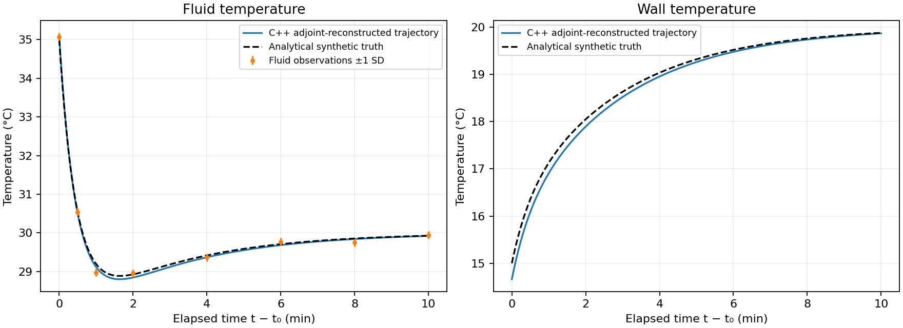
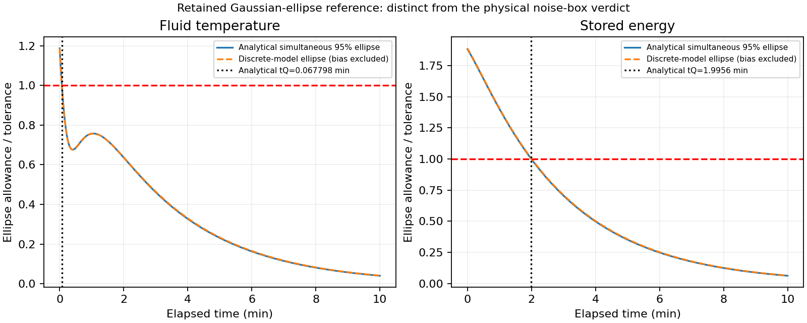
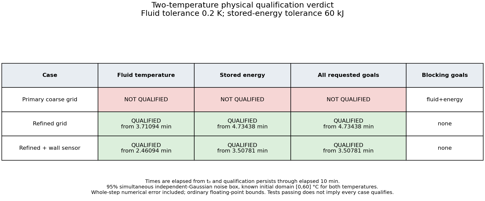
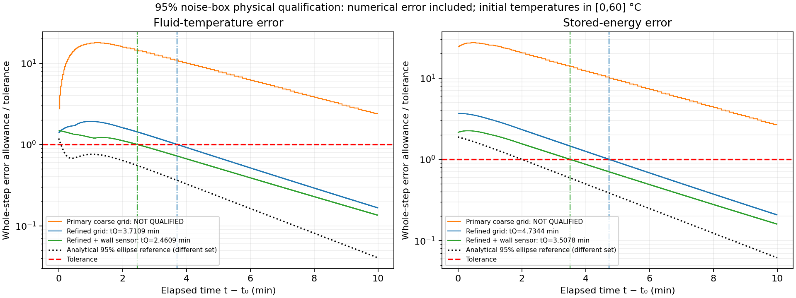
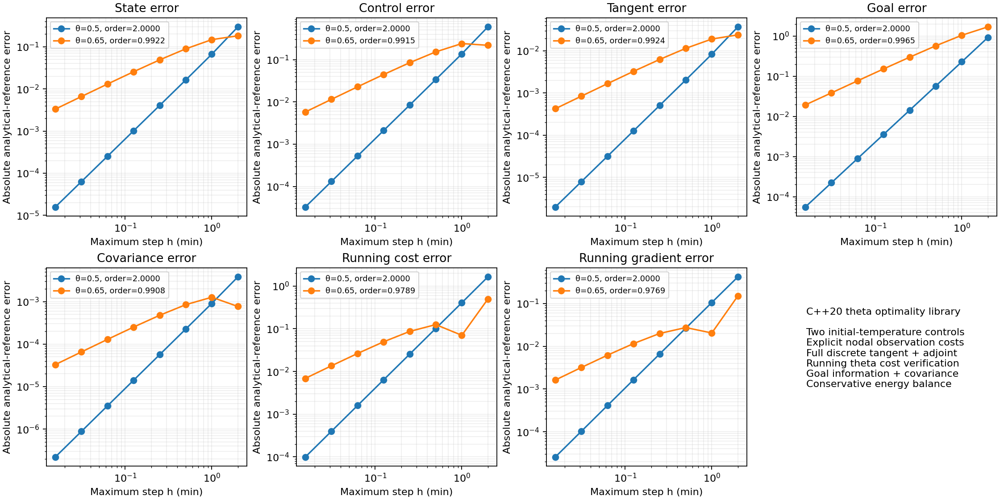

# Two-temperature reconstruction and qualification in C++20

## Purpose and scope

This is the second physical example using the same theta-consistent optimality library as the nonlinear decay case. We reconstruct **two unknown initial temperatures** from fluid-temperature observations, then determine when two engineering goals meet their tolerances: fluid temperature within **0.2 K**, and stored thermal energy within **60 kJ**.

The forward solution, observation costs, tangents, adjoints, Hessian products, optimization, information matrix, covariance, confidence polygons, physical numerical-error bounds, and qualification decisions all run in C++20. Python only renders the C++ output files. We retain the earlier Python benchmark's measurements and Gaussian-ellipse references, and add a separate computable numerical-error-aware qualification analysis. The assumptions and uncertainty sets of these two analyses are stated separately below.

## 1. Model and units

Fluid and wall temperatures are $T_g$ and $T_w$. Thermal capacities are $C_g=60$ and $C_w=240$ kJ/K. The inlet-to-fluid, fluid-to-wall, and wall-to-environment thermal coefficients are each 1 kW/K. Inlet and environmental temperatures are held at $40^\circ\mathrm C$ and $10^\circ\mathrm C$. With time measured in minutes, the balances reduce to

$$
\dot T_g=40-2T_g+T_w,
\qquad \dot T_w=2.5+0.25T_g-0.5T_w.
$$

Equilibrium is $\mathbf T_{\mathrm{eq}}=(30,20)^T\,^\circ\mathrm C$. Let

$$
\mathbf A=\begin{pmatrix}-2&1\\0.25&-0.5\end{pmatrix},
\qquad\dot{\mathbf T}=\mathbf A(\mathbf T-\mathbf T_{\mathrm{eq}}).
$$

In the C++ example, $t\in[t_0,t_f]=[2,12]$ minutes. All observations and reported qualification times use elapsed time $\tau=t-t_0\in[0,10]$. The controls are $\boldsymbol\xi=(T_g(t_0),T_w(t_0))^T$, and synthetic truth is $(35,15)^T\,^\circ\mathrm C$.

The stored-energy goal is the deviation from equilibrium:

$$
U=60(T_g-30)+240(T_w-20)\quad\text{kJ}.
$$

This deviation can be negative. It is not an absolute thermal energy and is not a temperature. State plots use degrees Celsius, temperature error allowances use kelvin increments, and energy errors use kJ.

## 2. Analytical reference

The eigenvalues are

$$
\lambda_s=\frac{-5+\sqrt{13}}4,\qquad
\lambda_f=\frac{-5-\sqrt{13}}4.
$$

Define projectors $\mathbf P_s=(\mathbf A-\lambda_f\mathbf I)/(\lambda_s-\lambda_f)$ and $\mathbf P_f=\mathbf I-\mathbf P_s$. Then

$$
\mathbf E(\tau)=e^{\lambda_s\tau}\mathbf P_s+e^{\lambda_f\tau}\mathbf P_f,
\qquad\mathbf T(t;\boldsymbol\xi)=\mathbf T_{\mathrm{eq}}+\mathbf E(\tau)(\boldsymbol\xi-\mathbf T_{\mathrm{eq}}).
$$

The exact tangent is $\mathbf E(\tau)$, and the initial-state gradient of a linear goal $\mathbf c^T\mathbf T$ is $\mathbf E(\tau)^T\mathbf c$. We use $\mathbf c_g=(1,0)^T$ and $\mathbf c_U=(60,240)^T$. These formulas are independent references; the library does not call them to advance a numerical state or obtain an optimization gradient.

## 3. Reconstruct the initial state through the library

Fluid-temperature observations occur at elapsed times $0,0.5,1,2,4,6,8,10$ minutes. We retain the original synthetic Gaussian record, with independent standard deviation $\sigma=0.1$ K and original seed 20261017. The values are embedded and exported by C++ to avoid implementation-dependent random-distribution sequences.

The discrete cost is

$$
J_h(\boldsymbol\xi)=\frac1{2\sigma^2}\sum_j[T_{g,h}(t_j;\boldsymbol\xi)-y_j]^2.
$$

`Problem::nodal` represents these isolated samples without time-quadrature weights. The code uses the library's forward theta solution, explicit tangent propagation, discrete adjoint gradient, incremental-adjoint Hessian, and Newton driver. It starts from the equilibrium guess $(30,20)^T$. Because this model is affine and the cost is quadratic, the optimizer makes **one full Newton update**, followed by a stationarity check. It does not bypass the optimization through an analytical least-squares solution.

The analytical-model fit is $(35.0831075032,14.7055996831)^T\,^\circ\mathrm C$. On the primary numerical grid, the fit is $(35.0786431803,14.6611925791)^T\,^\circ\mathrm C$. The primary grid divides each observation interval into 16 steps and uses $\theta=0.65$, giving 112 steps and $h_{\max}=0.125$ minutes.



## 4. Preserve the original conservative thermal step

The original normalized energy balance was

$$
\mathbf M\dot{\mathbf T}=\mathbf K\mathbf T+\mathbf b,
\quad\mathbf M=\operatorname{diag}(1,4),
\quad\mathbf K=\begin{pmatrix}-2&1\\1&-2\end{pmatrix},
\quad\mathbf b=(40,10)^T.
$$

The current library supports identity-mass ODEs. Since $\mathbf M$ is constant and invertible, supplying $\mathbf f=\mathbf M^{-1}(\mathbf K\mathbf T+\mathbf b)$ produces exactly the same theta update. We independently implement the original constant-mass step and compare its trajectory with the library solution.

The discrete total-energy identity is also checked:

$$
U_{n+1}-U_n=-60h_n\{(1-\theta_n)[T_{g,n}+T_{w,n}-50]
+\theta_n[T_{g,n+1}+T_{w,n+1}-50]\}.
$$

Thus normalizing the mass matrix does not discard the conservative balance. The step multipliers have a different scaling from a mass-residual formulation, while the physical trajectory and reduced control gradients agree.

## 5. Information, covariance, and Gaussian-ellipse reference

Propagate each unit initial-temperature perturbation through the library tangent. Let $\mathbf H_h$ contain the resulting fluid-observation sensitivities. The information matrix is

$$
\mathbf I_h=\mathbf H_h^T\sigma^{-2}\mathbf H_h,
\qquad\mathbf P_h=\mathbf I_h^{-1}.
$$

Each information column is computed by a tangent–observation-weight–adjoint action using `state_pullback`, and checked against the full Hessian product. For this affine least-squares example the full Hessian and information matrix are identical. The primary covariance is approximately

$$
\mathbf P_h=\begin{pmatrix}
0.0093848184&-0.0060344428\\
-0.0060344428&0.0396780422
\end{pmatrix}\;\mathrm K^2.
$$

The off-diagonal covariance matters. For goal gradient $\mathbf g(t)$, the simultaneous 95% initial-ellipse allowance is

$$
E_G(t)=\rho\sqrt{\mathbf g(t)^T\mathbf P\mathbf g(t)},
\qquad\rho=\sqrt{\chi^2_{2,0.95}}=\sqrt{-2\log(0.05)}.
$$

This is a two-control simultaneous ellipse factor, not the scalar marginal factor 1.96. For the correctly specified continuous affine Gaussian model, the analytical ellipse gives fluid qualification after **0.0677981935 minutes** and energy qualification after **1.9955601263 minutes**. The code finds all variance stationary points from the two exponential modes, brackets threshold crossings between them, and reports persistent rather than merely first qualification.

The primary discrete-model ellipse gives node times 0.09375 and 2.125 minutes. These are retained diagnostics. With data generated by the continuous model, the discrete estimator can have a deterministic model-discretization bias. An accurate covariance alone does not bound that bias, so those numerical ellipse times do not determine the final physical verdict.



## 6. Numerical-error-aware physical confidence sets

For the physical verdict we use a separate 95% simultaneous Gaussian **noise box**, plus an explicit admissible initial-temperature domain:

$$
\boldsymbol\xi\in[0,60]^2\;^\circ\mathrm C.
$$

This is a deterministic physical-domain assumption, not a Bayesian prior distribution and not a fact inferred from the observations. It contains the synthetic truth. The analytical Gaussian-ellipse reference above does not need this additional domain; the domain is used to obtain uniform computable numerical-error bounds below. The two sets have different geometry and should not be expected to give identical qualification times.

Choose a measurement half-width $d_m$ satisfying $[2\Phi(d_m/\sigma)-1]^m=0.95$, with $m=8$ in the baseline and $m=9$ with the added wall sensor. C++ computes this using the library's independent-Gaussian noise-box calibration. Because the model is affine, the inverse image of each bounded observation is a strip in the two-dimensional initial-temperature plane. Intersect those strips with the admissible rectangle using convex-polygon clipping.

The numerical model's strip must be inflated by its physical temperature allowance:

$$
|T_{g,h}(t_j;\boldsymbol\xi)-y_j|\le d_m+\eta(t_j).
$$

The resulting polygon is an outer confidence set containing the corresponding analytical-model polygon. The C++ tests verify containment for every analytical polygon vertex. The event underlying this construction has probability 95% under the stated independent-Gaussian model, conditional on the fixed true initial temperatures being in the admissible domain. The code checks this particular record contains the synthetic truth; it does not claim an empirical repeated-noise coverage study.

## 7. Compute the physical numerical-error allowance without an oracle

For this matrix, the infinity-norm logarithmic measure is

$$
\mu_\infty(\mathbf A)=\max_i(A_{ii}+\sum_{j\ne i}|A_{ij}|)=-0.25\;\mathrm{min}^{-1}.
$$

Let $\mathbf T_h$ interpolate the numerical temperatures linearly. On a step its ODE defect is affine in time, and

$$
\|\mathbf d\|_\infty\le D_n
=\max(\theta_n,1-\theta_n)\|\mathbf A(\mathbf T_{n+1}-\mathbf T_n)\|_\infty
+\varepsilon_{\mathrm{solve}}/h_n.
$$

For uniform validity over the initial rectangle, take the maximum $D_n$ from its four corner trajectories. The forward map and defect are affine in initial temperatures, and a convex norm achieves its maximum over the rectangle at a vertex. These trajectories are computed by the C++ library, not by the exact propagator.

Starting with $\eta_0=0$, propagate

$$
\eta_{n+1}=e^{-0.25h_n}\eta_n
+\frac{1-e^{-0.25h_n}}{0.25}D_n.
$$

This bounds the infinity-norm discrepancy between numerical and continuous temperatures. For a goal $\mathbf c^T\mathbf T$, its numerical contribution is at most $\|\mathbf c\|_1\eta$. For each goal, maximize the discrete prediction difference from the nominal numerical reconstruction over the confidence polygon's vertices, then add that numerical contribution. This handles numerical error both during inference and during prediction.

To cover the entire interval between nodes, use the larger numerical support at the two endpoints plus $\|\mathbf c\|_1\max(\eta_n,\eta_{n+1})$. The scalar comparison solution with constant defect bound is monotone on each step, so this encloses its intermediate values. The nominal continuous-time object being qualified is the piecewise-linear numerical reconstruction.

These are conditional analytical bounds evaluated in ordinary floating point, not outward-rounded interval certificates. They can be conservative, particularly because their numerical defect maximum protects the whole broad initial rectangle rather than only the inferred confidence polygon. The C++ tests compare the bound with analytical corner trajectories, verify the conservative energy identity, and sample full-step envelopes against analytical truth for independent checks.

## 8. Explicit physical qualification verdicts

Both goals must qualify persistently through elapsed 10 minutes. Joint qualification begins at the later of the two individual qualification times; if either goal remains unqualified, the joint requirement is not established.

| Case | Fluid temperature | Stored energy | All requested goals |
|---|---|---|---|
| Primary grid, 16 subdivisions, $\theta=0.65$ | Not qualified | Not qualified | **Not qualified** |
| Refined grid, 256 subdivisions, $\theta=0.5$ | From 3.7109375 min | From 4.734375 min | **From 4.734375 min** |
| Same refined grid plus wall sensor | From 2.4609375 min | From 3.5078125 min | **From 3.5078125 min** |

The primary result means the conservative data/model-error budget does not establish the tolerances; it does not prove the actual simulation errors exceed them. The refined grid has 1792 steps and maximum step 0.0078125 minutes. Refinement reduces the physical model-error allowance. At that same resolution, adding a wall observation improves information about the wall temperature and advances qualification further.

The added observation is at elapsed one minute, with synthetic value $T_w(1;\boldsymbol\xi^\dagger)+0.03$ degrees Celsius and assumed independent Gaussian standard deviation 0.1 K. It is included in the actual nodal objective and reoptimization, not merely in a hypothetical covariance update. An independent rank-one covariance update agrees with the new tangent–adjoint information solve. These are retrospective reconstructions using all observations, not online decisions before the future measurements arrived.





## 9. Verify the theta cost quadrature separately

Sampled observations must not acquire mesh-dependent quadrature weights. To exercise genuine running-cost quadrature in this same thermal model, a separate test uses

$$
J_{\mathrm{run}}=\frac12\int_{t_0}^{t_f}(T_g-30)^2\,dt.
$$

Its cost is assembled by the library's theta endpoint weights. If the fluid row of $\mathbf E(\tau)$ is $e^{\lambda_s\tau}\mathbf s^T+e^{\lambda_f\tau}\mathbf f^T$, the exact reduced Hessian is

$$
\mathbf Q=F(2\lambda_s)\mathbf s\mathbf s^T
+F(\lambda_s+\lambda_f)(\mathbf s\mathbf f^T+\mathbf f\mathbf s^T)
+F(2\lambda_f)\mathbf f\mathbf f^T,
\qquad F(r)=\frac{e^{10r}-1}{r}.
$$

The analytical cost is $\tfrac12(\boldsymbol\xi-\mathbf T_{\mathrm{eq}})^T\mathbf Q(\boldsymbol\xi-\mathbf T_{\mathrm{eq}})$ and its gradient is $\mathbf Q(\boldsymbol\xi-\mathbf T_{\mathrm{eq}})$. We compare both with the theta-integrated cost and its library adjoint, and test Hessian products by finite differences. This verifies quadrature without changing the meaning of isolated observations.

## 10. Mesh convergence and numerical validation

Across eight nested observation-aligned meshes for each of $\theta=0.5$ and $0.65$, the executable repeats the two-control optimization. It compares the state, reconstructed initial controls, tangent, energy-goal adjoint, covariance, running cost, and running-cost gradient with analytical references. The half-weight method gives finest-pair orders approximately

$$
2.000015,\;2.000018,\;1.999991,\;2.000003,
\;2.000008,\;2.000001,\;1.999996.
$$

The off-centered method approaches first order. These are temporal discretization tests; qualification times derived from conservative error budgets and step-start reporting need not share the second-order rate.



The thermal executable currently passes **90 checks**, in addition to the existing library and decay suites. Checks include exact recovery of retained reference values, stationarity after one Newton update, adjoint finite differences in a two-control direction, Hessian–information equivalence, goal adjoints against tangents, covariance symmetry and sensor update, original mass-step equivalence, conservative energy balance, confidence-set containment, defect and whole-step bounds, running quadrature, and seven temporal convergence components.

## Run and inspect

```bash
make thermal
make thermal-plots
```

The complete project suite and both qualification plot sets run with

```bash
make test qualification-plots
```

`examples/two_temperature_model.hpp` supplies the model, data, analytical references, confidence geometry, and model-specific defect allowance. `examples/two_temperature_qualification.cpp` runs the inverse problem and qualification through the common library. `tools/plot_two_temperature.py` only draws the C++ CSV outputs. No Python is required for numerical tests or qualification decisions.

Outputs under `results/two_temperature/` include `summary.csv`, `checks.csv`, `qualification_decisions.csv`, `continuous_envelopes.csv`, `curves.csv`, `observations.csv`, `optimizer_trace.csv`, `confidence_polygons.csv`, and `convergence.csv`. The verdict CSV is the source for the plot's per-goal and joint statuses; the renderer does not independently decide whether a case qualifies.
