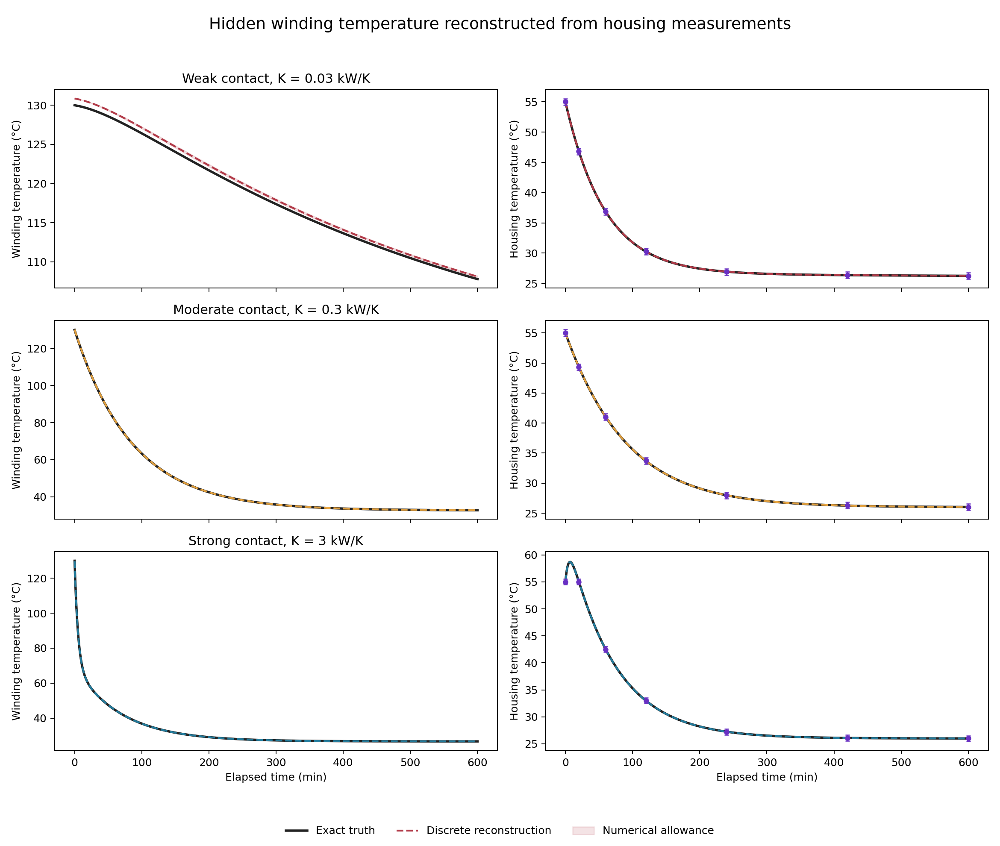
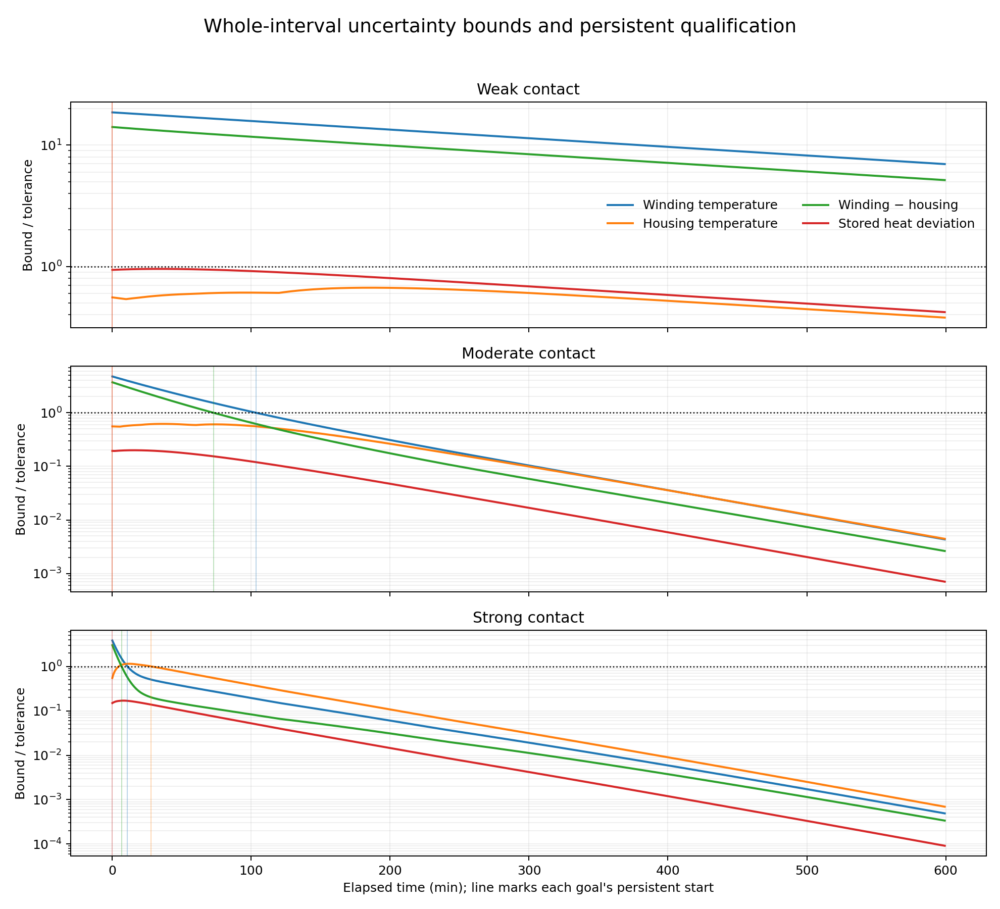
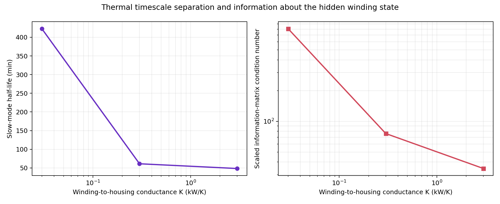
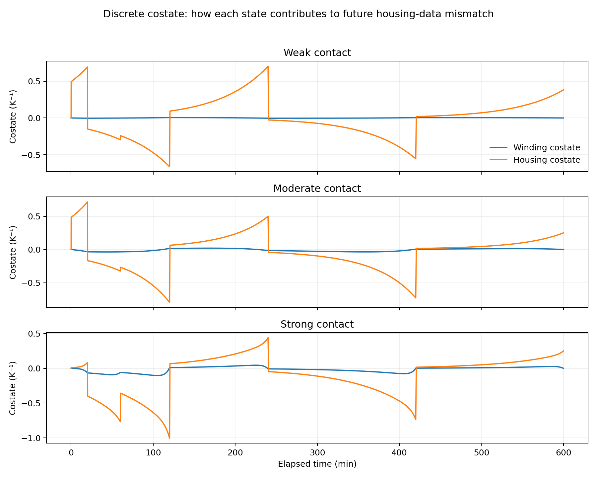
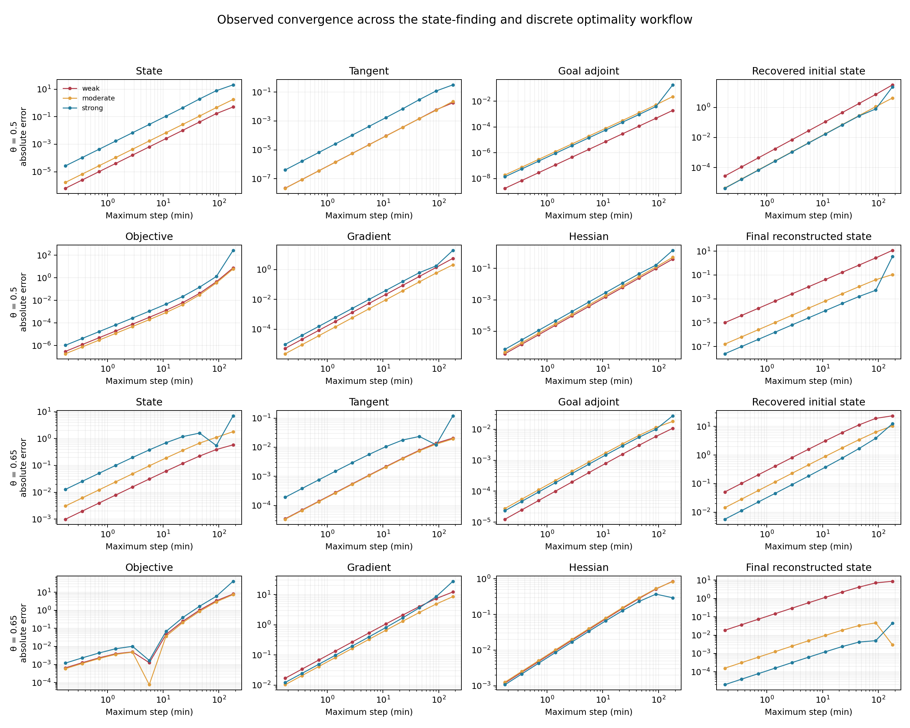

# Recovering a motor winding temperature from housing measurements

## Purpose

This experiment asks a practical state-finding question: **can a winding
temperature be determined from a temperature sensor mounted on the motor
housing?** The winding is hidden inside the machine. Heat passes from winding
to housing through a known thermal contact, while the housing loses heat to the
ambient. If the contact is weak, changes in the winding take a long time to
appear at the housing sensor. A small optimization gradient can then coexist
with a poorly determined winding temperature.

We vary only the known winding-to-housing conductance. For each value we use
the same initial-state prior, observation times, sensor noise, and engineering
tolerances. An exact two-mode solution provides an independent reference for
the C++20 theta forward solve, discrete cost, tangent, adjoint, Hessian-vector
products, optimizer, and qualification bounds.

All forward, inverse, reference, numerical-error, and qualification
calculations run in C++20. Python reads the resulting CSV files and draws the
figures. The example uses only existing shared-library interfaces; this study
did not require changing the generic optimality or qualification APIs.

## 1. Physical model and units

Let $T_c$ denote the winding temperature and $T_h$ the housing temperature,
both in degrees Celsius. The winding and housing heat capacities are

$$
C_c=18\;\mathrm{kJ/K},\qquad C_h=120\;\mathrm{kJ/K}.
$$

The motor produces a known constant loss of $P=2\;\mathrm{kW}$ in the winding.
The housing loses heat to an ambient at $T_a=25^\circ\mathrm C$ through a known
conductance $G=2\;\mathrm{kW/K}$. The winding-to-housing contact conductance
$K$ is known in each experiment and takes the three values

$$
K\in\{0.03,\;0.30,\;3.0\}\;\mathrm{kW/K}.
$$

Time is measured in minutes. Since $1\;\mathrm{kW}=1\;\mathrm{kJ/min}$, the
energy balances are

$$
\begin{aligned}
C_c\dot T_c &= P-K(T_c-T_h),\\
C_h\dot T_h &= K(T_c-T_h)-G(T_h-T_a).
\end{aligned}
$$

Equivalently, with $\mathbf x=(T_c,T_h)^T$,

$$
\dot{\mathbf x}=\mathbf A(K)(\mathbf x-\mathbf x_{\rm eq}),\qquad
\mathbf A(K)=
\begin{pmatrix}
-K/C_c & K/C_c\\
K/C_h & -(K+G)/C_h
\end{pmatrix}.
$$

The equilibrium is

$$
T_{h,\rm eq}=T_a+P/G=26^\circ\mathrm C,\qquad
T_{c,\rm eq}=T_{h,\rm eq}+P/K.
$$

The unknown initial state is $\mathbf x(t_0)=\boldsymbol\xi$, with
$t_0=3\;\mathrm{min}$ and $t_f=603\;\mathrm{min}$. The true initial state is
$(130,55)^T\;^\circ\mathrm C$. It is used only to construct and check the
synthetic experiment; the optimizer starts from $(115,55)^T\;^\circ\mathrm C$.
The admissible initial-state domain is

$$
\boldsymbol\xi\in[70,160]\times[35,75]\;^\circ\mathrm C.
$$

## 2. Exact two-mode reference

The two eigenvalues of $\mathbf A(K)$ are real and negative. Write them as
$\lambda_s$ and $\lambda_f$, ordered so that
$\lambda_s>\lambda_f$. The corresponding projectors are

$$
\mathbf P_s=\frac{\mathbf A-\lambda_f\mathbf I}{\lambda_s-\lambda_f},
\qquad \mathbf P_f=\mathbf I-\mathbf P_s.
$$

Then the exact state transition matrix and trajectory are

$$
\mathbf E(\tau)=e^{\lambda_s\tau}\mathbf P_s+e^{\lambda_f\tau}\mathbf P_f,
\qquad
\mathbf x(t_0+\tau;\boldsymbol\xi)=
\mathbf x_{\rm eq}+\mathbf E(\tau)(\boldsymbol\xi-\mathbf x_{\rm eq}).
$$

The tangent with respect to the initial state is $\mathbf E(\tau)$. For a
linear state goal $g=\mathbf c^T\mathbf x(t)$, its initial-state gradient is
$\mathbf E(\tau)^T\mathbf c$. These formulas independently check both forward
and adjoint sensitivities.

The slow-mode half-lives are about **422.81 minutes** for weak contact,
**61.11 minutes** for moderate contact, and **48.41 minutes** for strong
contact. The fast-mode half-lives are about **40.90**, **28.33**, and **3.57
minutes**, respectively. The slow mode changes sharply between weak and
moderate contact; at strong contact, winding and housing nearly equilibrate
with each other and the ambient-cooling mode sets the long tail.

## 3. Measurements and the analytical inverse problem

The only sensor measures housing temperature at elapsed times

$$
\tau_j\in\{0,20,60,120,240,420,600\}\;\mathrm{min}.
$$

The data are the exact housing temperatures from the model plus fixed noise
values $0.20\;\mathrm K$ times
$(0.10,-0.15,0.05,0.20,-0.10,0.15,-0.05)$. The assumed sensor standard
deviation is $\sigma=0.20\;\mathrm K$. These are manufactured observations,
not motor-test measurements.

For each observation, let $\mathbf h_j$ be the second row of
$\mathbf E(\tau_j)$. Then

$$
T_h(t_0+\tau_j;\boldsymbol\xi)
=T_{h,\rm eq}+\mathbf h_j(\boldsymbol\xi-\mathbf x_{\rm eq}).
$$

The analytical least-squares fit solves the two-by-two normal equations

$$
\mathbf H\boldsymbol\xi=\mathbf b,\qquad
\mathbf H=\frac1{\sigma^2}\sum_j\mathbf h_j^T\mathbf h_j,
\quad
\mathbf b=\frac1{\sigma^2}\sum_j\mathbf h_j^T
\left[y_j-T_{h,\rm eq}+\mathbf h_j\mathbf x_{\rm eq}\right].
$$

The eigenvalues of $\mathbf H$ show the strength of the two initial-state
directions in the stated coordinates. To make that comparison meaningful
under the rectangular prior, we also report the condition number of
$\mathbf D\mathbf H\mathbf D$, with $\mathbf D=\operatorname{diag}(45,20)$ K,
the prior half-widths. The scaled condition numbers are approximately **807**,
**76**, and **35** as contact increases. All three matrices have rank two, yet
the weak-contact case has substantially less information about one
combination of initial winding and housing temperatures.

## 4. The discrete optimality system used for reconstruction

For each conductance, the C++ code builds an observation-aligned grid and
advances the state using the library's implicit theta method:

$$
\mathbf x_{n+1}=\mathbf x_n+h_n\left[(1-\theta)\mathbf f(\mathbf x_n)
+\theta\mathbf f(\mathbf x_{n+1})\right].
$$

The inverse objective is the discrete nodal least-squares functional

$$
J_h(\boldsymbol\xi)=\frac1{2\sigma^2}\sum_j
\left[T_{h,h}(t_j;\boldsymbol\xi)-y_j\right]^2.
$$

The observations are isolated measurements, so they are nodal costs and carry
no time-step weights. The discrete optimizer uses the library forward solve,
the exact tangent of each implicit step, the discrete adjoint gradient, and
the incremental-adjoint Hessian-vector product. The affine model has a
quadratic reduced objective, so convergence to stationarity is easy to check;
that optimizer check alone does not establish that the hidden winding state is
well identified.

The executable checks the discrete objective gradient against centered finite
differences, the tangent against state finite differences, the tangent-adjoint
pairing, Hessian symmetry, the information action against a tangent followed
by an adjoint pullback, and the incremental-adjoint Hessian against finite
differences of the discrete gradient. It also compares the discrete fit with
the analytical fit for the same noisy observations.

The observation at $t_f$ contributes a terminal nodal source to the adjoint.
If that terminal observation were omitted, there would be no terminal cost and
the corresponding terminal costate condition would be zero.

## 5. Theta-consistent running-cost quadrature check

The state-finding objective above contains point observations. A separate
verification functional checks the library's running-cost quadrature without
pretending that an extra sensor was present:

$$
J_{\rm run}=\frac12\int_{t_0}^{t_f}
\left[T_h(t)-T_{h,\rm eq}\right]^2\,dt.
$$

The C++ code evaluates this functional with the library's theta endpoint
weights, compares its cost, adjoint gradient, and Hessian-vector product with
the exact two-mode integral, and checks the quadrature against an independent
fine trapezoidal integration of the exact trajectory. It also checks the
running-cost gradient and Hessian-vector product by finite differences.

## 6. Physical confidence set and numerical-error allowance

We use a simultaneous 95% box for seven independent Gaussian sensor errors.
Its half-width $r_{95}$ satisfies

$$
\left[2\Phi(r_{95}/\sigma)-1\right]^7=0.95.
$$

The physical initial-state confidence set is the prior rectangle intersected
with the inverse images of all seven measurement strips. At a measurement node,
the numerical strip is widened by a C++ computed state-error allowance. The
result is a polygon in the two initial temperatures. This is a bounded-data
set, rather than a local covariance ellipse. The exact analytical feasible
polygon is checked to lie inside the numerical one, and the synthetic truth is
checked for membership.

To bound time-discretization error, use the heat-capacity weighted norm

$$
\|\mathbf e\|_M=\sqrt{C_c e_c^2+C_h e_h^2},\qquad
\mathbf M=\operatorname{diag}(C_c,C_h).
$$

The matrix is self-adjoint in this norm because $\mathbf M\mathbf A$ is
symmetric. Its logarithmic norm is its largest eigenvalue $\lambda_s<0$.
Let $\mathbf x_h$ be the linear interpolation of a theta trajectory. Its
within-step ODE defect is bounded by

$$
D_n\le \max(\theta,1-\theta)\|\mathbf A(\mathbf x_{n+1}-\mathbf x_n)\|_M
+\frac{\|\mathbf r_n\|_M}{h_n},
$$

where $\mathbf r_n$ is the computed theta-step residual. The maximum over the
prior rectangle is taken at its four corners: each numerical trajectory and
its residual depend affinely on the initial state, and a norm is convex. With
$\eta_0=0$, propagate

$$
\eta_{n+1}=e^{\lambda_s h_n}\eta_n+
\frac{e^{\lambda_s h_n}-1}{\lambda_s}D_n.
$$

The component allowances are $\eta_n/\sqrt{C_c}$ and
$\eta_n/\sqrt{C_h}$. For any linear goal $\mathbf c^T\mathbf x$, its numerical
contribution is at most

$$
\eta_n\sqrt{\mathbf c^T\mathbf M^{-1}\mathbf c}.
$$

This also bounds the numerical error between nodes. With a constant defect
bound on a step, the scalar comparison solution is monotone on that step; the
maximum is bounded by the larger endpoint allowance. The uncertainty support
of a linearly interpolated goal is also bounded by its endpoint supports.
Together these give a whole-interval envelope rather than a node-only test.

These calculations use ordinary floating point and are conditional on the
stated model, parameters, prior, and independent Gaussian noise assumptions.
They are not outward-rounded interval certificates and do not include model
parameter uncertainty, uncertainty in the motor loss, sensor bias, or
discrepancy between this two-mass model and an actual motor.

## 7. Engineering qualification and what the sweep shows

The requested goals are winding temperature within **3 K**, housing
temperature within **1 K**, winding-to-housing temperature difference within
**4 K**, and total stored heat deviation within **1000 kJ**. Stored heat is

$$
Q=C_c(T_c-T_a)+C_h(T_h-T_a),
$$

so its gradient is $(C_c,C_h)^T$. It is an energy-like goal, not a temperature.
Every reported decision uses the full bounded-data polygon plus the numerical
allowance and requires the tolerance to hold on every remaining interval
through elapsed 600 minutes.

| Contact | Winding | Housing | Winding − housing | Stored heat | Joint |
|---|---:|---:|---:|---:|---:|
| Weak, 0.03 kW/K | **Not qualified** | 0 min | **Not qualified** | 0 min | **Not qualified** |
| Moderate, 0.30 kW/K | 103.59 min | 0 min | 72.89 min | 0 min | 103.59 min |
| Strong, 3.0 kW/K | 10.86 min | 27.97 min | 6.72 min | 0 min | 27.97 min |

The weak-contact case is the key result. Its information matrix is full rank,
and its optimizer reaches a gradient norm below $4\times10^{-13}$. Still, the
bounded uncertainty in the winding temperature remains above 3 K through the
entire 10-hour horizon. The housing temperature itself qualifies from the
initial time because it is directly observed there. The total stored heat also
qualifies from zero: that weighted aggregate is better constrained than the
hidden winding component. The joint decision remains unqualified because the
winding and winding-to-housing difference goals do not qualify.

The strong-contact housing bound starts below its 1 K tolerance, rises above
it as the hidden winding state transfers heat into the housing, then falls
below permanently after 27.97 minutes. This is why the code reports both the
first threshold crossing and the persistent qualification time. A stable
system does not make every uncertainty envelope decrease monotonically from
the start.









## 8. Convergence and validation

For each conductance and each $\theta\in\{0.5,0.65\}$, the executable
refines the mesh while retaining the same physical observation schedule and
noise. It reports errors in the state, tangent, goal adjoint, recovered
initial state, fixed-state objective, gradient, Hessian, and final reconstructed
state. The last refinement pair gives observed rates within 0.06 of **2** for
midpoint and within 0.06 of **1** for $\theta=0.65$ across all eight
quantities and all three conductances. The rates are computed and checked by
the C++ executable.



The example contributes **174 checks**. They cover the analytical fit,
full-rank but weak information, discrete stationarity, state finite
differences, tangent-adjoint pairing, objective-gradient finite differences,
incremental-adjoint Hessian checks, tangent-adjoint information actions,
confidence-set containment, physical heat balances, running-cost quadrature,
and measured convergence orders.

## Run the experiment

```bash
make weak-coupling
make weak-coupling-plots
```

`make weak-coupling` runs the C++ experiment by itself. It prints a compact
table of the measured orders for the final refinement pair and writes the
machine-readable `orders.csv`. `make weak-coupling-plots` runs the same test
and generates `convergence_orders.png`, which prints the measured rates for
all eight quantities, all three conductance cases, and both theta values.

The complete test suite includes this example:

```bash
make test qualification-plots
```

The C++ program writes `summary.csv`, `checks.csv`, `orders.csv`,
`qualification_decisions.csv`, `qualification_envelopes.csv`,
`trajectories.csv`, `observations.csv`, `costates.csv`, `convergence.csv`, and
`quadrature.csv` under `results/weak_coupling/`. The plotting script consumes
these outputs and makes no numerical or qualification decisions.
