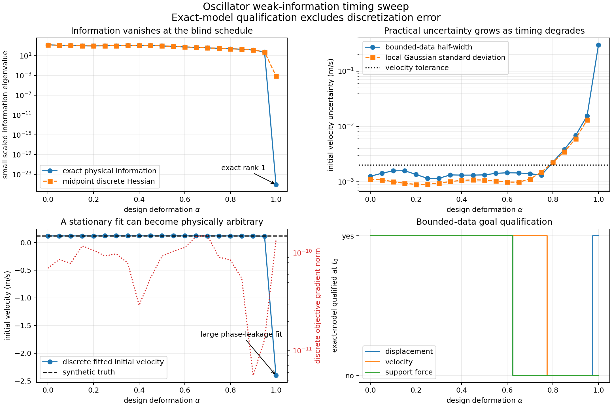

# Weak information as oscillator measurements approach a blind schedule

This experiment tests a distinction that is easy to miss in inverse problems:
**optimizer convergence is not state identification**. We keep the damped
oscillator, physical units, four bounded displacement observations, and one
fixed midpoint theta discretization. We continuously move the sample times from
a schedule that identifies both initial-state components toward exact
half-periods, which contain no information about initial velocity.

Run the experiment and render its plots with:

```bash
make information-sweep
make information-sweep-plots
```

`make test` runs its C++ checks. All simulation, fitting, information,
uncertainty, and qualification calculations are in C++20. Python only plots the
retained CSV files in `results/oscillator_information_sweep/`.

## Model, data, and unknowns

The physical state is displacement and velocity,

$$
\dot q=v,\qquad \dot v=-4.04q-0.4v,
$$

with $m=10$ kg, $c=4$ N s/m, $k=40.4$ N/m, decay rate $a=0.2$ s$^{-1}$,
and damped frequency $\omega=2$ rad/s. We infer $(q_0,v_0)$ from four
displacement measurements. The synthetic truth is $(0.02\text{ m},
0.12\text{ m/s})$. Measurement errors are fixed at
$\sigma(0.4,-0.6,0.2,0.8)$, with $\sigma=0.0005$ m. The prior is
$|q_0|\leq0.08$ m and $|v_0|\leq0.30$ m/s.

To compare sensitivities with different units, optimization uses scaled controls
$u_q=q_0/(0.02\text{ m})$ and $u_v=v_0/(0.12\text{ m/s})$. The normalized
least-squares objective is the sum of four isolated nodal costs; these are
point observations, so no time-step quadrature weight is applied.

## Deform the sample schedule

For $\alpha\in[0,1]$, interpolate each sample time between

$$
\tau^{\rm proper}=(0.3,0.9,1.8,3.2)\text{ s},\qquad
\tau^{\rm blind}=\left(\frac\pi2,\pi,\frac{3\pi}2,2\pi\right)\text{ s}:
\quad \tau_j(\alpha)=(1-\alpha)\tau_j^{\rm proper}
                     +\alpha\tau_j^{\rm blind}.
$$

The exact solution gives the displacement sensitivity row

$$
h_j^T=(1,0)\Phi(\tau_j),\qquad
\frac{\partial q(\tau_j)}{\partial v_0}
=e^{-a\tau_j}\frac{\sin(\omega\tau_j)}{\omega}.
$$

At $\alpha=1$, this derivative vanishes at all four samples. The scaled exact
information matrix is

$$
H_{\rm exact}(\alpha)=\sum_{j=1}^4
\frac{g_j(\alpha)g_j(\alpha)^T}{\sigma^2},\qquad
g_j=\left(\frac{\partial q_j}{\partial u_q},
          \frac{\partial q_j}{\partial u_v}\right)^T.
$$

Its small eigenvalue tends to zero and its rank drops from two to one. Intermediate
values need not produce a monotone eigenvalue curve: moving four samples changes
both information directions and their correlation. The endpoint rank loss is
the meaningful structural result.

## What the computation does

For each of 21 values of $\alpha$, the C++ program:

1. Creates a nonuniform mesh containing all four exact sample nodes and the
   uniform 512-step grid points.
2. Builds the scaled initial-state map and the midpoint ($\theta=0.5$) discrete
   oscillator system.
3. Adds four discrete nodal least-squares terms with the same fixed physical
   measurement errors.
4. Optimizes the discrete objective and reports the initial state and its
   gradient norm.
5. Independently computes the exact physical information matrix and the
   bounded-error feasible initial-state polygon.
6. Computes local Gaussian standard deviations from $H_{\rm exact}^{-1}$ when
   it is nonsingular, and goal uncertainty from the bounded polygon.
7. Checks tangent-adjoint pairing, the discrete objective gradient, and the
   incremental-adjoint Hessian at the midpoint design.

The data are generated by the analytical oscillator, but the fit in step 4 uses
the actual discrete theta forward solve and the library's discrete gradient and
Hessian. This isolates time-discretization effects from physical observability.

## How to read the plots



The upper-left panel compares the smallest eigenvalue of the exact physical
information matrix with that of the midpoint discrete Hessian. At the blind
endpoint, exact information has rank one. Midpoint discretization instead gives
a small positive eigenvalue: its phase error has made the discrete samples
slightly sensitive to velocity. That numerical sensitivity is not information
in the physical data.

The upper-right panel compares local Gaussian velocity standard deviation with
the half-width of the exact bounded-data feasible set. The bounded interval is
the primary statement here; it returns to the entire $[-0.30,0.30]$ m/s prior at
the blind endpoint. The local Gaussian approximation diverges as rank is lost.

The lower-left panel shows discrete fitted velocity and objective gradient norm.
At $\alpha=1$, the fitted velocity is approximately $-2.40$ m/s although the
synthetic truth is $0.12$ m/s, while the gradient norm is about
$1.3\times10^{-10}$. The discrete Hessian also has a small positive eigenvalue
near $8\times10^{-4}$, although the exact physical information eigenvalue is
zero to roundoff. The objective is nearly flat in that direction, so
stationarity alone cannot establish recovery. Midpoint phase leakage chooses
an arbitrary representative along the physically unobserved direction.

The lower-right panel reports exact-model goal qualification at the initial
time and the schedule plot shows how measurements move. These are analytical
physical-data diagnostics with bounded errors. **They do not include the
theta-discretization allowance and are not final engineering qualification
decisions.** The unqualified velocity result at the blind endpoint is the
important conclusion: more accurate optimization cannot overcome absent data.

The proper schedule gives full rank and qualifies the stated initial-state
goals under the bounded-data model. As timing degrades, goals cease to qualify
at different points because they depend on different combinations of the
uncertain state. At the exact blind schedule, velocity and support force remain
unqualified, even though initial displacement is constrained.

## Scope

This is a cross-cutting information-design test, not a replacement for the
matched poor/proper oscillator qualification experiment. It exercises the
discrete forward, nodal objective, tangent, adjoint, incremental adjoint, and
optimizer while using exact observability and bounded feasible sets as
independent references. The qualification columns intentionally omit numerical
error so the plot can isolate information loss; use the existing oscillator
case for qualification that includes a numerical reconstruction allowance.
